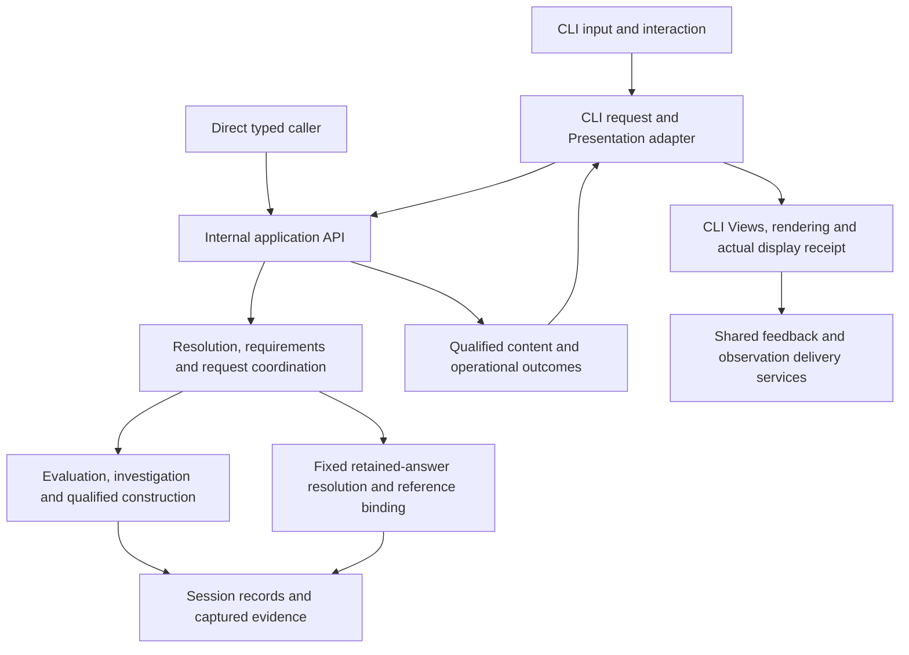

# Separate application functionality from its interfaces

Status: in review
Created: 2026-11-08
Updated: 2026-11-08
Superseded by:

## Problem and outcome

PostCode already separates analysis, qualified construction, retained selection
and much of arrangement. Its current Session coordinator nevertheless accepts
CLI-shaped requests and returns bounded CLI Views and rendered output. Provider
setup, publication and feedback also contain application behavior in command
modules. Another client would need to call terminal-oriented machinery or rebuild
parts of that behavior.

Establish a logical internal application API under `src/lib/`. The CLI becomes a
client of shared functionality. An ordinary in-process caller can open one
configured project, request supported information, follow a returned subject,
read an exact retained answer and inspect operational outcomes without command
parsing, terminal formatting, a CLI View or an observation sink. Existing CLI
functionality remains available through the same application operations.

The API is an internal implementation boundary, not a public package, wire
protocol, network service or separate process commitment. Future capabilities can
revise it through their own planning. Different clients may expose different
subsets. This work neither retires nor promises indefinite support for the
interactive human CLI.

## Scope and preservation

Cover current module inventory; project/repository organization; module, group,
mixed and Investigram inspection; dependency structure/children/parents;
summarize/explain/decompose/examine; associated interpretations; exact retained
answers; usage and work attribution; resolution and failure reporting; runtime
opening/validation/cancellation/cleanup; existing provider/account operations;
explicit inadequacy feedback and observation delivery used by the CLI. Keep the
nonpublic exports and interpretive fixture extensions working without making
them public commands.

Reuse existing qualified content, fixed catalog, evidence interfaces, operation
reuse and store invariants. Preserve claim-level qualification, captured basis,
originating versus consuming attribution, exact reference meanings, correction
eligibility and delivery, conflicts/reconsideration, and immutable answer support.
Keep actual usage independent of answer retention and research recording.

Retain the unchanged-input, one-project, transient Session and one-operation
contract. Retain terminal interruption of the Session, asynchronous Git ownership,
the CLI's compiler worker and separately awaitable cleanup. Do not introduce
automatic restart, concurrent requests, refresh, persistence, cross-Session
identity, historical access after invalidation, or a general scheduler.

Preserve CLI syntax, defaults, output meaning, bounds, reference allocation
schedules, continuations, text/JSON human-output contract, status codes and
automatic observation behavior. This is not a general CLI redesign. Internal
types/import paths may change without compatibility shims. If implementation
reveals a need for a consequential visible or identity change, bring that change
back for agreement; experimental output status is not blanket authorization.

## Preconditions and decisions

The assessment baseline is `e9e4965d98aa7ab8c9c69469ea768141afce5c94`. Recheck changed
code and governing material before implementation. There is no unfinished product
implementation prerequisite identified in this assessment.

Governing constraints include [qualified results and construction](../decisions/research-question-driven-observation.md),
[Lens resolution](../decisions/lens-application-and-request-outcomes.md),
[qualified answer/View identity](../decisions/qualified-construction-under-the-request-model.md),
[exact retained presentation](../decisions/exact-retained-answer-presentation.md),
[execution ownership](../decisions/execution-ownership-and-cancellation.md),
[Investigram continuity](../decisions/investigrams-and-progressive-investigation.md),
[human output](../decisions/human-facing-architectural-representations.md), and
[generated-output boundaries](../decisions/generated-output-boundaries.md).
Read their current successor mappings, not superseded clauses in isolation.

The [internal API decision](../decisions/internal-application-api.md) and additions
to the [application specification](../app-specification.md#application-interface-boundary)
and [architectural constraints](../architectural-constraints.md#application-interface-boundary)
must be accepted together before implementation. Their draft links name intended
canonical destinations.

## Responsibility and dependency design

Arrows express use/data flow, not a new stored pipeline. The same application
implementation runs for direct callers and within the CLI worker. The CLI adapter
inside that worker is a client, composed at the worker entry point; the application
does not import it. Parent-side publication and usage finalization remain intact.
No full-content worker transport for a new GUI or agent is needed to complete this
task. Future hosts may reuse execution ownership without inheriting CLI requests.

Suggested logical homes are `src/lib/application/` for the intended service
boundary and `src/lib/interfaces/cli/` for CLI coordination and Presentation code.
Existing domain, provider and infrastructure modules can retain their locations.
Move/split a module when its responsibility requires it; avoid a wholesale folder
reorganization. Do not create empty GUI/agent packages or plugin extension points.

| Application or shared service owns | Client/host owns |
| --- | --- |
| Typed input validation, Lens applicability, qualified subject resolution, request/work attribution and outcomes | Argument parsing, word tokenization, CLI aliases, defaults arising from CLI interaction, help and prompts |
| Requirements/precondition coordination, Evaluation, reuse, qualified construction and fixed answer retrieval | Presentation declarations, arranging supplied content, detail/page choices, terminal text, JSON View serialization and output safety |
| Subject/answer reference validity, binding and immutable selection | Display labels, command spellings for continuations, focus and which answer to return to |
| Semantic failure, invalidation and resource cleanup outcomes; usage/work state | SIGINT/EOF/TTY behavior, exit-code mapping, stdout/stderr and recovery guidance |
| Provider selection/service setup, credential and account operations, explicit connection check | Environment/argument acquisition, intentional route choice and presentation of transmission/billing disclosures, browser interaction prompts |
| Feedback report construction, observation batch/delivery mechanisms and typed delivery acknowledgment | Capturing what was actually displayed, optional feedback text, recording selection/destination and warning presentation |

The host supplies project configuration and actual output locations. Application
opening establishes their exclusion policy, shared by compiler and repository
acquisition, and enforces it during validation. The application cannot guess every
future output destination. Consolidate current CLI setup without inventing generic
directory-name exclusions or weakening path/alias checks.

## Bounded contracts

Names here describe contract roles; final TypeScript spelling is an implementation
choice. Export explicit service types from an intended entry point. Do not derive
the public-to-this-repository contract from a CLI function's `ReturnType`, expose a
store, or require callers to assemble constructors and support traversals.

### Requests and capability information

Support distinct typed forms:

- **Information request:** canonical Lens identity, explicit subject designation,
  Lens parameters and the current Session input context. Reuse the existing
  designation variants and validation. A precise answer target is not a subject.
- **Exact retained request:** a precise answer ID or existing Session-bound answer
  alias, with optional content-consumption requirements. It has no new subject,
  Lens parameters, replacement-following instruction or Evaluation plan.
- **Operational usage request:** subjectless reporting, not a fake Lens/Projection.

Request occurrence correlation and execution constraints remain separate from
answer identity. Capture caller-owned inputs before asynchronous work; preserve
malformed input and safe omission reasons without evaluating accessors. Refusals
do not become defects, and defects after validation do not become ordinary refusals.

Keep the CLI's supplied input and normalized presentation choices in its request/
publication context, correlated with the application's semantic request and actual
outcome. Do not reconstruct what was requested from the returned answer or lose
format/detail choices when separating the types. Shared attribution must preserve
the complete generating and consuming parent descriptions without importing CLI
renderers or treating client context as answer identity.

Expose read-only descriptions of the current registered Lens meanings,
applicability/cardinality and parameters from the same fixed catalog. This is
existing capability metadata, not a recommendation engine or a claim that every
listed question can currently succeed. Do not add subject search, automatic
clarification, dynamic registration or future questions. CLI aliases and help
remain in the CLI adapter.

### Content requirements and Presentation compatibility

Separate semantic requests from rendering choices. Direct content access must
not require `unicode`, `json`, `moreDetails`, CLI paging or terminal lifetimes.
Reuse the finite current module/group expansion declarations and qualified
result-family contracts for explicit content requirements. No arbitrary query
language or schema negotiation is needed.

For a CLI request, its adapter interprets format/detail/page options using its
captured Presentation declarations. It supplies compatible candidate contracts,
their declared standard expansions, preconditions and ordered fallbacks to shared
coordination. Shared coordination preserves the current order: prospective
compatibility before lookup, subject-specific compatibility after resolution,
requirements before Evaluation, and materialized compatibility before arrangement.
The adapter must not duplicate lookup, decide whether partial content satisfies a
semantic precondition, or silently discard explicit choices. A small neutral
descriptor suffices; do not pass renderer callbacks or a store across this boundary.

Keep the choice explanation from the captured declarations and actual selection.
CLI format restrictions and option vocabulary are interface data, while required
information and materialization are application contracts. The direct content
route is intentionally usable without an available CLI Presentation. It validates
requested support against the selected content family, and returns qualified
partial/unavailable content where the current method permits it. It does not
promise every possible expansion or silently broaden retained support.

### Results and exact answers

Return a discriminated application result with either an answer, self-contained
resolution information, or a usage report. Opening failure and unexpected
execution/cleanup errors remain separately typed; preserve the existing failure
distinctions rather than hiding every condition in a success flag.

An answer delivery supplies the precise answer identity and existing alias,
semantic family/variant, complete immutable resolved content, relevant Evaluation
outcomes and qualification, fixed mechanical/composite support, coordinated
reference bindings, and any selected consumption contract. Carry request
resolution/context, current work/usage and current request outcome beside that
answer, not in its retained identity. Use the existing family content types where
they fit; split them from Presentation modules where necessary. Do not clone the
entire Session or expose generic record enumeration merely for client convenience.

Preserve full correction/reconsideration and association snapshots, account
composition, evidence/provenance, omission/availability distinctions and all
selected support beyond CLI limits. Associated inspection delivers its composite
and exact mechanical support together. Exact retrieval of a mechanical-only
answer remains different from retrieving its composite.

Exact access resolves only the named answer and fixed support. No current-history
enumeration, subject lookup, analysis, new content selection, provider call or
evidence acquisition can satisfy it. Missing required retained records remain a
defect; an unknown/foreign/wrong-kind target or unsupported consumption request
returns an explicit refusal. Reading a failed/unavailable historical answer can
succeed now while preserving its historical outcome. It adds no inference charge.

The API's exact operation prepares content for presentation; it does not claim
that a View has been shown. CLI `present` applies its normal compatibility,
paging, unknown-continuation and current-outcome rules to that content. Preserve
stable aliases, binding schedules, answer/View identity separation and explicit
arrangement-key usage finalization. Retain the existing lifecycle limitation:
invalidation/closure can make an immutable historical answer unavailable.

### Lifecycle and delivery

Opening takes explicit project/runtime dependencies, output exclusions and
provider configuration. It does not parse arguments, consult terminal state or
require an observation destination. Credentials stay in their owning host and
outside investigator context, records, diagnostics and serialized request data.

Direct callers use the asynchronous open/execute/check/close lifecycle and
cancellation signal. Their Git owner lives in the calling process. The CLI host
keeps compiler work in its private worker and owns Git, provider dialogues and
authoritative usage in the parent. Input capture, atomic acceptance and usage
reporting are shared; hosting and transport do not create another implementation
of investigation policy. Preserve the current direct-runtime limitation that
synchronous compiler work is not independently preemptible from that same thread.

Default direct operations validate before and after execution. Preserve an
explicit deferred-publication facility for hosts that need to check immediately
before actual output and again afterward, as the CLI currently does. A caller
using it owns those checks. No result may be presented as successfully delivered
after detected invalidation; disclose a failure detected after emission. Document
this contract at the application boundary, not solely in the CLI reference.

Feedback and delivery are cohesive companion services, not Session methods that
require a project. A client supplies an immutable receipt of its actual output,
available displayed artifacts and context, or explicitly supplies no context.
Shared code constructs the self-contained feedback report and submits it without
lookup or reconstruction. Return delivery rejection and post-acceptance cleanup
warning distinctly; clients render them. No-recording direct use must not disable
explicit feedback. Retain the CLI's current batch-shaped snapshot if that is the
smallest safe adapter: a universal display-receipt schema and recording-policy
redesign are not prerequisites.

Move production credential assembly and the explicit connection check out of
`auth-command.ts`. Reuse existing credential/OAuth/agent services behind typed
account operations. Preserve intentional enablement, route/billing distinction,
no credential fallback, and the fact that the connection check costs inference
and is never implicitly run. This task does not change models, billing, login
policy or external provider behavior; validate these paths offline.

## Implementation milestones

1. **Contracts and first vertical slice.** Separate semantic request/result and
   content types from CLI Presentation/report modules. Establish the application
   entry point, fixed catalog descriptions, neutral requirements and direct
   module inventory plus typed refusal/usage. Adapt that CLI path through the same
   API. Verify full content, qualification and equivalent CLI meaning before
   extending to every family; temporary internal migration bridges may exist only
   within the task.
2. **All current answers and exact continuity.** Route organization, dependencies,
   inspection, interpretation and the internal extension fixtures through shared
   coordination. Split fixed retained-target/content preparation from arrangement.
   Move reference coordination ahead of pure arrangement while preserving order.
   Verify exact earlier answers after subsequent corrections and associations.
3. **CLI and runtime completion.** Compose the CLI client in the worker; retain
   existing parent publication/finalization and lifecycle behavior. Split report
   data from terminal renderers, generate command continuations only in the CLI,
   consolidate configuration/exclusion setup, and remove the old parallel request
   path. Both one-shot and shell use the same adapter and application services.
4. **Companion application services.** Extract account/configuration/check and
   feedback/delivery behavior from command handlers; preserve actual-display
   context and CLI observations. Test direct service use and CLI integration with
   existing credential/provider doubles and collected sinks. No live account
   mutation or paid inference is required.
5. **Verification, documentation and review.** Run the matrix below and repository
   checks. Update descriptive architecture, API lifecycle/usage documentation,
   affected implementation conventions and interface documentation. Update STATUS
   only for an externally meaningful capability/limitation change. Prepare the
   integrated-review handoff under the task protocol; human confirmation, not a
   clean test run, satisfies its review gate.

The separation is complex enough that an intermediate independent review after
milestone 2 should examine contract ownership and retained-answer fidelity before
completing host/service migration. The human arranges reviewers under the review
workflow; this plan does not delegate or schedule review automatically.

## Verification and completion criteria

Use real compiler/repository fixtures and `ScriptedInvestigator` at the existing
communication substitution boundary. Compare semantics with the shared
reference-aware comparison policy; do not erase qualification, support, order or
identity inputs to make comparisons pass. Extend existing tests where appropriate.

| Check | Required distinguishing evidence |
| --- | --- |
| Direct API, independent of interfaces | Import only the intended API and documented types in a small integration test. Open a fixture, list existing Lens meanings, request inventory/organization/dependencies/inspection, investigate and follow an Investigram, retrieve an exact answer, obtain usage, and close. No CLI parser, Presentation, terminal writer or sink is configured or invoked. |
| Complete content | Use beyond-bound exports/documentation, dependency occurrences and association/revision content. Direct results retain full selected qualification/support while CLI output retains its honest bounds and omission counts. Source-bearing support is not automatically serialized to human-facing JSON. |
| Qualified resolution | Missing/ambiguous names, actual precise references, incompatible bound targets, malformed/unrepresentable input, invalid parameters, no compatible Presentation, and materialization refusal. Inspect candidates, prerequisite qualification/work and retained answer pointers without later lookup or observations; distinguish valid empty/partial/unavailable answers. |
| Fresh versus exact | In one Session obtain A, perform later work that adds corrections/associations/reconsideration, obtain fresh B, then retrieve and present exact A. Compare A's full content, support, snapshots and ID unchanged. Deny selection/Evaluation/provider calls on the exact path. Target originals and replacements explicitly; cover conflicting revisions and associated composites. |
| CLI compatibility and consumption | One-shot and shell, Unicode/JSON, all existing command families, more detail, association/revision paging and unknown tokens, canonical aliases/precise targets and one-shot expiry. Same effective information requirements yield equivalent answers through API and CLI; different rendering preserves the answer and changes only applicable View/report identity. |
| Compatibility planning | Preserve pre-lookup refusal, post-resolution family checks, fallback requirements before Evaluation, explicit option preservation and materialization checks. A raw content request succeeds independently of CLI Presentation availability. A retained request cannot acquire absent support even if that support exists elsewhere in the Session. |
| Lifecycle and faults | Opening failure, changed/unverifiable input, interrupted work, late replies, provider failures, unexpected defects, sink rejection and unconfirmed cleanup. Default direct and deferred CLI checks preserve withholding/disclosure behavior. No restart, duplicated work or leaked ownership. Current usage remains available after interruption and is not charged again by exact access. |
| Binding and identity | Same qualified application through name/precise designation; separate answer aliases; current allocation/collision schedules; all fixed off-page references; no mutation by subsequent selection. Parent usage finalization preserves the explicit arrangement key and idempotence. |
| Companion services | Account operations and explicit connection check through offline doubles, route/credential boundaries, context-free and displayed-result feedback, failed-display replacement of old feedback context, actual output and self-contained batches, visible delivery rejection/cleanup warnings without erasing results. No research capture required for direct operational attribution. |
| Architectural dependency | Inspect runtime and type imports transitively from the application service and core. They do not reach CLI parsing, renderers, terminal helpers or CLI View types; worker composition is explicitly outside that graph. Client imports use the intended API, not stores, selectors or Evaluators. Add a focused boundary check using existing tooling if useful, without adding a dependency merely for this check. |

Reuse relevant coverage in `request-model`, `subject-resolution`, `projection-content`,
`presentation-compatibility`, `retained-presentation`, `investigation-selection`,
`answer-identity`, `investigation-revisions`,
`work-attribution`, `execution-ownership`, `session-inputs`, `output-boundary`,
`human-output`, `source-disclosure`, `feedback`, `chatgpt-auth`, `lens-extensions`
and `exports-lens` tests. In particular, inspect `test/retained-presentation.test.ts`
and `test/investigation-selection.test.ts` rather than replacing them with a smoke
test of the new facade. Run `npm run check` and `npm test` for the completed change;
use existing offline subprocess/worker fixtures and disclose platform limits.

Completion requires the direct API journey, adapted CLI, dependency separation,
preservation matrix and required review. A wrapper that still executes CLI
rendering, an API exposing only bounded Views, or an unconverted command path
owning application policy does not meet the goal. No GUI demonstration, natural
correction-discovery assessment, new diagram or live inference benchmark is part
of acceptance.

## Future compatibility and explicit non-goals

Structured accounts may later introduce qualified architectural subjects and
relationships beyond modules/Investigrams, and structured content sufficient for
structural, state and interaction diagrams. Keep family/variant distinctions and
support extensible in ordinary code; do not invent universal graph/account types
now. A diagram cannot derive missing program semantics during arrangement.

Presentation/navigation work may add question discovery, composition, origin
lineage and graphical representations. Minimal GUI work may add subject/question
controls and returning to previous results. The current exact-answer mechanism
is a prerequisite for continuity, not an implementation of navigation history.
External-agent work may select a transport and stable consumption contract; the
internal API's complete content is not automatically an authorized external
evidence endpoint. Built-in Investigator restrictions remain unchanged.

Each of those tasks can extend this boundary and completes independently. This
task creates no universal account schema, dynamic plugin framework, arbitrary
record API, generic event bus, general persistence, multi-state support or new
research-recording controls. It does not remediate the known captured-basis
observation export or navigation-origin gaps. Do not use new observations for an
assessment requiring those missing guarantees.

## Risks and open choices

The human has agreed in principle with the full-content API, neutral
requirements/compatibility split, retained CLI worker arrangement, inclusion of
companion services and CLI preservation scope. These are the working direction
for this plan. Review of the detailed contracts and governing revisions remains
open before package approval and promotion; implementation is not authorized.

The main implementation risks are exposing source-bearing content through the
wrong audience boundary; changing acquisition/alias schedules during extraction;
losing frozen support behind a convenient live lookup; and moving usage/cleanup
ownership into disposable state. The verification matrix targets these risks.
Full content can be larger than a View; keep the current CLI worker delivery
bounded and avoid gratuitous cloning. No speculative performance target or
incremental transport is required.

If the neutral compatibility descriptor proves to require a general planner, or
preserving current worker behavior requires domain code to import CLI adapters,
return to planning with the concrete conflict. Do not widen this into a runtime
rewrite. File names and helper extraction are routine choices within the accepted
responsibilities; a new lifecycle, disclosure or identity policy is not.
