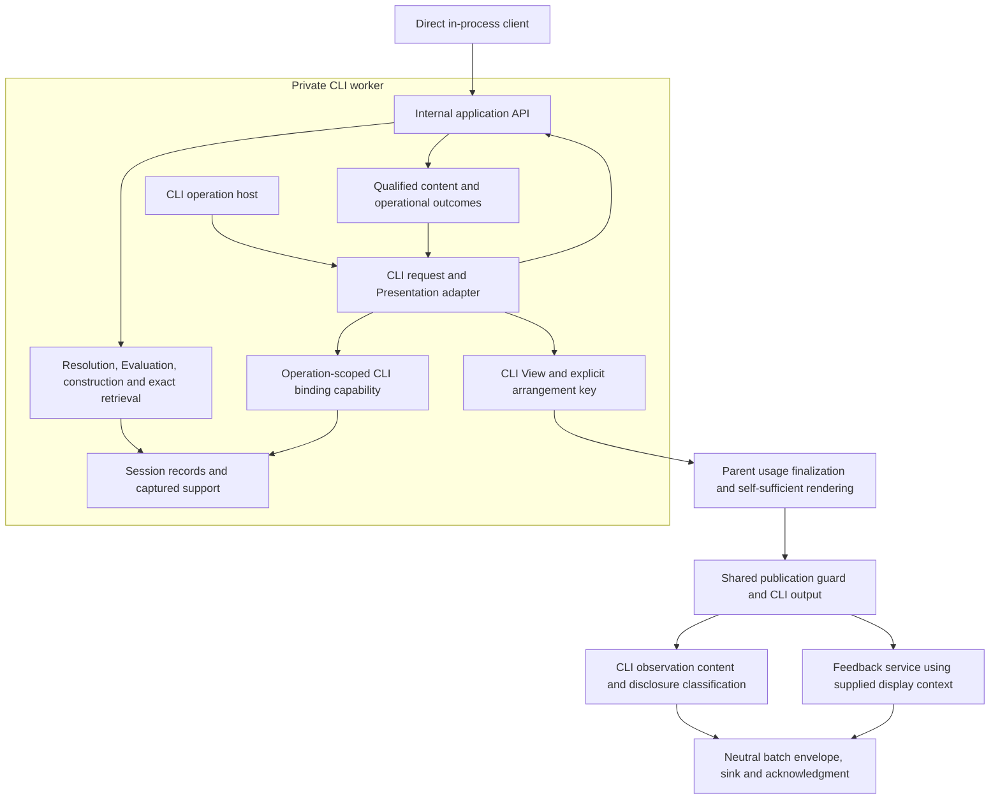

# Separate application functionality from its interfaces

Status: in review
Created: 2026-11-08
Updated: 2026-11-08
Superseded by:

## Problem and outcome

PostCode already separates analysis, qualified construction, retained selection
and much of arrangement. Its current Session coordinator nevertheless accepts
CLI-shaped requests and returns bounded CLI Views and rendered output. Provider
setup, publication and feedback also contain application behavior in command
modules. Another client would need to call terminal-oriented machinery or rebuild
parts of that behavior.

Establish a logical internal application API under `src/lib/`. The CLI becomes a
client of shared functionality. An ordinary in-process caller can open one
configured project, request supported information, follow a returned subject,
read an exact retained answer and inspect operational outcomes without command
parsing, terminal formatting, a CLI View or an observation sink. Existing CLI
functionality remains available through the same application operations.

The API is an internal implementation boundary, not a public package, wire
protocol, network service or separate process commitment. Future capabilities can
revise it through their own planning. Different clients may expose different
subsets. This work neither retires nor promises indefinite support for the
interactive human CLI.

## Scope and preservation

Cover current module inventory; project/repository organization; module, group,
mixed and Investigram inspection; dependency structure/children/parents;
summarize/explain/decompose/examine; associated interpretations; exact retained
answers; usage and work attribution; resolution and failure reporting; runtime
opening/validation/cancellation/cleanup; existing provider/account operations;
explicit inadequacy feedback and observation delivery used by the CLI. Keep the
nonpublic exports and interpretive fixture extensions working without making
them public commands.

Reuse existing qualified content, fixed catalog, evidence interfaces, operation
reuse and store invariants. Preserve claim-level qualification, captured basis,
originating versus consuming attribution, exact reference meanings, correction
eligibility and delivery, conflicts/reconsideration, and immutable answer support.
Keep actual usage independent of answer retention and research recording.

Retain the unchanged-input, one-project, transient Session and one-operation
contract. Retain terminal interruption of the Session, asynchronous Git ownership,
the CLI's compiler worker and separately awaitable cleanup. Do not introduce
automatic restart, concurrent requests, refresh, persistence, cross-Session
identity, historical access after invalidation, or a general scheduler.

Preserve CLI syntax, defaults, output meaning, bounds, reference allocation
schedules, continuations, text/JSON human-output contract, status codes and
automatic observation behavior, except for the agreed outcome distinction below.
This is not a general CLI redesign. Internal
types/import paths may change without compatibility shims once their production,
test and `scripts/` consumers are migrated. If implementation
reveals a need for a consequential visible or identity change, bring that change
back for agreement; experimental output status is not blanket authorization.

The agreed visible change concerns `unknown-continuation`: when the application
has produced/retrieved an answer but CLI arrangement cannot use a continuation,
the application's work report is `completed`; the CLI publication/observation
outcome remains a presentation failure with exit code 3. The observation's
application work-status field therefore changes from `failed` to `completed` for
this case. Malformed request syntax remains a refusal, and historical investigation
failure remains separate. This exception does not authorize other visible changes.

## Preconditions and decisions

The assessment baseline is `e9e4965d98aa7ab8c9c69469ea768141afce5c94`. Recheck changed
code and governing material before implementation. There is no unfinished product
implementation prerequisite identified in this assessment.

Governing constraints include [qualified results and construction](../decisions/research-question-driven-observation.md),
[Lens resolution](../decisions/lens-application-and-request-outcomes.md),
[qualified answer/View identity](../decisions/qualified-construction-under-the-request-model.md),
[exact retained presentation](../decisions/exact-retained-answer-presentation.md),
[execution ownership](../decisions/execution-ownership-and-cancellation.md),
[Investigram continuity](../decisions/investigrams-and-progressive-investigation.md),
[human output](../decisions/human-facing-architectural-representations.md), and
[generated-output boundaries](../decisions/generated-output-boundaries.md).
Read their current successor mappings, not superseded clauses in isolation.

The [internal API decision](../decisions/internal-application-api.md) and additions
to the [application specification](../app-specification.md#application-interface-boundary)
and [architectural constraints](../architectural-constraints.md#application-interface-boundary)
must be accepted together before implementation. Their draft links name intended
canonical destinations.

## Responsibility and dependency design

Arrows express use/data flow, not a new stored pipeline. The application engine
can run in-process for direct clients or inside the CLI worker; the diagram's
worker placement shows the CLI instance. The CLI client is composed at the worker
entry, outside the application's dependency graph. It receives selected content,
arranges it there, and keeps the existing worker-to-parent View/key delivery.
Application code does not import that client. Parent-owned Git, investigator
dialogues, credentials and authoritative usage retain their current ownership.

Direct callers use the in-process asynchronous lifecycle, which cannot pre-empt
synchronous compiler work in that thread. A GUI host will probably need worker
hosting and a full-content transport built on the same contracts; that work belongs
to MINIGUI. Deliver plain structured-clone-safe data now so it need not redesign
semantic results. A browser cannot directly run this Node application API. Neither
an additional worker facade nor a binding transport is required here.

Suggested logical homes are `src/lib/application/` for intended service exports
and `src/lib/interfaces/cli/` for CLI coordination/Presentation code. Keep coherent
domain/provider/infrastructure modules where they are; avoid a repository-wide
move or placeholder GUI/agent packages. Presentations may be shared by clients
with compatible consumption contracts without becoming application dependencies.

| Application or shared service owns | Client/host owns |
| --- | --- |
| Typed request validation, Lens applicability, qualified resolution, request/work attribution and outcomes | Argument parsing, word tokenization, aliases, interaction defaults, help and prompts |
| Requirements/precondition coordination, Evaluation/reuse, interpretation selection into answers and exact retrieval | Presentation declarations, arranging supplied content, detail/page choices, text/JSON View output and output safety |
| Precise reference validity, immutable selection and append-only alias infrastructure | Which answer to display; CLI-only arrangement-time alias requests through its scoped capability |
| Typed execution/lifecycle outcomes, usage/progress and shared publication-validity policy | SIGINT/EOF/TTY behavior, host-supplied reference lifetime, exit codes, stdout/stderr and guidance |
| Provider/account setup and explicit connection-check services | Environment/argument acquisition, intentional route choice, transmission/billing disclosures and sign-in interaction |
| Neutral batch envelope, sink and acknowledgment; feedback report/submission using supplied context | CLI observation content construction and source classification, actual-display snapshots, feedback input and warnings |

The host supplies project configuration and actual output locations. Application
opening establishes their exclusion policy, shared by compiler and repository
acquisition, and enforces it during validation. It cannot guess every future output
destination. Consolidate CLI setup without generic directory-name exclusions.

## Bounded contracts

Names here describe contract roles; final TypeScript spelling is an implementation
choice. Export explicit service types from an intended entry point. Do not derive
the public-to-this-repository contract from a CLI function's `ReturnType`, expose a
store, or require callers to assemble constructors and support traversals.

### Request and lifecycle surface

The operation table is the contract spine, not a frozen method-name or wire design.
The application API is the request-validation boundary for direct callers; a
TypeScript annotation is not proof that runtime input satisfies it.

| Operation or channel | Input | Output and invariant |
| --- | --- | --- |
| Open | Project configuration, exclusions, configured dependencies/bounds, captured declarations and host context | Session or typed opening failure; no terminal or sink prerequisite |
| Inspect capabilities | Captured catalog | Read-only Lens meaning, applicability/cardinality, parameters, result contracts and semantic requirement descriptors; no CLI format lists, executable registrations, subject-specific success claims or ranking |
| Request information | Canonical Lens ID, explicit subject designation, semantic parameters and supported information requirements or a captured Presentation choice | Qualified selected answer or self-contained resolution result; invocation context is separate from answer identity |
| Obtain exact retained answer | Precise Projection ID and optional supported content-consumption requirements | Fixed selected content/support, including both halves of associated inspection; no lookup, reselection, Evaluation, inference or acquisition |
| Report usage | Explicit subjectless report request | Attempt/Session usage with its limitations; no fabricated Lens or Projection |
| Receive work and attempt progress | Opening-time callbacks corresponding to existing `onWork`, `onProgress` and `onReport` | Immutable, correlated plain-data events and final reports; preserve attribution, order and usage ownership independently of rendering or recording |
| Check, interrupt and close | Session/lifecycle operation or cancellation signal | Typed invalidation, interruption, closed, busy and cleanup outcomes; one active operation, no restart and separately reportable cleanup |
| Guard publication | Execution/delivery context and host-owned output action | Shared pre/post-output checks and an outcome distinguishing withheld output from failure detected after output; output formatting remains client-owned |

Precise IDs suffice for all answer, candidate and follow-up use. There is **no
general compact-binding operation**. The CLI resolves its compact target syntax
through application-owned alias infrastructure at composition. Already allocated
coordination-time aliases may appear as optional fields; other clients can ignore
them. A future external-agent short-reference contract is separate work.

Request occurrence correlation and execution constraints remain separate from
answer identity. Capture caller-owned inputs before asynchronous work; preserve
malformed input and safe omission reasons without evaluating accessors. Refusals
do not become defects, and defects after validation do not become ordinary refusals.

Keep the CLI's supplied input and normalized presentation choices in its request/
publication context, correlated with the application's semantic request and actual
outcome. Do not reconstruct what was requested from the returned answer or lose
format/detail choices when separating the types. Shared attribution must preserve
the complete generating and consuming parent descriptions without importing CLI
renderers or treating client context as answer identity.

### Content requirements and Presentation compatibility

Clients own Presentation declarations: acceptable content contracts, required
standard expansions, preconditions and ordered fallbacks. Supply them once at
client composition or Session opening. Application coordination validates semantic
rules (including organization's `group-details` requirement), captures and freezes
the declarations before work, and requests name choices among that snapshot. Do
not accept replacement declarations per request or re-read later caller mutation.
Capability metadata exposes semantic requirements, not CLI encoding choices.

The CLI translates format/detail/page choices through its captured declarations.
Shared coordination preserves prospective compatibility before lookup, refinement
after subject resolution, required expansions before Evaluation, and materialized
compatibility before arrangement. The client cannot duplicate lookup or fallback
policy, silently relax explicit choices, or decide that partial information is an
established empty result. Keep actual selection criteria inspectable from the
captured declaration. No renderer callback or general planner is needed here.

A direct information request without a Presentation acquires all current standard
expansions for the subject kinds of its answer family. It may explicitly request a
supported subset. This default follows subject-kind standard-expansion semantics;
all current standard expansions are mechanical and inference-free. Expansions
contribute to answer identity. Parity with current CLI defaults is a useful test,
not the rationale. Revisit the default when a future subject kind introduces a
costly expansion, such as inference. A subset changes requested support, not the
Lens question, and missing/partial materialization remains qualified.

Exact retrieval returns the answer's fixed selected content without adding these
default expansions. Any explicit consumption requirements are checked against
that support. In particular, the existing organization Presentation's requirement
for `group-details` must not become a refusal of otherwise valid raw retrieval.
An incompatible Presentation is different from unavailable answer content.

### Results and exact answers

Return a discriminated application result with either an answer, self-contained
resolution information, or a usage report. Opening failure and unexpected
execution/cleanup errors remain separately typed; preserve the existing failure
distinctions rather than hiding every condition in a success flag.

An answer delivery supplies the precise answer identity, semantic family/variant,
immutable resolved selected content, relevant Evaluation outcomes and qualification,
fixed mechanical/composite support and any selected consumption contract. Previously
allocated aliases may be included, but retrieval does not promise or allocate a
compact reference for every item. Carry request
resolution/context, current work/usage and current request outcome beside that
answer, not in its retained identity. Delivery context also carries `repositoryRoot`
(or explicit unavailability), method provenance (`methods`) and host-supplied
reference lifetime. The host knows whether the Session ends with this command;
that lifetime is neither a Lens parameter nor a mere display preference, although
it affects current View identity and continuation guidance. Use the existing family content types where
they fit; split them from Presentation modules where necessary. Do not clone the
entire Session or expose generic record enumeration merely for client convenience.

Delivered answers, reports and progress events are plain, structured-clone-safe
data: no store handles, compiler objects, class instances or functions. Service
methods and configured callbacks are not part of these payloads. Clone/freeze at
ownership boundaries so caller mutation cannot change retained content or earlier
reports. For current eager families, full content means the entire selected
materialized content before display bounds, not exhaustive analysis or a complete
program capture. This does not prohibit later qualified lazy materialization.

Preserve full correction/reconsideration and association snapshots, account
composition, evidence/provenance, omission/availability distinctions and all
selected support beyond CLI limits. Associated inspection delivers its composite
and exact mechanical support together. Exact retrieval of a mechanical-only
answer remains different from retrieving its composite.

Exact access resolves only the named answer and fixed support. No current-history
enumeration, subject lookup, analysis, new content selection, provider call or
evidence acquisition can satisfy it. Missing required retained records remain a
defect; an unknown/foreign/wrong-kind target or unsupported consumption request
returns an explicit refusal. Reading a failed/unavailable historical answer can
succeed now while preserving its historical outcome. It adds no inference charge.

The API's exact operation prepares content for presentation; it does not claim
that a View has been shown. CLI `present` applies its normal compatibility,
paging, unknown-continuation and current-outcome rules to that content. Preserve
stable aliases, binding schedules, answer/View identity separation and explicit
arrangement-key usage finalization. Retain the existing lifecycle limitation:
invalidation/closure can make an immutable historical answer unavailable.

### CLI binding and outcome boundaries

The store retains append-only, never-rebind aliases. Preserve coordination-time
allocations for name-lookup candidates and population construction in
`subject-resolution.ts`, `module-selection.ts`, `organization/projections.ts` and
`exports/content.ts`, plus existing answer-alias coordination. Do not suppress them
for direct calls if that would change shared behavior; they are optional data to
non-CLI clients.

Arrangement-time binding is a capability supplied only to the CLI client at worker
composition. Validate IDs/kinds against the answer's supplied reference population;
provide no store/query/selection authority. Keep today's page-driven batches and
order, including associated-listing binding last. Do not preallocate every
reference in complete content or move all binding ahead of arrangement.

The CLI worker's serialized requesting operation covers both the application call
and CLI arrangement. Its scoped binding capability is usable only within that
operation and is revoked on settlement, invalidation or close. It cannot escape
into a returned payload or be used while another operation is running. Preserve
validation around that compound operation. This is CLI-internal composition, not
a new general API binding operation or callback supplied by ordinary clients.

Separate application work outcome from client presentation/publication outcome.
For an answer successfully produced/retrieved with `unknown-continuation`, keep
application work `completed`, while CLI presentation/publication and observations
record failure and exit 3. Do not retroactively edit the application's report.
Preserve the qualified View, same answer, continuation guidance and historical
outcome. Malformed syntax remains refused through the existing input path. The
acceptance matrix must assert both statuses, including the agreed change to the
observation work-status field.

### Lifecycle and delivery

Opening takes explicit project/runtime dependencies, output exclusions and
provider configuration. It does not parse arguments, consult terminal state or
require an observation destination. Credentials stay in their owning host and
outside investigator context, records, diagnostics and serialized request data.

Direct callers use the asynchronous open/execute/check/close lifecycle and
cancellation signal. Their Git owner lives in the calling process. The CLI host
keeps compiler work in its private worker and owns Git, provider dialogues and
authoritative usage in the parent. Input capture, atomic acceptance and usage
reporting are shared; hosting and transport do not create another implementation
of investigation policy. Preserve the current direct-runtime limitation that
synchronous compiler work is not independently preemptible from that same thread.

Default direct operations validate before and after execution. A shared publication
guard additionally applies the current best-effort pre-output and post-output
checks for delayed display, so clients do not copy lifecycle policy. Replace the
bare `deferPublicationCheck` API option with this guarded host path; any internal
deferral is private to the guard and cannot bypass its checks. Preserve the CLI's
existing validation phases, withholding before output and explicit invalidation
if output was already emitted. Returning data does not establish later display
validity. The guard owns checks/outcomes; the client owns actual output and records
what was emitted. No new atomic freshness guarantee is implied.

Expose typed lifecycle failures, reusing the existing invalidated, interrupted,
closed and cleanup distinctions and adding a typed busy outcome for a concurrent
call. Busy does not become an analysis failure or silently queue/restart work.
Keep progress and final attempt reports correlated with the same request and
available through terminal outcomes; discard late callbacks under the existing
cancellation boundary. Report usage without reconstructing it from Views.

Split `observations.ts` at its dependency boundary. The batch envelope, local sink,
submission and typed acknowledgment belong in a neutral module with no CLI View
or renderer imports, including through its type dependencies. CLI-specific batch
content construction and source-disclosure classification stay with the CLI. The
feedback service depends only on neutral contracts and accepts a supplied immutable
snapshot of actual displayed artifacts/output or explicit context-free input.
It constructs/submits the existing self-contained feedback report without live
lookup, reconstruction or new investigation. Keep missing context explicit.

Clients render acknowledgments, delivery rejection and accepted-delivery cleanup
warnings. These outcomes do not erase delivered application results. The current
batch-shaped display snapshot may remain if it depends only on the neutral envelope;
no universal receipt schema or generalized batch builder is required. Preserve CLI
automatic recording and its last-displayed-result behavior, including replacing an
old answer with a subsequently displayed failure. Direct non-recording use still
permits explicit feedback.

This extraction relates to [optional recording and feedback context](../backlog.md#separate-optional-research-recording-from-feedback-context)
but does not implement that item: no no-recording CLI option, recording-policy
change or generalized event framework is included.

Move production credential assembly and the explicit connection check out of
`auth-command.ts`. Reuse existing credential/OAuth/agent services behind typed
account operations. Preserve intentional enablement, route/billing distinction,
no credential fallback, and the fact that the connection check costs inference
and is never implicitly run. This task does not change models, billing, login
policy or external provider behavior; validate these paths offline.

## Implementation milestones

### M1 — Establish a binding-sensitive application path

Inventory production, tests and untyped `scripts/*.mjs` consumers of Session,
request, CLI and worker results, including dynamic `_build` imports and instrumentation
of worker files. Extract intended semantic request/result and lifecycle contracts,
capability descriptions and captured requirements. Implement direct inventory,
module `inspect` and exact retrieval, plus CLI `present`, through one shared engine.
Keep CLI arrangement in its worker client and exercise operation-scoped alias
binding there. Establish the shared publication guard, distinct work/presentation
outcomes, structured-clone-safe delivery and typed busy behavior on this slice.

Verify direct use without parser, renderer, terminal or sink; compare CLI behavior
against the baseline except the explicitly agreed work-status change. Exercise
caller mutation, malformed input, missing/incompatible subjects, complete/partial/
empty content, subset/default expansions, exact retrieval and alias collisions.
Preserve opening/exclusion and cleanup behavior.

**Intermediate independent review checkpoint:** inspect dependency direction,
capture-once declarations, precise-ID contracts, binding scope/order, separate
outcomes and publication lifecycle before broad migration. A facade that calls
CLI execution or returns bounded Views as content fails. So does a changed CLI
allocation schedule, escaped binding capability or bypassed publication check.
A necessary contract or scope change returns to the human. The human arranges the
reviewer; this plan does not schedule or delegate review automatically.

### M2 — Complete current information and exact-answer operations

Migrate organization, dependencies, mixed/group/Investigram inspection,
interpretation requests/follow-ups, resolution and usage. Reuse constructors,
fixed content resolvers, evaluation and the investigator bridge. Exercise the
nonpublic interpretive and exports fixtures without special facade branches.

The direct API journey obtains modules, resolves a subject, investigates it using
`ScriptedInvestigator`, follows an exact Investigram, accumulates corrections and
associations, retrieves the earlier exact answer, and issues fresh selection.
Assert the old answer's complete selected content/support/identity remain equal,
while the fresh answer exposes the deliberate selection changes, including
conflicts and reconsideration. Deny lookup, reselection, Evaluation and inference
on exact access. Use real evidence access, validation and retention; substitute
only the agent communication participant.

### M3 — Complete CLI, script consumers and companion services

Route both one-shot and shell through the application API and shared CLI adapter.
Preserve private View/key transport and parent usage finalization/rendering;
consolidate runtime/exclusion setup and retain signal/EOF behavior. Split request/
report data from terminal text and generate command continuations only in the CLI.
Remove obsolete parallel execution paths after consumers migrate.

Move credential assembly and the explicit cost-bearing connection check out of
command handlers, using existing services. Extract the neutral observation envelope,
sink/acknowledgment and feedback service, while retaining CLI batch construction
and source classification. Verify preflight ordering, disabled/invalid setup,
route/billing and no-fallback rules, authentication without a project, context-free
and displayed-result feedback, failed-display snapshot replacement and delivery
failure isolation. Use offline credential/provider doubles, not live credentials
or paid inference.

Migrate all current `scripts/` consumers, including dynamic build-root imports and
profiling/interruption harnesses. Type checking alone does not cover them. Verify
changed imports and representative offline executions, including a controlled
shell harness; do not import a live assessment script merely to test linkage if
its top level initiates inference. Historical validation records remain unchanged.

### M4 — Integrated verification, documentation and handoff

Run the matrix below, `npm run check` and `npm test`. Exercise a small direct client
and the CLI on the same deterministic fixture and record representative text/JSON
comparisons. Review runtime and type dependencies; retain no CLI-only semantic
execution path. Check script linkage/entry paths separately from TypeScript tests.

Document the intended internal API and lifecycle examples in
`docs/application-api.md`, linked from `docs/README.md`; maintain the descriptive
boundary map in `docs/architecture/README.md` and affected implementation conventions.
Update status/capability/CLI documentation only where descriptions actually change.
Explain the agreed work-status exception and retain current limitations.

Prepare the task protocol's integrated-review handoff and PR. The human arranges
review and decides when its gate is sufficient. Passing checks is not authorization
to close or merge implementation. No GUI, account diagram or live inference
assessment is needed to complete this task.

## Verification and completion criteria

Use real compiler/repository fixtures and `ScriptedInvestigator` at the existing
communication substitution boundary. Compare semantics with the shared
reference-aware comparison policy; do not erase qualification, support, order or
identity inputs to make comparisons pass. Extend existing tests where appropriate.

| Check | Required distinguishing evidence |
| --- | --- |
| Direct API, independent of interfaces | Import only the intended API and documented types in a small integration test. Open a fixture, list existing Lens meanings, request inventory/organization/dependencies/inspection, investigate and follow an Investigram, retrieve an exact answer, obtain usage, and close. No CLI parser, Presentation, terminal writer or sink is configured or invoked. Results/progress survive structured clone without capabilities or prototype behavior. |
| Complete content | Use beyond-bound exports/documentation, dependency occurrences and association/revision content. Direct results retain full selected qualification/support while CLI output retains its honest bounds and omission counts. Source-bearing support is not automatically serialized to human-facing JSON. |
| Qualified resolution | Missing/ambiguous names, actual precise references, incompatible bound targets, malformed/unrepresentable input, invalid parameters, no compatible Presentation, and materialization refusal. Inspect candidates, prerequisite qualification/work and retained answer pointers without later lookup or observations; distinguish valid empty/partial/unavailable answers. |
| Fresh versus exact | In one Session obtain A, perform later work that adds corrections/associations/reconsideration, obtain fresh B, then retrieve and present exact A. Compare A's full content, support, snapshots and ID unchanged. Deny selection/Evaluation/provider calls on the exact path. Target originals and replacements explicitly; cover conflicting revisions and associated composites. |
| CLI compatibility and consumption | One-shot and shell, Unicode/JSON, all existing command families, more detail, association/revision paging and unknown tokens, canonical aliases/precise targets and one-shot expiry. Same effective information requirements yield equivalent answers through API and CLI; different rendering preserves the answer and changes only applicable View/report identity. |
| Compatibility planning | Preserve pre-lookup refusal, post-resolution family checks, fallback requirements before Evaluation, explicit option preservation and materialization checks. Captured declarations ignore later mutation; direct defaults acquire family standard expansions and explicit supported subsets remain distinct. A raw content request succeeds independently of CLI Presentation availability. A retained request cannot acquire absent support even if that support exists elsewhere in the Session. |
| Lifecycle and faults | Opening failure, changed/unverifiable input, interrupted work, late replies, provider failures, unexpected defects, sink rejection and unconfirmed cleanup. Default direct and deferred CLI checks preserve withholding/disclosure behavior. No restart, duplicated work or leaked ownership. The shared guard covers withheld output and post-output invalidation without a public bypass flag. Current usage remains available after interruption and is not charged again by exact access. |
| Binding and identity | Direct clients complete the journey with precise IDs alone. Preserve name/reference equivalent answers, optional coordination aliases, separate answer aliases and CLI page-driven allocation/collision schedules. Arrangement binds only its supplied population within the serialized worker operation, never after settlement/invalidation/close; do not eagerly allocate all off-page references. Parent finalization retains the explicit arrangement key and idempotence. |
| Companion services | Account operations and explicit connection check through offline doubles, route/credential boundaries, context-free and displayed-result feedback, failed-display replacement of old feedback context, actual output and self-contained batches, visible delivery rejection/cleanup warnings without erasing results. No research capture required for direct operational attribution. |
| Progress and lifecycle types | Exercise `onWork`, `onProgress` and `onReport` equivalents, request correlation, final usage, caller mutation and late-callback suppression. Concurrent calls produce typed busy without affecting the active request; invalidation/interruption/cleanup retain distinct outcomes. |
| Outcome separation | After successful answer delivery, unknown continuation gives application work `completed`, CLI presentation/publication failure and exit 3; the observation work-status field reflects that agreed change. Malformed syntax remains refusal and retained investigation failure is historical. |
| Script consumers | Inventory static/dynamic `_build` imports and worker instrumentation in `scripts/`. Verify migrated imports and representative offline harness execution without triggering live assessments; record checks not covered by `npm run check`. |
| Architectural dependency | Inspect runtime and type imports transitively from the application service and core. They do not reach CLI parsing, renderers, terminal helpers or CLI View types; worker composition is explicitly outside that graph. Client imports use the intended API, not stores, selectors or Evaluators. Use a focused import-graph check with existing tooling, including type imports and neutral envelope/source-classification types; no new dependency is needed. |

Reuse relevant coverage in `request-model`, `subject-resolution`, `projection-content`,
`presentation-compatibility`, `retained-presentation`, `investigation-selection`,
`answer-identity`, `investigation-revisions`,
`work-attribution`, `execution-ownership`, `session-inputs`, `output-boundary`,
`human-output`, `source-disclosure`, `feedback`, `chatgpt-auth`, `lens-extensions`
and `exports-lens` tests. In particular, inspect `test/retained-presentation.test.ts`
and `test/investigation-selection.test.ts` rather than replacing them with a smoke
test of the new facade. Run `npm run check` and `npm test` for the completed change;
use existing offline subprocess/worker fixtures and disclose platform limits.

Completion requires the direct API journey, adapted CLI, dependency separation,
preservation matrix and required review. A wrapper that still executes CLI
rendering, an API exposing only bounded Views, or an unconverted command path
owning application policy does not meet the goal. No GUI demonstration, natural
correction-discovery assessment, new diagram or live inference benchmark is part
of acceptance.

## Future compatibility and explicit non-goals

Structured accounts may later introduce qualified architectural subjects and
relationships beyond modules/Investigrams, and structured content sufficient for
structural, state and interaction diagrams. Keep family/variant distinctions and
support extensible in ordinary code; do not invent universal graph/account types
now. A diagram cannot derive missing program semantics during arrangement.

Presentation/navigation work may add question discovery, composition, origin
lineage and graphical representations. Minimal GUI work may add subject/question
controls and returning to previous results. The current exact-answer mechanism
is a prerequisite for continuity, not an implementation of navigation history.
External-agent work may select a transport and stable consumption contract; the
internal API's complete content is not automatically an authorized external
evidence endpoint. Built-in Investigator restrictions remain unchanged.

Each of those tasks can extend this boundary and completes independently. This
task creates no universal account schema, dynamic plugin framework, arbitrary
record API, generic event bus, general persistence, multi-state support or new
research-recording controls. It does not remediate the known captured-basis
observation export or navigation-origin gaps. Do not use new observations for an
assessment requiring those missing guarantees.

GUI work must reuse or re-establish verified human-output disclosure/classification
before exposing source-bearing API content. The present `source-disclosure.ts`
classifies CLI Views and output, not arbitrary future GUI results. Shared
Presentation utilities are possible but not a reason to assume GUI conformance.

[Presentation representation, F5](../backlog.md#decide-how-gui-presentations-and-their-parameters-are-represented)
remains open for GUI choices. Precise IDs remove the need for this task to provide
population-wide compact-alias coordination to GUI clients; the existing CLI-only
schedule is preserved. This does not settle general GUI Presentation composition,
layout or identity, nor short references for external agents. MINIGUI will probably
need worker hosting plus full-content transport over these plain-data contracts;
it will display names and keep precise IDs internally rather than use CLI `@` aliases.

## Risks and review status

The human agreed with the original five recommendations and, in the merge
direction, settled precise-ID clients/CLI-only arrangement binding, completed
application work versus failed continuation presentation, capture-once declarations,
family-standard direct defaults and neutral observation/feedback dependencies.
These directions shape this merged draft. The detailed combined package remains
in review before approval/promotion; implementation is not authorized.

The independent reviews assessed two earlier packages. Their substantive findings
are not treated as a closed checklist for this new package. Reassess applicability
after the merge; only directed synthesis and applicable local wording corrections
belong to this pass.

Principal risks remain raw-support disclosure, altered acquisition/alias schedules,
live lookup replacing fixed support, publication checks bypassed between layers,
and usage/cleanup ownership lost with disposable state. Current CLI View/key
transport stays bounded; avoid needless full-content cloning without inventing
performance targets or caches.

If neutral compatibility requires a general planner, scoped CLI binding cannot
stay inside the requesting operation, or preserving the worker forces domain code
to import CLI adapters, bring the concrete conflict back to planning. Routine
signature/file-layout choices are implementation details; a new lifecycle,
disclosure or identity policy is not.
