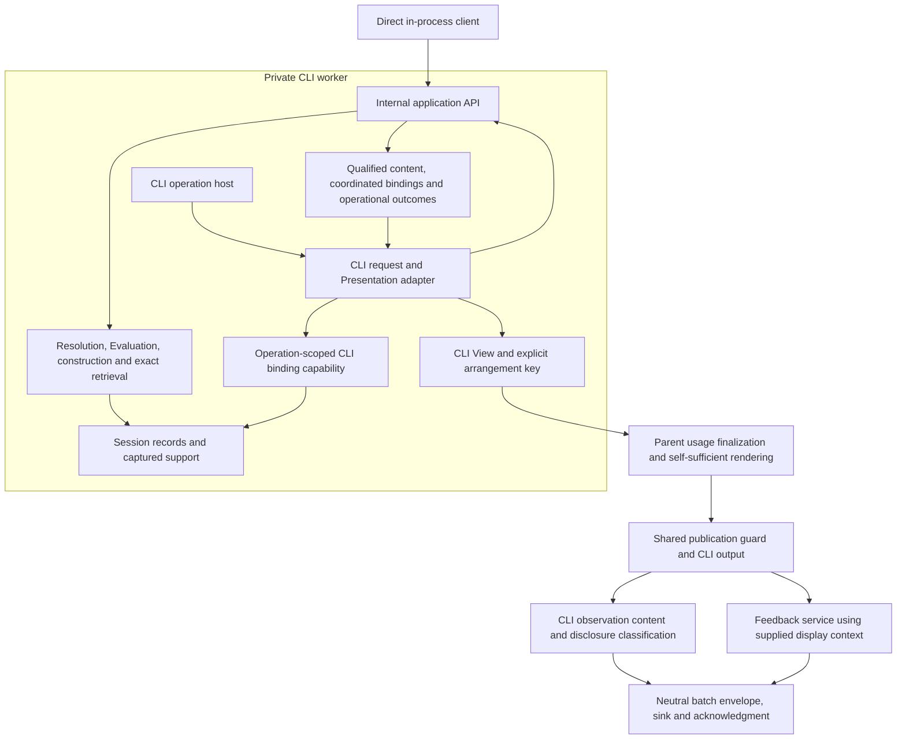

# Separate application functionality from its interfaces

Status: in review
Created: 2026-11-08
Updated: 2026-11-08
Superseded by:

## Problem and outcome

PostCode already separates analysis, qualified construction, retained selection
and much of arrangement. Its current Session coordinator nevertheless accepts
CLI-shaped requests and returns bounded CLI Views and rendered output. Provider
setup, publication and feedback also contain application behavior in command
modules. Another client would need to call terminal-oriented machinery or rebuild
parts of that behavior.

Establish a logical internal application API under `src/lib/`. The CLI becomes a
client of shared functionality. An ordinary in-process caller can open one
configured project, request supported information, follow a returned subject,
read an exact retained answer and inspect operational outcomes without command
parsing, terminal formatting, a CLI View or an observation sink. Existing CLI
functionality remains available through the same application operations.

The API is an internal implementation boundary, not a public package, wire
protocol, network service or separate process commitment. Future capabilities can
revise it through their own planning. Different clients may expose different
subsets. This work neither retires nor promises indefinite support for the
interactive human CLI.

## Scope and preservation

Cover current module inventory; project/repository organization; module, group,
mixed and Investigram inspection; dependency structure/children/parents;
summarize/explain/decompose/examine; associated interpretations; exact retained
answers; usage and work attribution; resolution and failure reporting; runtime
opening/validation/cancellation/cleanup; existing provider/account operations;
explicit inadequacy feedback and observation delivery used by the CLI. Keep the
nonpublic exports and interpretive fixture extensions working without making
them public commands.

Reuse existing qualified content, fixed catalog, evidence interfaces, operation
reuse and store invariants. Preserve claim-level qualification, captured basis,
originating versus consuming attribution, exact reference meanings, correction
eligibility and delivery, conflicts/reconsideration, and immutable answer support.
Keep actual usage independent of answer retention and research recording.

Retain the unchanged-input, one-project, transient Session and one-operation
contract. Retain terminal interruption of the Session, asynchronous Git ownership,
the CLI's compiler worker and separately awaitable cleanup. Do not introduce
automatic restart, concurrent requests, refresh, persistence, cross-Session
identity, historical access after invalidation, or a general scheduler.

Preserve CLI syntax, defaults, output meaning, bounds, reference allocation
schedules, continuations, text/JSON human-output contract, status codes and
automatic observation behavior, except for the agreed outcome and identity/provenance
changes below.
This is not a general CLI redesign. Internal
types/import paths may change without compatibility shims once their production,
test and live `scripts/` consumers are migrated; historical checkpoint tools retain
their documented build assumptions. If implementation
reveals a need for a consequential visible or identity change, bring that change
back for agreement; experimental output status is not blanket authorization.

The agreed outcome boundary finalizes application work independently of client
presentation. Exact `present` with `unknown-continuation` changes application work
from `failed` to `completed`; the command/observation remains failed with exit 3.
The human also agreed that unexpected arrangement failures after completed
application work must leave that work completed, preserving the client's failure
classification and exit code. Application validity failures before finalization,
syntax/compatibility refusals and historical investigation outcomes stay distinct.

The human directed separation of Presentation-method versions from application
identity within this task. Removing them from analysis-input and Session method
capture changes provenance and may change downstream IDs and compact spellings
across builds. Preserve their allocation algorithm, populations and order, not
literal cross-build spellings. Within a Session, exact answers and bindings remain
immutable. No other semantic/output change is authorized by these exceptions.

## Preconditions and decisions

The assessment baseline is `e9e4965d98aa7ab8c9c69469ea768141afce5c94`. Recheck changed
code and governing material before implementation. There is no unfinished product
implementation prerequisite identified in this assessment.

Governing constraints include [qualified results and construction](../decisions/research-question-driven-observation.md),
[Lens resolution](../decisions/lens-application-and-request-outcomes.md),
[qualified answer/View identity](../decisions/qualified-construction-under-the-request-model.md),
[exact retained presentation](../decisions/exact-retained-answer-presentation.md),
[execution ownership](../decisions/execution-ownership-and-cancellation.md),
[Investigram continuity](../decisions/investigrams-and-progressive-investigation.md),
[human output](../decisions/human-facing-architectural-representations.md), and
[generated-output boundaries](../decisions/generated-output-boundaries.md).
Read their current successor mappings, not superseded clauses in isolation.

The [internal API decision](../decisions/internal-application-api.md) and revisions
to the [application specification](../app-specification.md#application-interface-boundary),
[architectural constraints](../architectural-constraints.md#application-interface-boundary)
and [core concepts](../core-concepts.md#evaluation) must be accepted together before
implementation. Their draft links name intended canonical destinations.

## Responsibility and dependency design

Arrows express use/data flow, not a new stored pipeline. The application engine
can run in-process for direct clients or inside the CLI worker; the diagram's
worker placement shows the production CLI instance. The same CLI adapter also
supports in-process composition for tests and controlled harnesses. Worker entry
and in-process test assembly both stay outside the application dependency graph. It receives selected content,
arranges it there, and keeps the existing worker-to-parent View/key delivery.
Application code does not import that client. Parent-owned Git, investigator
dialogues, credentials and authoritative usage retain their current ownership.

Direct callers use the in-process asynchronous lifecycle, which cannot pre-empt
synchronous compiler work in that thread. A GUI host will probably need worker
hosting and a full-content transport built on the same contracts; that work belongs
to MINIGUI. Deliver plain structured-clone-safe data now so it need not redesign
semantic results. A browser cannot directly run this Node application API. Neither
an additional worker facade nor a binding transport is required here.

Suggested logical homes are `src/lib/application/` for intended service exports
and `src/lib/interfaces/cli/` for CLI coordination/Presentation code. Keep coherent
domain/provider/infrastructure modules where they are; avoid a repository-wide
move or placeholder GUI/agent packages. Presentations may be shared by clients
with compatible consumption contracts without becoming application dependencies.

| Application or shared service owns | Client/host owns |
| --- | --- |
| Typed request validation, Lens applicability, qualified resolution, request/work attribution and outcomes | Argument parsing, word tokenization, aliases, interaction defaults, help and prompts |
| Requirements/precondition coordination, Evaluation/reuse, interpretation selection into answers and exact retrieval | Presentation declarations, arranging supplied content, detail/page choices, text/JSON View output and output safety |
| Precise reference validity, immutable selection and append-only alias infrastructure | Which answer to display; CLI-only arrangement-time alias requests through its scoped capability |
| Typed execution/lifecycle outcomes, usage/progress and shared publication-validity policy | SIGINT/EOF/TTY behavior, host-supplied reference lifetime, exit codes, stdout/stderr and guidance |
| Provider/account setup and explicit connection-check services | Environment/argument acquisition, intentional route choice, transmission/billing disclosures and sign-in interaction |
| Neutral batch envelope, sink and acknowledgment; feedback report/submission using supplied context | CLI observation content construction and source classification, actual-display snapshots, feedback input and warnings |

The host supplies project configuration and actual output locations. Application
opening establishes their exclusion policy, shared by compiler and repository
acquisition, and enforces it during validation. It cannot guess every future output
destination. Consolidate CLI setup without generic directory-name exclusions.

## Bounded contracts

Names here describe contract roles; final TypeScript spelling is an implementation
choice. Export explicit service types from an intended entry point. Do not derive
the public-to-this-repository contract from a CLI function's `ReturnType`, expose a
store, or require callers to assemble constructors and support traversals.

### Request and lifecycle surface

The operation table is the contract spine, not a frozen method-name or wire design.
The application API is the request-validation boundary for direct callers; a
TypeScript annotation is not proof that runtime input satisfies it.

| Operation or channel | Input | Output and invariant |
| --- | --- | --- |
| Open | Project configuration, exclusions, configured dependencies/bounds, captured declarations and host context | Session or typed opening failure; no terminal or sink prerequisite |
| Inspect capabilities | Captured catalog | Read-only Lens meaning, applicability/cardinality, parameters, result contracts and semantic requirement descriptors; no CLI format lists, executable registrations, subject-specific success claims or ranking |
| Request information | Canonical Lens ID, explicit subject designation, semantic parameters and supported information requirements or a captured Presentation choice | Qualified selected answer or self-contained resolution result; invocation context is separate from answer identity |
| Obtain exact retained answer | Precise Projection ID or existing Session-bound answer alias, plus optional supported content-consumption requirements | Fixed selected content/support, including both halves of associated inspection; no fresh subject discovery, reselection, Evaluation, inference or acquisition |
| Report usage | Explicit subjectless report request | Attempt/Session usage with its limitations; no fabricated Lens or Projection |
| Receive work and attempt progress | Opening-time callbacks corresponding to existing `onWork`, `onProgress` and `onReport` | Immutable, correlated plain-data events and final reports; preserve attribution, order and usage ownership independently of rendering or recording |
| Check, interrupt and close | Session/lifecycle operation or cancellation signal | Typed invalidation, interruption, closed, busy and cleanup outcomes; one active operation, no restart and separately reportable cleanup |
| Guard publication | Execution/delivery context and host-owned output action | Shared pre/post-output checks and an outcome distinguishing withheld output from failure detected after output; output formatting remains client-owned |

Precise IDs suffice for all answer, candidate and follow-up use; they are not the
only accepted request spelling. Shared application coordination retains the existing
`reference` designation accepting precise IDs or Session aliases and accepts
Session-bound answer aliases on exact requests. The CLI translates its syntax but
does not pre-resolve aliases to IDs. Resolve aliases per request in the application,
keeping the supplied designation in normalized request context, work attribution
and observations, with the same unknown/unbound/foreign/wrong-kind distinctions
and lookup/allocation path. Answer identity uses the resolved referent as before.

There is **no general compact-binding operation**. Allocation capability is supplied
at CLI composition, whereas input alias resolution is shared request behavior.
Already allocated coordination aliases may appear as optional fields; non-CLI
clients need neither send nor display them. A future external-agent short-reference
contract remains separate work.

Request occurrence correlation and execution constraints remain separate from
answer identity. Capture caller-owned inputs before asynchronous work; preserve
malformed input and safe omission reasons without evaluating accessors. Refusals
do not become defects, and defects after validation do not become ordinary refusals.

Capture optional client-owned invocation fields alongside the semantic request
under the decision's [report-context contract](../decisions/internal-application-api.md#invocation-context).
The attachment is not a second normalized semantic request. The application owns
occurrence IDs, purpose, constraints, attribution and status; the attachment cannot
overwrite them or select additional work. Safely capture/freeze supplied fields
before asynchronous work and retain them with current and generating-parent contexts.

| Report input | Producer and authority |
| --- | --- |
| Canonical Lens ID, catalog question, semantic designation, normalized parameters and program-input meaning | Shared application normalization against the captured catalog; return these in typed context |
| Supplied command/reference spelling, Presentation choices and their interface defaults, host reference lifetime | CLI input/host adapter; safely captured as client fields, with no second semantic normalization |
| Rejected-input details and representation/omission limits | Shared safe capture/validation reports typed problems and preserved data; CLI-owned input representation remains in the attachment |
| Legacy CLI `context.request` | CLI reporting adapter combines the two captured sources, preserving current field shape/order and values |

Preserve the existing CLI `context.request` in `request-work`, resolution/usage
reports and observation requests, including earlier generating parents. The report
adapter neither computes catalog questions/designation semantics again nor asks the
application to construct a CLI-shaped request. It does not infer choices from the
answer or reapply defaults during reporting. Compare serialized context fields as
well as full reports under the existing occurrence/reference comparison policy and
explicit method-provenance exceptions. Direct clients use typed semantic context
and need no CLI attachment or legacy projection.

### Content requirements and Presentation compatibility

Clients own Presentation declarations: acceptable content contracts, required
standard expansions, preconditions and ordered fallbacks. Supply them once at
client composition or Session opening. Application coordination validates semantic
rules (including organization's `group-details` requirement), captures and freezes
the declarations before work, and requests name choices among that snapshot. Do
not accept replacement declarations per request or re-read later caller mutation.
Capability metadata exposes semantic requirements, not CLI encoding choices.

The CLI translates format/detail/page choices through its captured declarations.
Shared coordination preserves prospective compatibility before lookup, refinement
after subject resolution, required expansions before Evaluation, and materialized
compatibility before arrangement. The client cannot duplicate lookup or fallback
policy, silently relax explicit choices, or decide that partial information is an
established empty result. Keep actual selection criteria inspectable from the
captured declaration. No renderer callback or general planner is needed here.

A direct information request without a Presentation acquires all current standard
expansions that its resolved answer family's content contract carries. It may
explicitly request a supported subset. Current defaults are:

| Content contract | Default expansion requirements |
| --- | --- |
| Modules | Module standard expansions: exports, documentation, composition |
| Organization | Module standard expansions and group-details |
| Dependencies | Module standard expansions and group-details |
| Module exports | Exports and documentation; this content contract does not carry composition |
| Investigation, including Investigram inspection | None; a module subject does not imply module-detail acquisition |

Module/group/mixed inspection uses its resolved mechanical contract; associated
interpretation does not add expansion requirements. Lens-required support still
applies independently. This default follows subject-kind standard-expansion semantics;
all current standard expansions are mechanical and inference-free. Expansions
contribute to answer identity. Parity with current CLI defaults is a useful test,
not the rationale. Revisit the default when a future subject kind introduces a
costly expansion, such as inference. A subset changes requested support, not the
Lens question, and missing/partial materialization remains qualified.

Exact retrieval returns the answer's fixed selected content without adding these
default expansions. Any explicit consumption requirements are checked against
that support. In particular, the existing organization Presentation's requirement
for `group-details` must not become a refusal of otherwise valid raw retrieval.
An incompatible Presentation is different from unavailable answer content.

### Results and exact answers

Information and exact-answer requests return an answer or self-contained resolution
information. The separate subjectless usage operation returns a usage report. Opening failure and unexpected
execution/cleanup errors remain separately typed; preserve the existing failure
distinctions rather than hiding every condition in a success flag.

An answer delivery supplies the precise answer identity, semantic family/variant,
immutable resolved selected content, relevant Evaluation outcomes and qualification,
fixed mechanical/composite support and any selected consumption contract. Previously
allocated aliases may be included, but retrieval does not promise or allocate a
compact reference for every item. Carry request
resolution/context, current work/usage and current request outcome beside that
answer, not in its retained identity. Delivery context also carries `repositoryRoot`
(or explicit unavailability), method provenance (`methods`) and host-supplied
reference lifetime. The host knows whether the Session ends with this command;
that lifetime is neither a Lens parameter nor a mere display preference, although
it affects current View identity and continuation guidance. Use the existing family content types where
they fit; split them from Presentation modules where necessary. Do not clone the
entire Session or expose generic record enumeration merely for client convenience.

Delivered answers, reports and progress events are plain, structured-clone-safe
data: no store handles, compiler objects, class instances or functions. Service
methods and configured callbacks are not part of these payloads. Clone/freeze at
ownership boundaries so caller mutation cannot change retained content or earlier
reports. For current eager families, full content means the entire selected
materialized content before display bounds, not exhaustive analysis or a complete
program capture. This does not prohibit later qualified lazy materialization.

Preserve full correction/reconsideration and association snapshots, account
composition, evidence/provenance, omission/availability distinctions and all
selected support beyond CLI limits. Associated inspection delivers its composite
and exact mechanical support together. Exact retrieval of a mechanical-only
answer remains different from retrieving its composite.

Exact access resolves only the named answer and fixed support. No current-history
enumeration, subject lookup, analysis, new content selection, provider call or
evidence acquisition can satisfy it. Missing required retained records remain a
defect; an unknown/foreign/wrong-kind target or unsupported consumption request
returns an explicit refusal. Reading a failed/unavailable historical answer can
succeed now while preserving its historical outcome. It adds no inference charge.

The API's exact operation prepares content for presentation; it does not claim
that a View has been shown. CLI `present` applies its normal compatibility,
paging, unknown-continuation and current-outcome rules to that content. Preserve
stable aliases, binding schedules, answer/View identity separation and explicit
arrangement-key usage finalization. Retain the existing lifecycle limitation:
invalidation/closure can make an immutable historical answer unavailable.

### Reference allocation and the CLI operation scope

Follow the decision's [allocation and scope rules](../decisions/internal-application-api.md#cli-bindings-and-outcomes).
The inventory below distinguishes population coordination from the narrower
investigation binding port. Paths are under `src/lib/` at the assessment baseline;
M1 checks every call site and captures collision-sensitive order before moving it.
Supply coordinated maps as plain ID/alias entries, not store handles. Preserve
existing allocations for direct calls too; other clients need not use the aliases.

| Existing site | Schedule and population | Target owner and delivery |
| --- | --- | --- |
| `subject-resolution.ts: resolveSubjects` | Relevant module/group population for settled name lookup; explicit candidates on refusal; reference classification itself allocates nothing | Application resolution, preserving kind/order and candidate bindings |
| `module-selection.ts: selectResolvedModules` | Entire discovery module population before selected-module construction | Application construction coordination |
| `organization/projections.ts` | Organization group population for selected-entity construction | Application construction coordination, before downstream module work |
| `exports/content.ts` | Module basis population, then selected subjects, including precise outsiders | Application construction coordination |
| `session.ts`, investigation/Investigram-inspection branch | Whole module population for module investigation Lenses, otherwise retained Investigram population, before Evaluation/selection | Application fresh-request coordination; never add history enumeration to exact retrieval |
| `presentation.ts: createView` | Discovery modules then selected projection modules, population-wide | Extract wrapper's coordination to application; CLI receives module bindings |
| `organization/presentation.ts: createOrganizationView` | Evaluation groups, selected groups, module evaluation population, then embedded-detail discovery/selected modules | Extract application coordination in that order; supply group/module/detail maps |
| `dependencies/presentation.ts: createDependencyView` | Basis modules then selected projection modules | Extract application coordination; supply map |
| `program-presentation.ts`, exports branch | Module basis then selected subject | Extract application coordination; supply subject binding |
| `session.ts` and `retained-presentation.ts`, mechanical associated inspection | All associated matches, including off-page matches, after mechanical allocations and before continuation lookup/arrangement | Application coordination supplies full association map; never shrink to displayed rows |
| `session.ts`, `retained-presentation.ts`, mechanical and investigation wrappers: `answerIds` | Separate answer-alias namespace at existing success/refusal/preparation points, before dependent arrangement | Application answer preparation supplies answer bindings; preserve exact/refused target behavior |
| `investigation/presentation.ts: createInvestigationView` and exact investigation path | Bounded investigation traversal/revision-page batch, navigable module subjects, then any supplied candidate bindings; validate against `content.references` | CLI arrangement requests through revocable operation-local port; preserve batch/order |
| `investigation/presentation.ts: arrangeInvestigationView`, historical-inspection association call | All association matches, off-page included, after displayed references, navigation and candidate bindings | Final whole-population batch through the same validated port; CLI-port allocation stays at this position over the application-supplied population, not moved into early preallocation |

Mechanical content has no `references` population and needs no new one. Its
existing populations drive application coordination and supplied maps. The scoped
port is only for the investigation arrangement sites that already use
`referenceBinding`, including their final whole-association batch; it does not
replace mechanical population coordination. A direct client receives the already
coordinated association aliases for mechanical associated inspection, but historical
Investigram inspection promises no new association aliases unless the CLI port
allocates them. These optional bindings do not affect precise-ID access. Do not
preallocate the whole investigation reference population.

Use a trusted internal operation-scope entry point (`withCliOperation` is an
illustrative name) shared by worker and in-process CLI composition. It acquires
the guard once and exposes a single-request executor backed by shared machinery,
not a nested ordinary guarded API call. The scope owns capability expiry on
settlement/throw/invalidation/close. No capability crosses worker transport.

Complete application work collection before arrangement, including moving
`consumeInterpretation(view.projection.id)` to the already selected composite
`target` in the fresh mechanical path. Audit other post-arrangement
`WorkScope.record` calls; arrangement adds no investigation work. Finalize application
work after its required validity checks and before arrangement. Retain the operation
guard until arrangement settles and revoke the port on every exit. The CLI's
deferred check is explicitly owned by the publication path; it does not reopen
work after arrangement or output failure. Test complete associated-inspection
attribution and the terminal-status distinctions below.

### Refusal and outcome compatibility

Follow the [refusal/context decision](../decisions/internal-application-api.md#invocation-context).
Client ownership of eligibility means the client declares its option policy;
shared coordination still decides compatibility and issues resolution outcomes.
Capture client-owned option eligibility as bounded declarative data over opaque
option values and semantic facts already known to coordination (contract,
cardinality, inspection/association/revision support). Preserve ordered fallbacks
and reasons. This is a finite extraction of today's checks, not arbitrary client
predicates or a plugin rule language. CLI parser errors remain client errors before
application request capture. Programmatic callers that bypass parsing still use
shared safe capture/rejection, preserving parent versus worker execution and usage
attribution.

The matrix specifies current → target. Unless marked **changed**, every work
status, command outcome/event, exit code and emitted report shape is unchanged.
Rows assume no superseding publication/lifecycle failure. Identity/provenance
fields also have the separately agreed method-capture changes; this matrix concerns
request outcomes. `R` is the shared
resolution report, rendered by the CLI and finalized with parent-owned usage;
`U` is its usage counterpart. `—` means no non-View report. Command outcomes/events
are CLI-only; direct calls have typed results/errors and work reports, not exit codes.

| Condition | Detection now → target | Work now → target | Command outcome / event / exit | Non-View report source |
| --- | --- | --- | --- | --- |
| Argument/tokenization error before a request | CLI parser → CLI parser | Absent → absent | One-shot: no command observation, exit 2. Shell: refused / command-refused, continues interaction without assigning command exit 3 | CLI diagnostic, no R or request-work |
| Malformed `--after`/`--revision-page`, paging on a fresh command, or other parser-rejected command syntax | CLI parser → CLI parser, before application capture | Absent → absent | Same parser outcomes: one-shot exit 2 without observation; shell refused / command-refused and continues | CLI diagnostic, no R or request-work |
| Unrepresentable/malformed request, unknown Lens, malformed `after`/`revisionPage` or fresh paging supplied programmatically past the CLI parser | Request capture; parent handles wholly rejected input → shared safe capture/rejection service, same parent path for CLI-shaped calls | refused → refused | When passed through `publishCommand`: refused / command-refused / 3. Direct execute callers receive a refusal with no automatic command event/exit | Shared rejected-request R in parent or local composition; not the parser-error route |
| Invalid semantic parameters, designation or usage-report inputs | Session executor → shared request validation | refused → refused | refused / command-refused / 3 | R from application |
| Prospective format/detail/paging ineligibility before lookup | Combined compatibility check → shared match of captured client declarations | refused → refused | refused / command-refused / 3 | R, presentation-unavailable |
| Missing/ambiguous subject, unknown reference, answer-as-subject, unsupported subject, incomplete/unavailable lookup | Shared subject resolution → same | refused → refused | refused / command-refused / 3 | R with unchanged reason, candidates, prerequisite work and qualification |
| Resolved-family incompatibility | Session compatibility → shared compatibility | refused → refused | refused / command-refused / 3 | R, presentation-unavailable |
| Materialization precondition with no permitted fallback | Content compatibility → shared compatibility | refused → refused | refused / command-refused / 3 | R with fixed retained-answer pointers and qualification |
| Exact unknown/unbound, foreign or wrong-kind answer | Retained target resolver → shared exact resolver | refused → refused | refused / command-refused / 3 | R, unknown-answer / foreign-answer / unsupported-answer |
| Exact format/detail/paging incompatibility, absent group-details or other required retained support, unmet materialization precondition | Retained compatibility → shared matching of captured CLI declarations | refused → refused | refused / command-refused / 3 | R, presentation-unavailable; raw exact API retrieval without those requirements still succeeds |
| Accepted fresh information or successful exact retrieval, including a historically failed answer | Session executor → application with CLI adapter | completed → completed | completed / command-completed / 0 | — |
| Fresh interpretation attempt unavailable or not accepted | Investigation/application result → same | failed → failed | failed / command-failed / 3 | —; qualified View retains attempt outcome |
| Well-formed but unknown continuation in `present` | CLI arrangement inside Session → CLI adapter inside scope | **failed → completed** | failed / command-failed / 3 | —; same qualified View and guidance |
| Out-of-range revision page | Arrangement → CLI adapter | completed → completed | completed / command-completed / 0 | —; preserve current page bounds/qualification |
| Valid subjectless usage request | Session executor → usage service | completed → completed | completed / command-completed / 0 | U |
| Invalidation/interruption during request, before result delivery | Session/worker lifecycle → shared lifecycle | invalidated/interrupted → same | invalidated / session-invalidated / 2; interrupted / command-interrupted / 130 | No R; host error and available final usage |
| Operational analysis failure or unexpected defect before application completion | Executor catch → shared execution catch | failed/defect → same | failed / command-failed / 3; defect / command-defect / 1 | No R; host error and available final usage |
| Arrangement throw after completed application work | Executor catch → CLI adapter/scope catch | **failed/defect/invalidated/interrupted → completed**, according to the former thrown-error class | Same exception classification: failed / command-failed / 3; defect / command-defect / 1; invalidated / session-invalidated / 2; interrupted / command-interrupted / 130 | No R; host error and available final usage; no successful display inferred |
| Direct-call post-execution invalidation | Direct Session post-check → direct API post-check, before work finalization | invalidated → invalidated | Not a CLI command | Typed lifecycle failure |
| Concurrent or closed direct call | Session guard/lifecycle → shared guard with typed busy/closed outcomes | No new accepted work; active/previous report unchanged | Not a CLI command | Typed error; no queue, restart or fabricated request report |
| CLI pre-output or post-output invalidation after delivered result | Parent publication check via worker → neutral guard via worker check transport | Already finalized result status → same (normally completed) | invalidated / session-invalidated / 2 | Preserve withholding before output; after output retain emitted View/R/U and disclose failure |
| Host output exception after delivered result | Publication catch → host/guard catch | Already finalized result status → same | defect / command-defect / 1 | Preserve emitted-output bookkeeping and available final usage |
| Sink rejection or cleanup warning after publication | Submission/host cleanup → neutral sink/host cleanup | Unchanged | Does not replace prior command outcome/exit | Warning/acknowledgment, no replacement R |

Opening/configuration failures occur before request work: keep their typed opening
or configuration result, CLI diagnostics/exit 2 (opening interruption 130), and
absence of a fabricated request report. Preserve existing parent work sealing when
a worker terminates before versus after its final report; do not reclassify an
already sealed report. Add race tests at those actual boundaries.

`unknown-continuation` is currently reachable only through `present`. Remove the
unreachable fresh-request checks when splitting the executor, after confirming
capture still rejects fresh paging. Keep batch `formatVersion: 4` under the
experimental-output policy; document both agreed work-status changes explicitly. Mechanical partial/unavailable results retain their
current qualified-success behavior; they are not all fresh investigation failures.

### Lifecycle and delivery

Opening takes explicit project/runtime dependencies, output exclusions and
provider configuration. It does not parse arguments, consult terminal state or
require an observation destination. Credentials stay in their owning host and
outside investigator context, records, diagnostics and serialized request data.

Preserve trusted runtime/provider assembly seams for offline tests and controlled
assessment, including the existing investigator, investigator-selection,
configuration substitution, credential and bounds injections. Host assembly supplies
these dependencies; they are not ordinary request fields, capability metadata or a
general external-agent escape hatch. Keep the CLI adapter's test injection route
into those same services so assessment harnesses need not imitate production login.

Direct callers use the asynchronous open/execute/check/close lifecycle and
cancellation signal. Their Git owner lives in the calling process. The CLI host
keeps compiler work in its private worker and owns Git, provider dialogues and
authoritative usage in the parent. Input capture, atomic acceptance and usage
reporting are shared; hosting and transport do not create another implementation
of investigation policy. Preserve the current direct-runtime limitation that
synchronous compiler work is not independently preemptible from that same thread.

Default direct operations validate before and after execution, finalizing work
only after the post-check succeeds. This is the ordinary client contract; a later
client rendering failure leaves that final report unchanged. A shared publication
guard additionally applies the current best-effort pre-output and post-output
checks for delayed display, so clients do not copy lifecycle policy. Replace the
bare `deferPublicationCheck` API option with this guarded host path; any internal
deferral remains a private CLI worker-protocol field owned by the guard and cannot
bypass its checks. The neutral parent-side policy takes a `check` transport; in the
CLI it sends checks to the worker before and after actual parent output. The CLI
always uses this guarded deferral. In-process adapter tests use a local check
transport to exercise the same guarded composition; ordinary API tests exercise
the non-deferred lifecycle separately. No extra `withCliOperation` mode is required.
Preserve the CLI's existing validation phases, withholding before output and explicit invalidation
if output was already emitted. Returning data does not establish later display
validity. The guard owns checks/outcomes; the client owns actual output and records
what was emitted. No new atomic freshness guarantee is implied.

Expose typed lifecycle failures, reusing the existing invalidated, interrupted,
closed and cleanup distinctions and adding a typed busy outcome for a concurrent
call. Busy does not become an analysis failure or silently queue/restart work.
Keep progress and final attempt reports correlated with the same request and
available through terminal outcomes; discard late callbacks under the existing
cancellation boundary. Report usage without reconstructing it from Views.

Split `observations.ts` at its dependency boundary. The batch envelope, local sink,
submission and typed acknowledgment belong in a neutral module with no CLI View
or renderer imports, including through its type dependencies. CLI-specific batch
content construction and source-disclosure classification stay with the CLI. The
feedback service depends only on neutral contracts and accepts a supplied immutable
snapshot of actual displayed artifacts/output or explicit context-free input.
It constructs/submits the existing self-contained feedback report without live
lookup, reconstruction or new investigation. Keep missing context explicit.

Clients render acknowledgments, delivery rejection and accepted-delivery cleanup
warnings. These outcomes do not erase delivered application results. The current
batch-shaped display snapshot may remain if it depends only on the neutral envelope;
no universal receipt schema or generalized batch builder is required. Preserve CLI
automatic recording and its last-displayed-result behavior, including replacing an
old answer with a subsequently displayed failure. Direct non-recording clients
currently get context-free feedback only. Displayed-result feedback remains a CLI
capability because its snapshot is batch-shaped. A new client-specific display
receipt/builder is separate work; do not build a substitute to broaden this task.

This extraction relates to [optional recording and feedback context](../backlog.md#separate-optional-research-recording-from-feedback-context)
but does not implement that item: no no-recording CLI option, recording-policy
change or generalized event framework is included.

Move production credential assembly and the explicit connection check out of
`auth-command.ts`. Reuse existing credential/OAuth/agent services behind typed
account operations. Preserve intentional enablement, route/billing distinction,
no credential fallback, and the fact that the connection check costs inference
and is never implicitly run. This task does not change models, billing, login
policy or external provider behavior; validate these paths offline.

## Implementation milestones

### M1 — Establish a binding-sensitive application path

Inventory production, tests and untyped script consumers recursively, including
dynamic build-root imports and worker instrumentation. Then establish two explicit
implementation checkpoints, in order:

1. **Method-provenance checkpoint.** Make the registry/capture separation a separate
   early commit before extracting request execution or changing outcome handling.
   Work through the existing entry points: remove Presentation versions from
   `typescript/project.ts` input/Session capture, group them with client methods,
   preserve responsible View/key formulas, and separate application from artifact
   provenance. Version the responsible changed capture/record methods. Compare the
   original build with this build, recording the exact provenance and downstream
   reference changes and verifying unchanged semantic content/outcomes. Record both
   commit/build identities and retain this post-split build as the extraction baseline.
   Do not combine this deliberate identity transition with the extraction comparison.
2. **Boundary slice.** Extract intended semantic request/result and lifecycle
   contracts, capability descriptions and captured requirements. Implement direct
   inventory, module `inspect` and exact retrieval, plus CLI `present`, through one
   shared engine. Compose the same CLI adapter in the worker and in-process test
   host; migrate representative `openSession`/`ViewRequest`/`rendered` tests without
   discarding their behavioral assertions, and add direct API tests separately.
   Move client-specific delivery assembly to the adapter. Exercise applicable
   allocation/outcome rows and scoped binding in both hosts, including mechanical
   associated inspection and historical Investigram inspection. Establish the shared
   publication guard, distinct work/presentation outcomes, plain-data delivery and
   typed busy behavior. Compare this slice with the post-split build: only the agreed
   outcome changes may now differ; no further method-capture differences are hidden.

Verify direct use without parser, renderer, terminal or sink; compare CLI behavior
against the post-split baseline except the explicitly agreed work-status changes.
Confirm renderer-version changes cannot affect application identities. Exercise
caller mutation, malformed input, missing/incompatible subjects, complete/partial/
empty content, subset/default expansions, exact retrieval and alias collisions.
Preserve opening/exclusion and cleanup behavior.

**Intermediate independent review checkpoint:** inspect dependency direction,
capture-once declarations, precise-ID contracts, binding scope/order, separate
outcomes and publication lifecycle before broad migration. A facade that calls
CLI execution or returns bounded Views as content fails. So does a changed CLI
allocation schedule, escaped binding capability or bypassed publication check.
A necessary contract or scope change returns to the human. The human arranges the
reviewer; this plan does not schedule or delegate review automatically.

### M2 — Complete current information and exact-answer operations

Migrate organization, dependencies, mixed/group/Investigram inspection,
interpretation requests/follow-ups, resolution and usage. Reuse constructors,
fixed content resolvers, evaluation and the investigator bridge. Exercise the
nonpublic interpretive and exports fixtures without special facade branches.

The direct API journey obtains modules, resolves a subject, investigates it using
`ScriptedInvestigator`, follows an exact Investigram, accumulates corrections and
associations, retrieves the earlier exact answer, and issues fresh selection.
Assert the old answer's complete selected content/support/identity remain equal,
while the fresh answer exposes the deliberate selection changes, including
conflicts and reconsideration. Deny fresh subject discovery, reselection, Evaluation and inference
on exact access. Use real evidence access, validation and retention; substitute
only the agent communication participant.

### M3 — Complete CLI, script consumers and companion services

Route both one-shot and shell through the application API and shared CLI adapter.
Preserve private View/key transport and parent usage finalization/rendering;
consolidate runtime/exclusion setup and retain signal/EOF behavior. Split request/
report data from terminal text and generate command continuations only in the CLI.
Complete migration of the existing CLI-shaped in-process test corpus to the same
adapter (roughly 18 files at baseline), retaining assertions and trusted injection
seams. Remove obsolete parallel execution paths after live consumers migrate.

Move credential assembly and the explicit cost-bearing connection check out of
command handlers, using existing services. Move `hostedDisclosure`,
`chatGPTDisclosure` and command/doc-path guidance out of
`investigation/openai/configuration.ts` into CLI policy. Return typed configuration
reasons and let the CLI preserve the exact diagnostics. Keep `runAuthentication`'s
process `SIGINT` handling in CLI host assembly and pass cancellation to services.
Extract the neutral observation envelope,
sink/acknowledgment and feedback service, while retaining CLI batch construction
and source classification. Verify preflight ordering, disabled/invalid setup,
route/billing and no-fallback rules, authentication without a project, context-free
and displayed-result feedback, failed-display snapshot replacement and delivery
failure isolation. Use the retained trusted assembly seams with offline
credential/provider doubles, not live credentials or paid inference.

Classify scripts during M1, then act by role (names below omit `.mjs`):

| Role | Scripts and treatment |
| --- | --- |
| Live CLI, measurement and parity harnesses | Migrate `compare-session-requests`, `measure-session-journey`, `measure-partial-session`, `probe-session-interruption`, `probe-compiler-interruption`, `profile-analysis` and `assess-human-output`; inspect dynamic imports and instrumentation as well as static imports. |
| Live investigation assessment support | Review/migrate `module-investigation/run-shell`, `diagnose-chatgpt`, `verify-configuration`, `injected-setup`, `check-browser`, `request-budget` and `usage-report`. Data-only or dependency-independent helpers may need no changes; preserve their current behavior and fixture files. |
| Historical cross-build comparisons | Preserve `compare-view-construction`, `compare-investigation-construction`, `compare-investigation-revisions`, `compare-session-conversion` and `compare-analysis` with their recorded checkpoint/build assumptions. The last two use `cli.js`, but their old assertion policy is not automatically the extraction oracle. |
| Historical cross-build benchmark pair | Preserve `benchmark-analysis` with its child `measure-analysis` as checkpoint tooling. The child loads parser and sink modules from each supplied build; do not naively migrate those paths or claim it works across the extraction boundary. New benchmark compatibility is not required for this task. |
| Shared fixture/build helper | Review `comparison-fixtures` as support shared by historical and current harnesses. Preserve existing exports/behavior for historical consumers; place new comparison-specific behavior in the focused extraction harness if needed. |

Document historical build assumptions in nearby comments or existing harness
documentation; do not retarget both builds to new internal paths or retain product
shims solely for checkpoint tools. This classification covers all current script
entry points and helpers; recheck for additions at implementation start.

Type checking alone does not cover scripts. Verify migrated imports and
representative offline executions, including a controlled shell harness. Do not
import a live assessment script merely to test linkage if its top level initiates
inference. Historical validation records remain unchanged.

### M4 — Integrated verification, documentation and handoff

Run the matrix below, `npm run check` and `npm test`. Exercise a small direct client
and the CLI on the same deterministic fixture and record representative text/JSON
comparisons through each build's stable `src/lib/cli.js` `runCli` entry. Use a
focused current comparison harness, retaining the existing reference-aware
comparison policy. Preserve the two-checkpoint evidence from M1: original to
post-method-split for provenance/identity changes, then post-split to final extraction
for the agreed outcome changes. Report any further identity-method change separately
with its reason; do not absorb it into the earlier allowed difference.
Review runtime and type dependencies; retain no CLI-only semantic
execution path. Check script linkage/entry paths separately from TypeScript tests.

Document intended exports and lifecycle examples in entry-point TSDoc. Maintain
the descriptive boundary map in `docs/architecture/README.md` and affected
implementation conventions; do not add a standalone API inventory document.
Update `docs/cli-reference.md`'s `request-work` description and `present`
unknown-continuation wording, explicitly retaining batch format version 4. Update
other status/capability documentation where descriptions actually change and retain
current limitations.
Advance responsible identity methods only when their actual semantics change,
with an explicit comparison explanation. Account for the method registry entering
analysis-input identity; a file move alone does not justify a method bump or
normalizing away a resulting provenance difference. Establish the human-directed
[identity separation](../decisions/internal-application-api.md#method-provenance):
application captures contain no client Presentation methods, and delivery adds only
the methods responsible for the actual artifact. Check provenance and identity
inputs separately from the import graph.

Prepare the task protocol's integrated-review handoff and PR. The human arranges
review and decides when its gate is sufficient. Passing checks is not authorization
to close or merge implementation. No GUI, account diagram or live inference
assessment is needed to complete this task.

## Verification and completion criteria

Use real compiler/repository fixtures and `ScriptedInvestigator` at the existing
communication substitution boundary. Compare semantics with the shared
reference-aware comparison policy; do not erase qualification, support, order or
identity inputs to make comparisons pass. Record the deliberate method-capture
transition and resulting reference mapping separately from unchanged semantic content. Extend existing tests where appropriate.

| Check | Required distinguishing evidence |
| --- | --- |
| Direct API, independent of interfaces | Import only the intended API and documented types in a small integration test. Open a fixture, list existing Lens meanings, request inventory/organization/dependencies/inspection, investigate and follow an Investigram, retrieve an exact answer, obtain usage, and close. No CLI parser, Presentation, terminal writer or sink is configured or invoked. Results/progress survive structured clone without capabilities or prototype behavior. |
| Complete content | Use beyond-bound exports/documentation, dependency occurrences and association/revision content. Direct results retain full selected qualification/support while CLI output retains its honest bounds and omission counts. Source-bearing support is not automatically serialized to human-facing JSON. |
| Qualified resolution | Missing/ambiguous names, actual precise references, incompatible bound targets, malformed/unrepresentable input, invalid parameters, no compatible Presentation, and materialization refusal. Inspect candidates, prerequisite qualification/work and retained answer pointers without later lookup or observations; distinguish valid empty/partial/unavailable answers. |
| Fresh versus exact | In one Session obtain A, perform later work that adds corrections/associations/reconsideration, obtain fresh B, then retrieve and present exact A. Compare A's full content, support, snapshots and ID unchanged. Deny selection/Evaluation/provider calls on the exact path. Target originals and replacements explicitly; cover conflicting revisions and associated composites. |
| CLI compatibility and consumption | One-shot and shell, Unicode/JSON, all existing command families, more detail, association/revision paging, out-of-range pages and unknown/malformed tokens, canonical aliases/precise targets and one-shot expiry. Never reconstruct another page from bounded CLI JSON. Same effective information requirements yield equivalent answers through API and CLI; different rendering preserves the answer and changes only applicable View/report identity. |
| Compatibility planning | Preserve pre-lookup refusal, post-resolution family checks, fallback requirements before Evaluation, explicit option preservation and materialization checks. Captured declarations ignore later mutation; direct defaults acquire family standard expansions and explicit supported subsets remain distinct. A raw content request succeeds independently of CLI Presentation availability. A retained request cannot acquire absent support even if that support exists elsewhere in the Session. |
| Lifecycle and faults | Opening failure, changed/unverifiable input, interrupted work, late replies, provider failures, unexpected defects, sink rejection and unconfirmed cleanup. Default direct and guarded CLI checks preserve withholding/disclosure behavior. Verify one guard acquisition in `withCliOperation`, complete attribution before arrangement, application finalization before arrangement, direct post-check finalization and transported CLI publication checks, and revocation on settlement/throw/invalidation/close. No restart, duplicated work or leaked ownership. The shared guard covers withheld output and post-output invalidation without a public bypass flag. Current usage remains available after interruption and is not charged again by exact access. |
| Binding and identity | Direct clients complete the journey with precise IDs alone. Shared coordination also accepts bound input aliases and retains their supplied spelling/refusals in reporting. Preserve name/reference equivalent answers, optional coordination aliases, separate answer aliases and each site's allocation schedule. Investigation arrangement binds only its supplied reference population; mechanical/association coordination remains population-wide, including the final historical-inspection association batch through the port. The port is usable within the serialized operation, never after settlement/invalidation/close; do not eagerly allocate the whole investigation reference population. Parent finalization retains the explicit arrangement key and idempotence. |
| Companion services | Account operations and explicit connection check through offline doubles, route/credential boundaries, context-free and displayed-result feedback, failed-display replacement of old feedback context, actual output and self-contained batches, visible delivery rejection/cleanup warnings without erasing results. No research capture required for direct operational attribution. |
| Progress and lifecycle types | Exercise `onWork`, `onProgress` and `onReport` equivalents, request correlation, final usage, caller mutation and late-callback suppression. Concurrent calls produce typed busy without affecting the active request; invalidation/interruption/cleanup retain distinct outcomes. |
| Method identity separation | Hold program inputs, semantic requirements and application methods fixed while changing only the test client Presentation method. Analysis-input, evidence, Evaluation and answer identities remain equal under the existing Session-reference comparison policy; affected View/arrangement identity and artifact provenance change. Application method changes still affect responsible identities. Assert application captures have no Presentation methods, preserve explicit usage-key finalization, and explain baseline-to-new provenance/reference differences rather than dropping them. |
| Report and attribution preservation | Compare CLI resolution/usage JSON, observation request and request-work contexts, generating/consuming parents and all associated-inspection work entries; preserve serialized context fields from their application/client sources without duplicate normalization. Exercise the complete outcome matrix, including parser errors in one-shot versus shell, programmatic rejected parent input, raw exact access, malformed versus unknown paging, scope throws and direct versus deferred post-check invalidation. |
| Outcome separation | After exact `present` retrieval, unknown continuation gives application work `completed`, CLI presentation/publication failure and exit 3; the observation work-status field reflects that agreed change. Unexpected arrangement failure after completed application work also leaves work completed; verify the unchanged client failure outcome/diagnostic/exit and no false display receipt. Malformed syntax remains refusal and retained investigation failure is historical. |
| Script consumers | Inventory static/dynamic `_build` imports and worker instrumentation in `scripts/`. Distinguish live harness migrations from historical checkpoint assumptions; compare builds through `runCli`. Verify representative offline execution without triggering live assessments; record checks not covered by `npm run check`. |
| Architectural dependency | Inspect runtime and type imports transitively from the application service and core. They do not reach CLI parsing, renderers, terminal helpers or CLI View types; worker composition is explicitly outside that graph. Client imports use the intended API, not stores, selectors or Evaluators. Use the existing TypeScript compiler API to inspect source import edges, including `import type` and neutral envelope/source-classification dependencies; emitted JavaScript alone is insufficient. No new dependency is needed. Check method registry capture and delivered provenance separately. |

Reuse relevant coverage in `request-model`, `subject-resolution`, `projection-content`,
`presentation-compatibility`, `retained-presentation`, `investigation-selection`,
`answer-identity`, `investigation-revisions`,
`work-attribution`, `execution-ownership`, `session-inputs`, `output-boundary`,
`human-output`, `source-disclosure`, `feedback`, `chatgpt-auth`, `lens-extensions`
and `exports-lens` tests. In particular, inspect `test/retained-presentation.test.ts`
and `test/investigation-selection.test.ts` rather than replacing them with a smoke
test of the new facade. Run `npm run check` and `npm test` for the completed change;
use existing offline subprocess/worker fixtures and disclose platform limits.

Completion requires the direct API journey, adapted CLI, dependency separation,
preservation matrix and required review. A wrapper that still executes CLI
rendering, an API exposing only bounded Views, or an unconverted command path
owning application policy does not meet the goal. No GUI demonstration, natural
correction-discovery assessment, new diagram or live inference benchmark is part
of acceptance.

## Future compatibility and explicit non-goals

Structured accounts may later introduce qualified architectural subjects and
relationships beyond modules/Investigrams, and structured content sufficient for
structural, state and interaction diagrams. Keep family/variant distinctions and
support extensible in ordinary code; do not invent universal graph/account types
now. A diagram cannot derive missing program semantics during arrangement.

Presentation/navigation work may add question discovery, composition, origin
lineage and graphical representations. Minimal GUI work may add subject/question
controls and returning to previous results. The current exact-answer mechanism
is a prerequisite for continuity, not an implementation of navigation history.
External-agent work may select a transport and stable consumption contract; the
internal API's complete content is not automatically an authorized external
evidence endpoint. Built-in Investigator restrictions remain unchanged.

Each of those tasks can extend this boundary and completes independently. This
task creates no universal account schema, dynamic plugin framework, arbitrary
record API, generic event bus, general persistence, multi-state support or new
research-recording controls. It does not remediate the known captured-basis
observation export or navigation-origin gaps. Do not use new observations for an
assessment requiring those missing guarantees.

GUI work must reuse or re-establish verified human-output disclosure/classification
before exposing source-bearing API content. The present `source-disclosure.ts`
classifies CLI Views and output, not arbitrary future GUI results. Shared
Presentation utilities are possible but not a reason to assume GUI conformance.

[Presentation representation, F5](../backlog.md#decide-how-gui-presentations-and-their-parameters-are-represented)
remains open for GUI choices. Precise IDs remove the need for this task to provide
population-wide compact-alias coordination to GUI clients; the existing CLI-only
schedule is preserved. This does not settle general GUI Presentation composition,
layout or identity, nor short references for external agents. MINIGUI will probably
need worker hosting plus full-content transport over these plain-data contracts;
it will display names and keep precise IDs internally rather than use CLI `@` aliases.

## Risks and review status

The human agreed with the original five recommendations and, in the merge
direction, settled precise-ID clients/CLI-only arrangement binding, completed
application work versus failed continuation presentation, capture-once declarations,
family-standard direct defaults and neutral observation/feedback dependencies.
These directions shape this merged draft. The detailed combined package remains
in review before approval/promotion; implementation is not authorized. The subsequent
human discussion added typed application context with optional client attachments,
application completion independent of presentation failures, and method-identity
separation to this task's scope.

After the earlier reviews and completeness pass, an independent review assessed
the combined package at `a4cd56f`. Its findings led to the allocation table, outcome
matrix, context and method-identity decisions and core-concept revisions. The revised
package, including the subsequent human directions, needs review before approval.

Principal risks remain raw-support disclosure, altered acquisition/alias schedules,
live lookup replacing fixed support, publication checks bypassed between layers,
and usage/cleanup ownership lost with disposable state. Current CLI View/key
transport stays bounded; avoid needless full-content cloning without inventing
performance targets or caches.

If neutral compatibility requires a general planner, scoped CLI binding cannot
stay inside the requesting operation, or preserving the worker forces domain code
to import CLI adapters, bring the concrete conflict back to planning. Routine
signature/file-layout choices are implementation details; a new lifecycle,
disclosure or identity policy is not.
