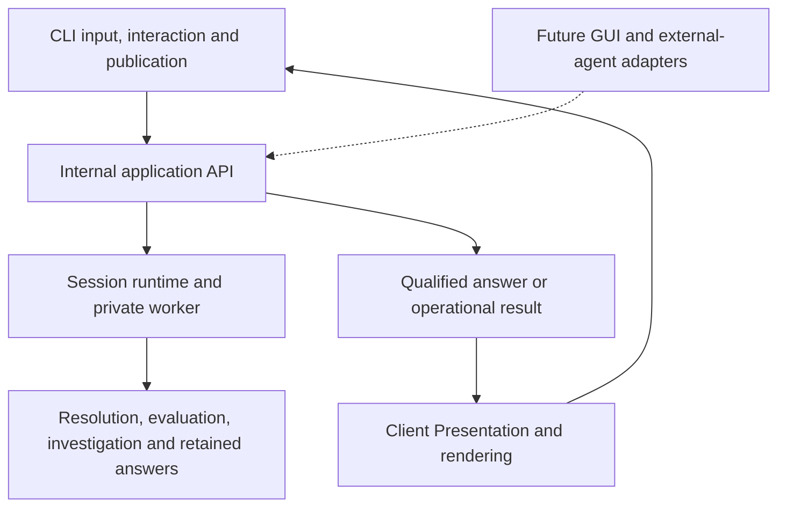

# Shared internal application API

Status: in preparation
Created: 2026-11-08
Updated: 2026-11-08
Superseded by:

## Purpose and intended outcome

PostCode's interfaces need to request investigations and use qualified answers without implementing application semantics or invoking a command parser. Establish an internal application API for the existing capabilities, and make the CLI a client. Interfaces own interaction, translation of their input, and presentation of supplied results. Shared application coordination owns request validation and resolution, evaluation, reuse, qualified answer selection, retention, references, operational attribution and lifecycle.

This is a bounded architectural extraction, not implementation of the future account, graphical or external-agent capabilities. Completion requires useful direct API use and preservation of the CLI, with no graphical caller or live inference prerequisite. The API remains an internal TypeScript boundary within this application; it is neither a public package nor a network/process protocol.

The [companion decision](../decisions/shared-application-api.md) and coordinated specification/constraint additions require human acceptance before implementation. The recommendations below are unresolved until that review. Implementation requires separate authorization after plan approval.

## Baseline and findings

Inspected baseline: `e9e4965d98aa7ab8c9c69469ea768141afce5c94` on 2026-11-08. Inspection covered source, existing tests, governing documents and descriptive architecture. It did not execute the application or establish passing runtime tests.

The existing architecture already separates most investigation semantics from the CLI. A wrapper around `runCli`, or simply renaming `openSession`, would leave important coupling; replacing the analysis core would discard useful boundaries.

| Existing boundary | Evidence at the baseline | Treatment |
| --- | --- | --- |
| Session-owned execution and retention | `src/lib/session.ts`: `openSession`, `requestExecutor`; `memory-store.ts`, `evaluation.ts`, `investigation/evaluation.ts` | Retain these responsibilities behind the application boundary. The CLI does not currently implement the investigator's evidence acquisition or acceptance. |
| Explicit Lens meaning, resolution and applicability | `requests.ts`, `request-catalog.ts`, `subject-resolution.ts`, `mechanical-implementations.ts` | Reuse shared definitions and qualified resolution; extract command aliases and CLI-shaped invocation fields. |
| Qualified content before presentation | `module-content.ts`, `organization/content.ts`, `dependencies/content.ts`, `investigation/content.ts`, `exports/content.ts`, `projection-content.ts` | Reuse the selected, fully qualified content contracts. They already preserve more information than bounded CLI JSON. Do not expose the store as the API. |
| Exact retained answers | `retained-presentation.ts`: `resolveRetainedContent`, `presentRetained`; `answer-references.ts`, `investigation/selection-record.ts` | Preserve fixed-support resolution, associated-inspection composites, frozen revision/association state and separate answer bindings. Split arrangement/rendering from this operation. |
| Presentation compatibility | `presentation-contracts.ts`, `request-catalog.ts` | Preserve declared requirements before evaluation, materialization checks and explicit fallbacks; remove terminal encoding as an application requirement. |
| Execution/resource ownership | `interactive-session.ts`, `session-worker.ts`, `session-protocol.ts`, `git-execution.ts`, `execution-errors.ts` | Retain the private worker and parent-owned Git, dialogue/usage and cleanup. They are infrastructure, not an external-agent interface. |
| Investigation domain and investigator access | `investigation/contracts.ts`, `execute.ts`, `acceptance.ts`, `evidence-access.ts` | Preserve bounded operations, atomic acceptance/corrections, evidence restrictions and usage. External callers do not become built-in Investigators. |
| Existing extension evidence | `test/lens-extensions.test.ts`, `test/exports-lens.test.ts` | Reuse the nonpublic interpretive and mechanical fixtures through the new boundary; do not add a speculative plugin system. |

Concrete coupling to remove or contain:

1. `ViewRequest` combines canonical Lens IDs with command aliases and the pseudo-Lens `usage`; subject designation uses `selector` plus flags. `captureRequest` recognizes only Unicode/JSON formats, and `captureCatalog` reserves CLI aliases. A new client should submit explicit semantic designations and request kinds, not imitate CLI input. Keep hostile/malformed input capture, explicit omitted fields and safe refusal behavior.
2. `session.ts` selects content, constructs Views and renders strings. It imports `renderMechanicalView`, `renderInvestigationView` and `renderRequestReport`. `interactive-session.ts` also rerenders after authoritative usage finalization. `ExecutedRequest` is inferred in the private worker protocol from this rendered result. Application results need an independently named contract, usable without these renderers.
3. `answer-presentation.ts` mixes structured continuations with shell command generation and shell-only lifetime guidance. `answer-references.ts` and `request-reporting.ts` embed CLI instructions in shared classification/reporting. Preserve reasons and available actions as data; let the CLI add its existing actionable wording.
4. `publishCommand` combines execution, validity checks, terminal output, exit codes, observation construction and displayed-result snapshots. Preserve checks in a shared lifecycle contract, while the CLI retains publication, output and exit policy. Required work attribution and final usage must remain available without observation construction.
5. `runCli` and `runShell` repeat runtime/output-exclusion setup. `configuredInvestigator` imports a credential factory from `auth-command.ts`; the cost-bearing connection check also lives there. Move reusable provider setup/check behavior behind neutral service boundaries; leave parsing, environment-variable interpretation, browser/sign-in interaction and terminal disclosure with the relevant adapter. Existing credential and OAuth services already carry most of this behavior.
6. `publishFeedback` combines report creation/submission with CLI acknowledgment, and calls back into `command-execution.ts`. Its `DisplayedResult` is an observation-batch snapshot. Extract the existing report/submission service and explicit supplied-context contract so another client need not call a terminal publisher. Preserve today's self-contained feedback protocol; this does not select a new observation format or implement the optional-recording backlog item.

File placement under `src/lib/` alone does not establish an interface-independent boundary. Conversely, presentational sorting, bounds, help, command eligibility and terminal escaping are legitimate interface responsibilities and need not move into the application.

## Scope and non-goals

Cover modules, project/repository organization, module/group/mixed inspection, dependency structure/parents/children, module summary, investigram inspection, explain/decompose/examine, exact retained presentation and usage. Preserve help, authentication, feedback, one-shot execution and the interactive shell as existing CLI facilities. Reuse existing provider and feedback services through narrow internal exports where needed; do not force project-independent operations into a project Session.

Do not add structured-account schemas, architectural subject kinds, diagram semantics, new Lenses, general search/retrieval, navigation-origin storage, managed Views/Workspaces, multi-Projection composition, persistence, live refresh, multi-session coordination, concurrent Session requests, an external-agent protocol, HTTP/MCP, public SDK packaging, new dependencies or a new research-recording mode. Do not remove the shell in this change. Preserving it now is not a commitment to retaining it indefinitely.

The internal exports Lens remains a validation fixture, not a new CLI capability. Existing known navigation-origin and captured-basis research-export gaps remain disclosed under their existing backlog entries; this extraction neither closes nor enlarges them.

## Boundary and contracts

[Needs review: accept the qualified-content boundary and runtime/lifecycle recommendations in the companion decision.]

The arrow from application to result supplies data, not a call into a renderer. Presentations may be shared by clients with compatible consumption contracts. They remain independently callable from supplied content, with no analysis, store enumeration or filesystem access.

### Entry points and ownership

Create a small intended entry point under `src/lib/application/`, with named request, result and lifecycle contracts. Keep existing core modules where they already form coherent responsibilities; no repository-wide directory migration is required. Production interfaces import this boundary and their Presentation modules, not Session internals, the store, compiler integration or worker protocol.

The default application Session uses the existing worker-backed execution owner. Opening accepts an explicit project/configuration, known generated-output exclusions and configured investigation dependencies/bounds. Snapshot options and catalog definitions. The API does not read argv, stdin, terminal properties or CLI environment variables, install process signal handlers, select an observation directory or print hosted-service notices. The CLI converts its defaults/environment into explicit options and communicates the existing transmission disclosure. Reusable provider setup retains intentional enablement, explicit billing route, preflight failure and no-fallback rules.

The trusted internal configuration/investigator injection seam remains available to offline tests and controlled assessment. It does not become a general agent-facing escape hatch. Production credentials remain parent-owned and outside returned application content, the compiler worker, observations and investigator context.

### Request and result surface

The following describes contract responsibilities, not a frozen method-name or serialization design:

| Operation | Input | Output and invariant |
| --- | --- | --- |
| Inspect available capabilities | Session's captured Lens and supported result/Presentation declarations | Read-only descriptions of question, applicability, cardinality, parameters and supported contracts. No new applicability claims about a particular subject, ranking or investigation. Return only useful capability metadata, not executable registrations or provider secrets. |
| Request information | Canonical Lens ID, explicit `SubjectDesignation`, semantic parameters and declared information/Presentation requirements | Qualified answer delivery or self-contained resolution result; invocation context remains separate from answer identity. No alias parsing or implicit `usage` Lens. |
| Obtain exact retained answer for presentation | Precise Projection ID or same-Session bound answer reference, compatible declared presentation needs | Fixed selected content and support, including both halves of associated inspection. No subject lookup, current selection, evaluation, inference or evidence acquisition. |
| Report usage | Explicit subjectless report request | Authoritative attempt/Session usage and its limitations; no fabricated Projection. |
| Check, interrupt and close | Session/lifecycle operation | Typed invalidation/interruption/cleanup outcomes with current work and usage still reportable. Terminal interruption and one active operation remain in force. |
| Obtain compact bindings where needed | Explicit IDs/kinds from a supplied answer's authorized reference population | Only append-only bindings; no query, retrieval, evaluation or expansion of that population. Precise IDs remain sufficient for a direct caller. |

Application results are a discriminated union of answer delivery, resolution result and usage report. Reuse existing domain failure classes/distinctions rather than flattening them into strings or `success: false`. An answer delivery contains the exact answer identity, selected qualified family content, supporting references/bases, selection mode, applicable compatibility decisions, normalized request/resolution context, full work attribution and authoritative usage. It carries no rendered string, terminal width, stdout/stderr or exit code.

Use the current content-family union, with an explicit associated-inspection composite, rather than a universal graph/account schema. Selected content includes full currently materialized values and qualifications before presentation bounds; “complete” here means complete selected content, not exhaustive repository analysis, a complete program capture or complete interpretation. Do not expose a mutable store, arbitrary record lookup, compiler objects, agent dialogue or provider transport.

The delivered content is trusted internal material, potentially including captured source support. It is **not** a ready-made public JSON or external-agent export. Human adapters continue to use classified, intelligible Presentations; external evidence disclosure needs its own later access contract. Do not automatically serialize the application result into current CLI JSON or observation batches.

Capture caller input before asynchronous work; preserve existing rejection distinctions without invoking accessors. Clone/freeze at ownership boundaries as needed so caller mutation, worker transfer or later accumulation cannot change retained content or earlier returned reports. Prefer explicit exported types over `ReturnType` inference from a private transport implementation.

### Presentation planning without CLI ownership

Retain prospective result/Presentation compatibility, requirements before evaluation, validation of materialized content and explicit fallback decisions. Use a small static set of semantic requirement/compatibility descriptors derived from the existing catalog. A client can request the current supported qualified content without selecting Unicode or JSON. This is not permission to defer required expansions until rendering or to fetch whatever a renderer later wants.

Split format eligibility and concrete display options from the application's requirement descriptors. The CLI maps its supported Unicode/JSON choices to the relevant descriptors before requesting work and validates format-specific choices before evaluation. The shared descriptor/content compatibility rules still own materialization and supported detail; no copied Lens applicability, answer selection or fallback policy in the CLI. Preserve explicit choices in the combined invocation/presentation record.

Move current family arrangement/rendering into client-side Presentation modules, reusing the present functions. They own bounds, human disclosure, page arrangement, format, CLI continuation commands and output. Paging consumes the exact supplied revision/association listing; no live-history fallback is permitted. A well-formed unknown continuation remains a qualified failed presentation of that same answer; malformed input remains refusal. Current successful presentation of a retained failed answer remains distinct from its historical investigation failure.

Preserve the established CLI binding schedule. Fresh coordination continues its existing population allocations; arrangement requests only the bindings it currently requires, in its existing batches/order. Use the existing scoped binding concept through a private worker bridge when necessary, without passing a store or functions over structured clone. Separate binding preparation from synchronous pure arrangement. Do not preallocate every off-page reference merely to simplify transfer: that can change later collision lengths. A returned answer authorizes only its own reference population, and close/invalidation revokes operational use under the existing lifecycle. Test the ownership/binding boundary before migrating every family.

Move parent usage finalization to the unrendered delivery boundary. The parent owns final call snapshots; Presentation constructs its View/identity from the finalized values and explicit arrangement inputs, preserving idempotence and the existing family identity rules. Usage changes must never rewrite the retained answer or create an inference attempt for presentation.

### Publication, feedback and lifecycle

Direct requests validate before execution and before returning a successful result. A renderer may take time after delivery: interface publication must also validate immediately before output and after output under the existing best-effort contract. Provide a small shared publication guard or equivalent explicit API operation so adapters do not reproduce lifecycle policy. Do not expose `deferPublicationCheck` as the normal application API escape hatch. CLI mapping still emits existing messages and exit statuses, including post-output invalidation and interruption, and records the output actually emitted.

Opening, requesting cancellation, settling pending work, and confirming resource exit remain distinct. Keep Git ownership and final usage outside disposable compiler state. Close is awaited on normal completion, failed opening, interruption and exceptions; cleanup warnings remain separately reportable. No automatic Session restart, per-request recoverable cancellation or post-invalidation retained-read service is introduced. Already returned data can be held by the caller, but it does not restore live reference validity or a closed Session.

Keep current automatic CLI observation submission, destination disclosure, generated-output exclusions and failure behavior. The application API works without an observation sink; its operational context/attribution/usage never depends on recording. The CLI supplies actual presented artifacts/output to existing observation construction. It must not imply that internal source-bearing content was displayed.

Extract neutral feedback construction/submission and return delivery acknowledgment/failure as data; the CLI owns feedback input, acknowledgment wording and last-displayed-result tracking. Preserve exact supplied display snapshots, context-free submission without opening a project, missing-context limitations and failure isolation. Do not reconstruct history, query a live store, run an investigation or report success for a deliberately dropped submission. Reusing the existing batch representation internally during this extraction is acceptable; no generic event framework or new destination is needed.

## Preservation and governing impact

The foundational meanings of Lens, Projection, Presentation, View, Session, Investigram and Claim context do not change. No core-concepts or foundation revision is needed. The package adds an explicit application/client boundary to the specification and constraints, supplementing rather than superseding the existing semantic decisions.

Relevant binding decisions include [request semantics and compatibility](../decisions/lens-application-and-request-outcomes.md), [qualified answer/View identity](../decisions/qualified-construction-under-the-request-model.md), [exact retained answers](../decisions/exact-retained-answer-presentation.md), [precise subject resolution](../decisions/precise-subject-designations-and-lookup-bindings.md), [unordered collections](../decisions/unordered-collection-inspection.md), [investigation operations](../decisions/investigation-operations-and-lenses.md), [progressive interpretation and corrections](../decisions/investigrams-and-progressive-investigation.md), [execution ownership](../decisions/execution-ownership-and-cancellation.md), [generated-output exclusions](../decisions/generated-output-boundaries.md), [human output](../decisions/human-facing-architectural-representations.md) and the successor [research/operational reporting contracts](../decisions/research-question-driven-observation.md). Follow the existing supersession mappings; historical mandatory-recording clauses are not newly reintroduced.

Preserve CLI command eligibility, defaults, supported options, output meaning, bounds, qualification, guidance, continuation behavior, source disclosure, status codes and automatic recording. Preserve literal names versus precise references and one-shot expiry. Internal API shape can change, and incidental implementation moves do not require compatibility wrappers for private deep imports. This plan does not authorize semantic CLI output changes. If comparison reveals a consequential change in shape, identity inputs, allocation schedule or behavior beyond this extraction, return it for human agreement before accepting it. Advance responsible identity methods only when their actual semantics change, with an explicit comparison explanation.

Adoption of the new constraint would precede conformance. The identified coupling is remediated in this plan, not silently declared conforming or deferred to a GUI task. Existing independently backlogged limitations remain separate. The implementation updates descriptive architecture, internal API documentation/examples and affected conventions; it updates status/capability/CLI documents only where their descriptions actually change. It does not revise governing documents beyond approved revisions or change `dev/` instructions.

## Milestones and validation

### M1 — Establish one working application path

Inventory all production and test consumers of Session/request/worker results. Extract the public-internal types and semantic request normalization; move aliases and text-only guidance to the CLI. Implement capability metadata and one mechanical information request through the application facade, private worker, qualified content delivery and existing CLI Presentation. Establish explicit reference binding and parent usage/report finalization contracts. Preserve opening/exclusions/cleanup on this slice.

Verify direct use with no parser, renderer, terminal streams or observation sink; compare the CLI's result against its baseline. Exercise malformed input, caller mutation, missing/incompatible subjects and partial/empty content. Measure transferred content size and elapsed work on an existing repository fixture to identify accidental repeated full-content cloning. Do not optimize with a new cache or weaken support to meet an invented performance target.

This is the first intermediate review checkpoint: inspect dependency direction, full-content transfer, reference allocation and publication lifecycle before broad migration. A necessary contract or scope change returns to the human; a facade that still calls `runCli` or renders inside execution does not pass.

### M2 — Complete information and exact-answer operations

Migrate the remaining mechanical families, inspection composite, investigation requests/follow-ups, resolution results and usage to the same boundary. Reuse existing evaluation, constructors, fixed resolvers and investigator bridge. Move retained-target resolution before client arrangement, and preserve current fresh-versus-retained semantics. Exercise the existing nonpublic interpretive and exports Lens fixtures without adding special cases in the facade.

The direct API sequence must obtain modules, resolve a subject, investigate it using `ScriptedInvestigator`, follow an exact investigram, accumulate a correction/association, retrieve the earlier exact answer, and issue a new selection. Assert identity/support equality for the old answer and the deliberate differences for new selection, including conflicts and reconsideration snapshots. Inject only the agent communication participant; use real evaluation, evidence access, validation and retention.

### M3 — Complete CLI adaptation and operational services

Route both one-shot and shell entry paths through the application boundary. Consolidate setup without changing signal/EOF semantics. Extract reusable provider factory/connection-check and feedback submission responsibilities from terminal modules. Separate request/report data from rendering and current display snapshots from application execution. Keep the existing observation schema and feedback context unless a separately accepted change is necessary.

Verify preflight ordering, disabled/invalid provider setup, no billing fallback, authentication without project opening, explicit cost-bearing connection-check behavior using controlled transport, feedback with and without prior result, observation delivery failures, terminal escaping, source disclosure and all exit/status paths. Do not use real credentials or hosted inference for routine verification.

### M4 — Integrated verification and handoff

Run `npm run check` and `npm test` in the implementation worktree. Exercise a small direct API client and the CLI on the same deterministic fixture; record representative terminal/JSON output and semantic comparisons. Update architecture and API usage documentation with ownership, lifecycle and boundary examples. Inspect the final production dependency graph and remove obsolete forwarding/deep-import paths only when their consumers are migrated.

Prepare the normal integrated-review handoff and PR under the task/review workflows. The human arranges independent review and decides when the gate is sufficient. Do not mark implementation complete or merge solely because checks pass. Planning review and implementation authorization remain separate from this future gate.

### Acceptance matrix

| Concern | Meaningful evidence |
| --- | --- |
| Usable application boundary | Small direct caller imports only intended application types/entry points, obtains qualified structured data without format selection, traverses returned precise subject/answer references, reports usage and closes. No CLI imports transitively enter application execution; runtime/core may depend on neutral contracts and infrastructure. |
| All current questions | API/CLI parity for every current Lens and both organization scopes, mixed inspection, and nonpublic extension fixtures. Use shared reference-aware comparisons, preserving foreign references, literal strings, ordering, qualification and omissions. |
| Resolution versus answers | Ambiguous/missing/incomplete/unavailable lookup, incompatible bound subjects, invalid parameters and malformed values remain distinct from empty/partial/failed answers. Reports remain usable after return without store/history lookup. |
| Exact retained continuity | Intervening investigation, correction, association and materialization cannot change earlier answer content/support. Composite versus mechanical-only targets remain distinct. Spy/trap tests prove no lookup, selection, evaluation, inference or acquisition on retained reads; ordinary validity checks remain allowed. |
| Presentation behavior | Both formats, supported additional detail, association/revision paging, out-of-range pages, unknown/malformed tokens, fallback/refusal and continuations preserving all effective choices. Bounded JSON is never used to reconstruct another page. |
| Identity and references | Name/reference equivalent answers; distinct invocation/View identity where appropriate; retained aliases stable; existing fresh allocation schedules/collisions; no current-history allocation during exact reads; foreign/expired/wrong-kind targets never retarget. |
| Usage and qualification | Retained failure remains historically visible but successful presentation incurs no new failed investigation or usage. Parent finalization counts calls once across success, rejection, interruption and close. Full generating/prerequisite attribution survives without recording. |
| Lifetime and publication | Cancel during opening/work, worker exit, Git deadline/unconfirmed exit, close while pending, input change before and after delivery/output, and late replies. Pending work settles once, no late successful publication, cleanup remains owned and separately reported. |
| Output and feedback | Existing human-output and terminal-control tests pass; no new raw support exposure. Exact displayed context survives feedback without reconstruction; sink failure does not erase a result or block subsequent valid use. |
| Independent completion | All preceding checks run using present capabilities and offline fixtures. No GUI, account schema, external-agent server, persistent store or future navigation implementation is needed to accept the boundary. |

Start from the existing tests in `request-model`, `request-designation-input`, `subject-resolution`, `presentation-compatibility`, `answer-identity`, `retained-presentation`, `investigation-revisions`, `investigation-selection`, `lens-extensions`, `exports-lens`, `execution-ownership`, `session-inputs`, `output-boundary`, `source-disclosure`, `human-output`, `feedback`, `cli` and `shell`. Add focused boundary tests where the new API could plausibly bypass the established guarantees; do not merely assert wrappers delegate to each other. Existing tests must be migrated where they target a changed internal contract, not weakened to conceal behavior changes.

## Future-use assessment and independent completion

The exploratory examples informed these constraints; they are not tests that this extraction must make real:

| Later use | What this API preserves now | Work belonging to the later task |
| --- | --- | --- |
| Structured accounts and representative structural/state/interaction diagrams | Typed qualified content, precise referents, relationships with their support, interpretation/revision distinctions, extensible content-family handling | Account schemas, policy-kind/instance/state/execution-role subjects, relationship destinations and actual diagram-sufficient investigation. A renderer cannot infer missing temporal semantics. |
| Account presentation/navigation | Separate fresh information and exact answer access; fixed support, qualified follow-up subjects, complete selected content before display bounds | New presentations, controls, known answer/account-origin lineage and a representation for unavailable relationships. Existing investigation provenance is not general navigation history. |
| Minimal graphical selection and return to results | Capability descriptions, explicit designation, independently usable resolution candidates, asynchronous lifecycle and exact references | GUI runtime/transport, choice discoverability, view arrangement, history/back navigation and graphical disclosure. A Node worker API does not run directly in a browser. |
| External-agent requests and consultation | Same investigations and qualified results without terminal parsing, exact-versus-repeatable distinction, explicit Session lifetime | A bounded exposed operation set, transport, access/disclosure rules, contribution/provenance handling and any persistence. Calling the human CLI still uses its human-output contract. |

For example, reopening an earlier admission answer after a correction must remain different from selecting its replacement. Following a half-open state must preserve that future subject's meaning; this plan does not manufacture that subject from a prose label. An outer/inner composition account needs qualified analysis of order and ownership before a diagram can depict it. These examples motivate preserving semantic content and exact references without selecting a universal account model today.

Each later task may change this internal API during its own planning and implementation. This plan makes no compatibility promise that would require speculative fields, generic metadata bags or unused extension mechanisms now.

## Consequential choices for review

| Choice | Recommendation | Alternative and tradeoff |
| --- | --- | --- |
| Result boundary | Complete selected qualified content plus operational results; existing Presentations outside execution | Returning today's bounded View descriptors is a smaller change, but another interface inherits CLI bounds and human-output shaping or bypasses the API to recover missing content. |
| Runtime boundary | One worker-backed application facade; direct core Session remains an internal implementation/test seam | Exposing multiple execution backends now increases public-internal lifecycle obligations without a current client need. A single synchronous in-process facade loses established interruption behavior. |
| Presentation requirements | Extract existing compatibility/expansion declarations, separating encoding from semantic requirements | A generic Presentation plugin language or a new universal query schema increases scope; ignoring requirements changes materialization and refusal semantics. |
| Operational facilities | Extract neutral provider/feedback services only where CLI currently owns reusable behavior; preserve CLI observation policy | Leaving them callable only via terminal handlers retains avoidable coupling. Broad research/feedback redesign is independent work. |
| Compatibility and future scope | Preserve existing CLI behavior; allow internal contract evolution; no future capability prerequisite | Freezing a public API or delivering future account/GUI features now would enlarge both scope and verification. |

The human resolves these choices before promotion/implementation. The first milestone resolves mechanical signature/file-layout details within the accepted boundary; it does not authorize changing the decisions. Principal risks are accidental disclosure of raw support, altered reference-binding schedules, excessive worker payload copying, misreporting retained failures/current usage, and loss of publication checks when rendering moves. The acceptance matrix targets each risk.
