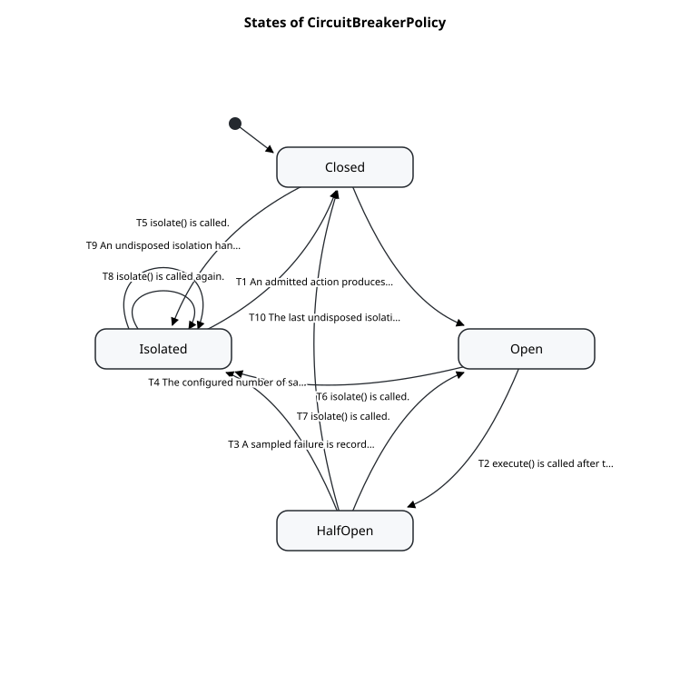

# Cockatiel book-model example

This walkthrough of the [reference-book model](model.md) assumes these architectural
investigations are available:

- **Investigate architectural concept**, covering state-dependent behavior,
  responsibility and interaction, with a state-diagram result requirement where indicated.
- **Entity-overview**, for introductory treatments of entities and surrounding context.
- **Explain**, for focused treatment of selected content, such as a state transition.

It also uses the module inventory as available architectural context, and the model’s
page-composition and book organization investigations to frame and connect treatments.

The walkthrough combines outputs retained from actual investigations using PostCode’s
earlier investigation mechanisms with hypothetical book investigation content authored
for this example.

## Evidence and authored additions

The principal specimens concern Cockatiel
`80b5ed67966dfcc5410a912285fcb3eeb2dc5e5e`:

| Evidence | What is available |
| --- | --- |
| [Fresh CircuitBreakerPolicy state account](../../records/validation/structured-architectural-accounts/m2-trials/circuit-breaker-policy-fresh.txt) and [diagram](../../records/validation/structured-architectural-accounts/m2-trials/circuit-breaker-policy-fresh.svg) | An actual generated four-state model, ten transitions and qualifications. |
| [Breaker-implementation account](../../records/validation/structured-architectural-accounts/m2-trials/follow-up-breaker.txt) and [diagram](../../records/validation/structured-architectural-accounts/m2-trials/follow-up-breaker.svg) | An actual generated abstraction of the opening criteria in three breaker implementations. |
| [M2 trial record](../../records/validation/structured-architectural-accounts/m2-trials/README.md) | Production context, fresh investigation and supersession, and validation limits. |
| [M4 live follow-up record](../../records/validation/structured-architectural-accounts/m4-option-context-authoring.md) | A broader HalfOpen diagram follow-up that timed out, and a narrower stale-sample prose follow-up that succeeded. Their complete answer bodies are not reproduced in the record. |

The committed `.txt` specimens are **renderings of state models, not complete
explanatory responses**. The operation already asks for explanatory prose, and
live records document model-plus-prose answers. The particular original prose
needed for this exercise is not available in the preserved specimen.

Titles, orientation, tag assignments, book relationships and guidance below are
authored illustrations.

The [authored journey](../initial-journey/cockatiel-account-examples.md) motivates
concurrency and neighboring concerns. It concerns the older revision
`f48bea55022ab15ab07eb52a79bfc1e661300fd4` and default single-trial recovery. Its
conclusions are not imported into the newer configurable-sampling specimen.

## Underlying investigation

This page explains the circuit-breaker policy’s state-dependent behavior.

The underlying investigation is **Investigate architectural concept**, with parameters
`concept: state-behavior` and `with-diagram: true`, applied to the
`circuit-breaker-policy` module as its subject.

The retained specimen was produced by the earlier `state-behavior` operation with a
state-diagram requirement. This illustration uses that retained account as the answer
to the hypothetical architectural-concept investigation. Mapping that investigation’s
parameters to an operation and result contract remains an implementation decision.

The module is the actual subject; the state bearer identified by the account is
a policy instance. The architectural investigation covers recovery, manual isolation
and qualified initialization/serialization information.

Page and tag names below are descriptive labels.

## Inputs and surrounding organization

Alongside the underlying result, suppose page composition receives the following guidance:

| Illustrative underlying output | Meaning and source connection |
| --- | --- |
| Response title | “Circuit-breaker policy states and transitions.” |
| Related material: breaker criteria | Reference the retained breaker-implementation account; it explains the criterion used in Closed/T1. |
| Follow-up: sample completions after isolation | Ask what happens when an already-admitted HalfOpen call completes after manual isolation. Source selection: the HalfOpen → Isolated transition, rendered as T7. |
| Follow-up: concurrent callers during recovery | Investigate sampled executions, waiting callers and their shared decision. Source selection: HalfOpen and its concurrency limitation. |

Source selections identify one or more parts of the reply to which the offered material
connects. The follow-up request separately identifies its investigation subject and input
context. T7 and similar labels refer to the rendered diagram.

The follow-up examples are informed by the live trials. In the M4 trial, the narrower
option used `transition:half_isolated` and the broader option used `state:half_open`
as selectors within that trial’s model.

### Request to book organization

Suppose this is the first page and no adequate organization exists. Page composition
passes the architectural result and an explanation of the need: situate the policy
state account alongside the purpose of circuit breaking and other relevant
architectural treatments, with appropriate tags.

Organization could obtain entity overviews using the module inventory as a stable
starting point, following the result's referents or requesting wider overviews.
Those overviews can offer relevant architectural investigations. Organization may
create useful page identities before obtaining their full accounts.

One hypothetical organizing result is:

| Page label | Underlying investigation | Available material in this exercise |
| --- | --- | --- |
| Circuit-breaker policy states and transitions | Investigate architectural concept: `state-behavior`, `with-diagram: true`; subject: the policy module | Retained model and diagram from the earlier `state-behavior` operation; full original prose unavailable here. |
| Circuit breaking and its participating responsibilities | Investigate architectural concept: responsibility; subject: the policy and its collaborators | Illustrative investigation and PageComposition object; no generated account supplied. |
| State-dependent control of execution | Investigate architectural concept: `state-behavior`; subject: the relevant Cockatiel execution-control mechanisms | Illustrative broader investigation and PageComposition object; no generated account supplied. |
| Breaker failure criteria | The existing investigation behind the retained breaker-implementation account | Actual model and diagram. |
| Concurrent callers during recovery | Investigate architectural concept: interaction; subject: participants in HalfOpen recovery, as offered above | Illustrative destination; no full interaction account supplied. |

### Tags and graph relationships

The organization investigation could create or reuse `BookOrganizationTag` objects
with these qualified names and descriptions:

| Tag name | Meaning | Example assignments |
| --- | --- | --- |
| Failure handling | Treatments of how failures affect the admission and handling of work | Policy states, circuit-breaking responsibilities, breaker criteria. |
| State-dependent behavior | Treatments of persistent modes and their effects on execution | Policy states, state-dependent control, concurrent recovery. |
| Concurrent execution | Treatments of coordination among overlapping calls | Concurrent recovery. |

Initial graph relationships could be:

| Broader PageComposition → narrower PageComposition | Applicable tag |
| --- | --- |
| Circuit-breaking responsibilities → policy states | Failure handling |
| State-dependent control → policy states | State-dependent behavior |

## Composed page: six component roles

The following six components show how page composition frames the policy’s state
account, adds context and connects it to further treatments.

### Title

**Page title:** Circuit-breaker policy states and transitions.

Page composition reuses the illustrative response title.

### Orientation

> This treatment explains how a circuit-breaker policy's modes govern execution,
> including automatic recovery and manual isolation. Its state belongs to a policy
> instance. The criterion for opening is delegated to a configured breaker;
> individual calls have their own progress, which this state account summarizes
> only through their aggregate effect on the policy.

This is authored page-composition text derived from the actual state account's
applicability, Closed/T1, Isolated and concurrency limitation. The retained breaker
account supports the distinction between outcome-history criteria and the circuit
modes supplied by the caller.

Page composition could also draw on the broader treatments once their accounts are available.

### Main content

This illustrates the common case of one current value supplying a substantive answer:
page composition presents its explanatory content directly, including the structured state
model and original prose. The following paragraphs are an authored stand-in for the
unavailable original prose, based on the retained model:

> In Closed, the policy admits work and reports its outcome to the configured
> breaker. When that breaker's failure criterion calls for opening, the policy
> enters Open and records a recovery delay.
>
> Elapsed time makes a recovery attempt eligible. The transition to HalfOpen shown
> in this account happens when a subsequent execution request arrives after the
> delay. That request joins a bounded recovery sample.
>
> Sampled failures can reopen the policy. If the configured sample completes,
> no sampled call remains in flight, and the failure limit has not already caused
> reopening, the policy returns to Closed.
>
> Manual isolation puts the policy in Isolated, where calls are rejected.
> Outstanding isolation handles keep it there; releasing the final handle returns
> an Isolated policy to Closed. Construction ordinarily starts in Closed, but
> supplying saved state takes a separately qualified initialization path.

The source selections are Closed/T1, Open/T2, HalfOpen/T3–T4, Isolated/T5–T10 and
the entry qualification.

#### Actual generated diagram

The main treatment includes the retained model and this actual generated picture:

Its scope is the four policy modes, including manual isolation, not the progress
of individual calls. The account claims four states and ten transitions while
qualifying concurrent behavior, hydration, serialization and malformed restored
state. Those qualifications remain attached to the picture.

Some diagram labels are truncated; the [retained account](../../records/validation/structured-architectural-accounts/m2-trials/circuit-breaker-policy-fresh.txt)
provides the full transition text.

#### Available transition and initialization detail

These are selections from the same main account:

| Source selection | Paraphrase of detail supplied by the actual account |
| --- | --- |
| T2: Open → HalfOpen | An execution request after the backoff creates fresh sample counters and a shared deferred decision, increments the attempt number, emits the half-open/state-change notifications and admits that request into the sample. |
| T3: HalfOpen → Open | A sampled failure reopens the policy when recorded failures are strictly greater than the configured threshold multiplied by the sample-call count. Backoff advances and calls waiting on the sample decision are resolved. |
| T4: HalfOpen → Closed | The configured sample has completed, no sampled call remains in flight, and the failure limit has not already caused reopening. Waiting calls are resolved. |
| Isolated and T5–T10 | Isolation handles retain manual isolation; additional isolation increments their count. Disposing the final handle returns an Isolated policy to Closed; intermediate disposal does not release other handles' isolation. |
| Entry and saved state | Without a truthy initial-state option, construction starts in Closed; otherwise it hydrates the supplied state. Hydration is an alternate entry, not a runtime transition. HalfOpen serializes as Open. Malformed restored data is outside the established model. |

Resolving the sample decision does not by itself establish every waiting caller's
subsequent execution outcome. That requires further investigation.

### Additional detail

The example selects the offered sample-completion clarification as additional
detail on this page, supplied by an explain investigation of the transition rendered
as T7. It explains what happens when an already-admitted HalfOpen call completes
after the policy has been manually isolated.

The source selection is the transition rendered as T7. The requested material is
a focused explanation of that transition's consequences. Page composition selects this
offered follow-up as additional detail alongside the main account.

The [M4 record](../../records/validation/structured-architectural-accounts/m4-option-context-authoring.md)
demonstrates a similar actual `clarify_stale_samples` option on its own
`transition:half_isolated` subject, with the original explanation supplied as
additional context. Its invocation produced an accepted prose answer in about
43 seconds. The full answer is not preserved in that record, so this example
leaves the follow-up’s answer unfilled.

### Broader-context links

Page composition selects the two illustrative broader treatments from the organization:

| Destination | Why it provides broader context | Relationship tag |
| --- | --- | --- |
| Circuit breaking and its participating responsibilities | Situate policy modes alongside the failure criterion and execution-facing responsibilities. | Failure handling |
| State-dependent control of execution | Situate this policy within a wider account of persistent control state and execution attempts. | State-dependent behavior |

### See-also links

#### Failure criteria in the breaker implementations

**Connection:** The policy delegates its opening decision to a configured breaker.
The [retained breaker account](../../records/validation/structured-architectural-accounts/m2-trials/follow-up-breaker.txt)
describes outcome-history criteria across ConsecutiveBreaker, CountBreaker and
SamplingBreaker. Its state categories differ from the caller's circuit modes.

**Destination:** the PageComposition for the existing investigation behind that
account. It has actual model and [diagram](../../records/validation/structured-architectural-accounts/m2-trials/follow-up-breaker.svg)
material available. The connection comes from the two accounts and the candidate
related-material reference. The destination's common abstraction is not a singleton state machine,
and its unknown common entry and other limitations remain attached.

#### Concurrent callers during recovery

**Destination investigation:** investigate architectural concept, with interaction
as the concept and the participants in HalfOpen recovery as the subject. The treatment
would explain sampled executions, other callers and their shared decision under an
explicit sampling configuration.

**Connection:** The main state account summarizes aggregate policy changes and
explicitly omits individual caller progress. The illustrative follow-up addresses
interactions among participants, so page composition places it on its own page rather
than treating it as focused additional detail about T7. Its intended account could
include an interaction picture if supported by the investigation contract.

This destination has no supplied full account here. The
[revised-selector trial](../../records/validation/structured-architectural-accounts/m2-trials/revised-selector-verification.md)
completed an actual HalfOpen follow-up about concurrency and returned a model and
prose, but does not preserve their full bodies for this exercise. Separately, the
[M4 trial](../../records/validation/structured-architectural-accounts/m4-option-context-authoring.md)
records a broader diagram follow-up that timed out during repair after about
181 seconds.

A breaker/bulkhead-composition investigation is another possible connection,
motivated by the older authored journey. It is not selected here and has no
same-basis generated answer in this exercise.

## Superseded and multiple answers

The main specimen's fresh answer superseded an earlier designation with grounds
of confirmation and refinement. Its historical predecessor is not a second current
value requiring synthesis.

The [review-elicitation trials](../../records/validation/structured-architectural-accounts/m2-trials/review-elicitation.md)
separately demonstrated multiple standing answer values, including a new explanation
reusing an unchanged model. For that case the model requires interpretation
of the current values into a unified treatment, combining complementary material
or preserving alternatives and unresolved relationships.

## What the walkthrough illustrates

- A state account and diagram become the main treatment of a page, framed by a
  title, orientation and surrounding book context.
- The T7 clarification supplies additional detail on that page, while concurrent
  recovery and breaker criteria have their own pages.
- Tags and broader-than relationships connect the policy account to wider treatments.
- The live trials illustrate both successful follow-ups and the delays or failures
  that readers may encounter.
