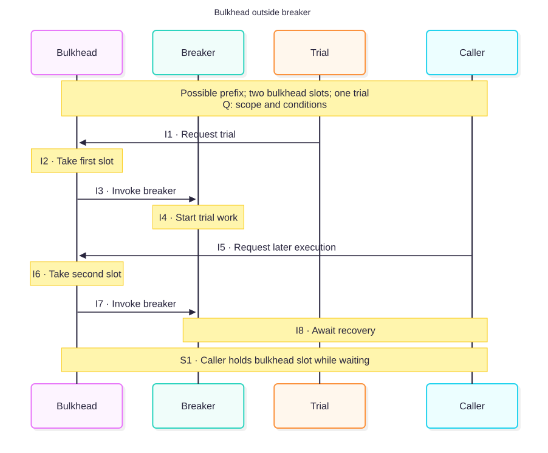
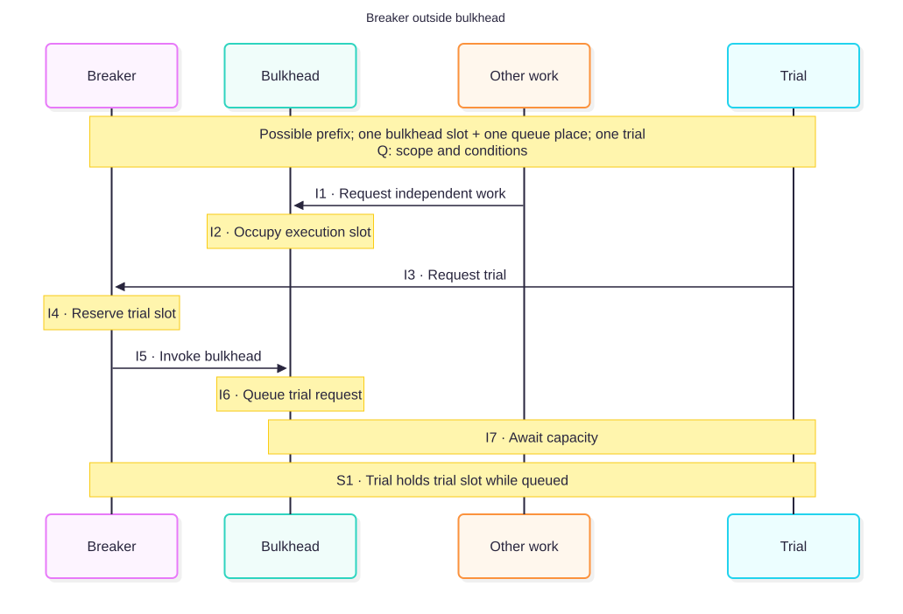

# Cockatiel composition: where a wrapped execution waits

Exploratory, non-governing examples. Extracted 2026-11-23 from the authored
structured-account composition probe of 2026-11-12. These are possible usage
scenarios interpreted from pinned source, not observed application objects,
runtime traces or live PostCode investigation results. Source claims and external
references are preserved from that exploration, not independently reverified here.
The old protocol fixtures and checkers remain in Git history.

The question is: **in either wrapping order, what can be waiting, whose state is
Half-open, and which capacity is occupied?**

| Order | Explicit setup | Waiting point |
| --- | --- | --- |
| Bulkhead outside breaker | Two bulkhead execution slots; the first execution is a pending breaker trial and a later caller takes the second slot. | The later caller holds bulkhead execution capacity while awaiting the breaker recovery decision. |
| Breaker outside bulkhead | One execution slot and one queue place; independent bulkhead-only work occupies the execution slot before a breaker trial arrives. | The trial holds the breaker trial slot while queued for bulkhead execution capacity. |

These are not the same workload with order swapped, predictions of every invocation,
or a performance comparison. With only one bulkhead slot in the first case, the later
caller would instead stop at the outer bulkhead. The second case requires the explicitly
shared bulkhead and independent occupant; reversing the first diagram would not
establish that scenario.

## Q — Shared scope and qualifications

The diagrams are overviews. Their legends, scenario setups and these qualifications
are part of the explanation; a short label does not remove a condition.

- Basis: Cockatiel revision `f48bea55022ab15ab07eb52a79bfc1e661300fd4`.
- Default single-call breaker recovery with zero permitted counted failures.
- No cancellation, isolation, restoration, reentrant execution from event listeners,
  other interfering state change or arrivals beyond the stated setup.
- Each case is a finite possible execution prefix stopping while occupancy persists.
  No completion, fairness, delay bound, deadlock or eventual-admission claim is made.
- Application work is distinct from the inner policy operation: a policy operation
  can have started while application work has not.
- Roles are bound separately within each scenario. Equal role names across diagrams
  do not identify the same object. Half-open is a shared state category, borne by
  the particular breaker role at the indicated situation.
- Situation snapshots are partial: absent entries are unspecified, not zero or false.

## Source basis and reading the legends

The original static inspection concerned these mechanisms. E-keys below are local
source labels, not Entity IDs or independent architectural claims:

| Key | Pinned source and relevant mechanism |
| --- | --- |
| E-policy | [Policy.ts](https://github.com/connor4312/cockatiel/blob/f48bea55022ab15ab07eb52a79bfc1e661300fd4/src/Policy.ts): `wrap`, ordered invocation of existing policy instances. |
| E-bulkhead | [BulkheadPolicy.ts](https://github.com/connor4312/cockatiel/blob/f48bea55022ab15ab07eb52a79bfc1e661300fd4/src/BulkheadPolicy.ts): execution/dequeue, active reservation across awaited inner work, pending queue and release. |
| E-admission | [CircuitBreakerPolicy.ts](https://github.com/connor4312/cockatiel/blob/f48bea55022ab15ab07eb52a79bfc1e661300fd4/src/CircuitBreakerPolicy.ts): `execute`, admission and recovery. |
| E-half-open | Same breaker source: `executeHalfOpen`, trial reservation and waiting for its decision. |
| E-default | Same breaker source: `createHalfOpenSamplingOptions`, default recovery sampling. |

The scenarios combine these mechanisms through authored interpretation. Earlier
exploratory accounts informed that interpretation; they were not independent
repository corroboration. The pictures are **sequence diagrams** for interaction /
trace-oriented behavior, following the reference category in
[architectural concept references](initial-journey/architectural-concept-references.md#interaction).
The resource snapshots are additional asserted meaning, not standard sequence notation
or occupancy calculated by a renderer.

I-keys identify steps within each diagram. The causal-support column records the
original explicit links, not sufficient or exclusive causes; “not asserted” does not
mean no cause exists. Diagram position alone does not assert causation. S1 identifies
that diagram's situation after its last step, not a shared situation across cases.

## Bulkhead outside breaker

Bulkhead capacity is two execution slots, initially empty; queue capacity is
irrelevant to this prefix. The breaker starts Open with recovery delay elapsed.
First application work stays pending until the later caller reaches the breaker.

[Mermaid source](cockatiel-composition/bulkhead-outside.mmd). [Shared qualifications](#scope).

### Participants

| On diagram | Full label | Designation |
| --- | --- | --- |
| Bulkhead | Outer bulkhead | local role bulkhead |
| Breaker | Inner breaker | local role breaker |
| Trial | First trial execution | local role trial |
| Caller | Later execution | local role caller |

### Interaction legend

The causal-support column preserves the exploration’s explicit links. It does not assert that a cause is sufficient or exclusive.

| Key | Short label | Full meaning / condition | Causal support | Evidence |
| --- | --- | --- | --- | --- |
| I1 | Request trial | Request through the outer bulkhead | Not asserted | E-policy |
| I2 | Take first slot | Reserve one of two execution slots | I1 | E-bulkhead |
| I3 | Invoke breaker | Invoke the inner breaker | I2 | E-policy |
| I4 | Start trial work | Enter Half-open, reserve its sole trial slot and start first application work | I3 | E-admission, E-half-open, E-default |
| I5 | Request later execution | A later execution requests the same outer bulkhead | Not asserted | E-policy |
| I6 | Take second slot | Reserve the remaining execution slot | I5 | E-bulkhead |
| I7 | Invoke breaker | Invoke the same inner breaker for the later execution | I6 | E-policy |
| I8 | Await recovery | Later execution awaits recovery; its application work has not started Condition: First trial still occupies the sole trial slot on arrival. Relationship: local relation recovery-wait. | I7, I4 | E-half-open |

### S1 — Caller holds bulkhead slot while waiting

Asserted after I8. Partial snapshot: absent entries are unspecified, not zero or false.

- State: local role breaker has category Half-open.

| Holder | Resource owner | Resource | Amount |
| --- | --- | --- | --- |
| local role trial | local role bulkhead | Execution slot | 1 |
| local role caller | local role bulkhead | Execution slot | 1 |
| local role trial | local role breaker | Recovery trial slot | 1 |

- Application work: local role caller — not-started.
- Active relations: local relation recovery-wait.
- Evidence: E-policy, E-bulkhead, E-half-open.

### Local relationships

- **recovery-wait** (waits-for-decision): local role caller → local role breaker. Condition: First trial still pending in Half-open. Evidence: E-half-open.

Composite policy order: local role bulkhead → local role breaker.

## Breaker outside bulkhead

Bulkhead capacity is one execution slot and one queue place, both initially empty.
Independent work takes the execution slot and remains pending through the final
waiting point. That work uses the bulkhead directly and does not pass through this
breaker. The breaker independently starts Open with recovery delay elapsed.

[Mermaid source](cockatiel-composition/breaker-outside.mmd). [Shared qualifications](#scope).

### Participants

| On diagram | Full label | Designation |
| --- | --- | --- |
| Breaker | Outer breaker | local role breaker |
| Bulkhead | Inner shared bulkhead | local role bulkhead |
| Other work | Bulkhead-only execution | local role occupant |
| Trial | Recovery trial execution | local role trial |

### Interaction legend

The causal-support column preserves the exploration’s explicit links. It does not assert that a cause is sufficient or exclusive.

| Key | Short label | Full meaning / condition | Causal support | Evidence |
| --- | --- | --- | --- | --- |
| I1 | Request independent work | Independent work uses the shared bulkhead directly | Not asserted | E-bulkhead |
| I2 | Occupy execution slot | Occupy the sole execution slot with still-pending independent work | I1 | E-bulkhead |
| I3 | Request trial | Request the outer breaker after its recovery delay | Not asserted | E-policy, E-admission |
| I4 | Reserve trial slot | Enter Half-open and reserve the sole trial slot | I3 | E-admission, E-half-open, E-default |
| I5 | Invoke bulkhead | Invoke the inner bulkhead as the trial operation | I4 | E-policy, E-half-open |
| I6 | Queue trial request | No execution slot is free; retain the trial request in the available queue slot | I5, I2 | E-bulkhead |
| I7 | Await capacity | Trial awaits bulkhead execution capacity; its application work has not started Condition: Independent work is still pending and no capacity has been released. Relationship: local relation capacity-wait. | I6, I4 | E-policy, E-bulkhead, E-half-open |

### S1 — Trial holds trial slot while queued

Asserted after I7. Partial snapshot: absent entries are unspecified, not zero or false.

- State: local role breaker has category Half-open.

| Holder | Resource owner | Resource | Amount |
| --- | --- | --- | --- |
| local role occupant | local role bulkhead | Execution slot | 1 |
| local role trial | local role bulkhead | Queue place | 1 |
| local role trial | local role breaker | Recovery trial slot | 1 |

- Application work: local role trial — not-started.
- Active relations: local relation capacity-wait.
- Evidence: E-policy, E-bulkhead, E-half-open.

### Local relationships

- **capacity-wait** (waits-for-capacity): local role trial → local role bulkhead. Condition: Bulkhead full with queue room for this execution. Evidence: E-bulkhead.

Composite policy order: local role breaker → local role bulkhead. The independent bulkhead-only execution is outside that path.

## What remains useful to investigate

The examples motivate the existing [composition and interaction backlog](../docs/backlog.md).
They do not prescribe the implemented content schema or prove support for these
interaction diagrams in the application.

- Local roles, waits and situation designations suffice for these two explanations.
  That does not establish that shared relationship identities or contextual Entities
  will never be useful. A general “waiting for recovery” relationship would need its
  own qualified account, not a renamed occurrence from one scenario.
- Resource ownership, occupancy and whether application work has started must be
  asserted content. An arrow sequence cannot supply those meanings on its own.
  Whether situations belong inside interactions or in a separate content type remains
  a useful question when another consumer needs the same information.
- Both traces describe entering Half-open in text and assert its later state. They
  do not supply a structured transition model with identified guards and effects.
  A renderer cannot infer a statechart from the snapshots. A general recovery model
  or a scenario-specific state model would require additional qualified analysis.
- Further investigation of a selected wait could test local addressing and how a
  later account reuses or introduces a shared identity. No end-to-end demonstration
  of that capability is claimed by these authored examples.

The retained SVGs and Mermaid sources are unchanged overview artifacts from the
exploration. Their qualified legends are preserved here; they are not current
application renderer output or executable protocol fixtures.
