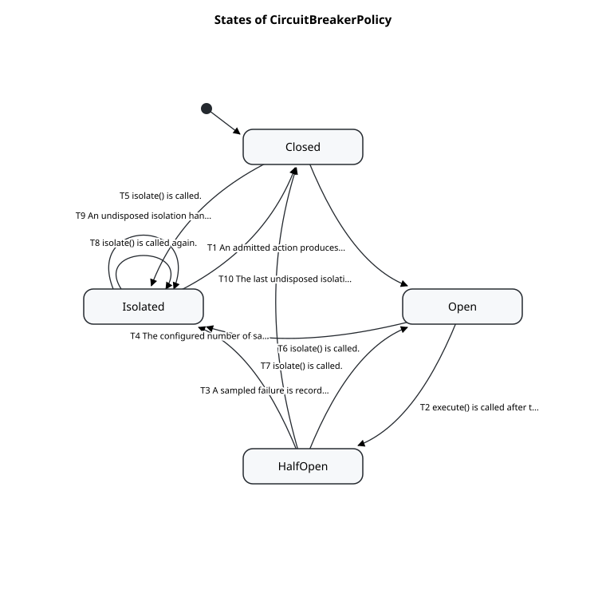

# Cockatiel page-composition exercise

Started: 2026-11-21. Revised: 2026-11-23 to conform to the
[reference-book proposal](investigation-pages-proposal.md).

This is an authored walkthrough of the proposed information model using actual
retained outputs. It is not a generated book, an implementation plan, a UI design
or a new live investigation. The investigation methods and detailed presentation
remain outside this exercise.

## Evidence and authored additions

The principal specimens concern Cockatiel
`80b5ed67966dfcc5410a912285fcb3eeb2dc5e5e`:

| Evidence | What is available |
| --- | --- |
| [Fresh CircuitBreakerPolicy state account](../records/validation/structured-architectural-accounts/m2-trials/circuit-breaker-policy-fresh.txt) and [diagram](../records/validation/structured-architectural-accounts/m2-trials/circuit-breaker-policy-fresh.svg) | An actual generated four-state model, ten transitions and qualifications. |
| [Breaker-implementation account](../records/validation/structured-architectural-accounts/m2-trials/follow-up-breaker.txt) and [diagram](../records/validation/structured-architectural-accounts/m2-trials/follow-up-breaker.svg) | An actual generated abstraction of the opening criteria in three breaker implementations. |
| [M2 trial record](../records/validation/structured-architectural-accounts/m2-trials/README.md) | Production context, fresh investigation and supersession, and validation limits. |
| [M4 live follow-up record](../records/validation/structured-architectural-accounts/m4-option-context-authoring.md) | A broader HalfOpen diagram follow-up that timed out, and a narrower stale-sample prose follow-up that succeeded. Their complete answer bodies are not reproduced in the record. |

The committed `.txt` specimens are **renderings of state models, not complete
explanatory responses**. The operation already asks for explanatory prose, and
live records document model-plus-prose answers. The particular original prose
needed for this exercise is not available in the preserved specimen. Its absence
is not evidence that the generated prose was inadequate.

Titles, orientation, tag assignments, book relationships and proposed guidance
below are authored illustrations. They are not outputs retained from a book
organization or page-composition investigation. The new prose is distinguished
from the actual generated models and diagrams. No live inference was run, and
none of these artifacts independently proves the software's behavior.

The [authored journey](initial-journey/cockatiel-account-examples.md) motivates
concurrency and neighboring concerns. It concerns the older revision
`f48bea55022ab15ab07eb52a79bfc1e661300fd4` and default single-trial recovery. Its
conclusions are not imported into the newer configurable-sampling specimen.

## Underlying investigation and page identity

The underlying investigation is **`state-behavior` on the
`circuit-breaker-policy` module**, with a state-diagram requirement:

> Explain this circuit-breaker policy's state-dependent behavior.

The quoted question describes the recorded operation; it is not an arbitrary prose
request defining page identity. The proposed book catalogue could express this as
*investigate architectural concept* on the same policy module, with parameters
`concept: state-dependent behavior` and `with-diagram: true`, requiring a state diagram. These
are illustrative catalogue parameters; their mapping to an operation and result
contract belongs to INVEST. The retained trial's request remains unchanged.

The module is the actual subject; the state bearer identified by the account is
a policy instance. The question covers recovery, manual isolation and qualified
initialization/serialization information. A recovery-only title would not change
that underlying scope.

The proposed `PageComposition` identity is determined by this investigation.
It remains the same when another response or composition is supplied. The fresh
account superseded an earlier designation in the recorded trial; those two
responses are not two page identities or two equally standing current answers.

The underlying investigation could be registered without evaluation, allowing its
PageComposition object to exist before an answer or page components are produced.
The page-composition investigation supplies qualified associations to that object
through investigrams. The page-composition Lens uses that investigation and selects
its results into a Projection; presenting that Projection gives the book-style View.
An earlier Projection retains its exact selections when subsequent associations change.

All page and tag names below are descriptive labels, not runtime identifiers.
Exact investigation, content and association references would be needed in an
implementation; matching these labels does not establish identity.

## Inputs and surrounding organization

Composition receives the underlying result and available guidance. It can consult
existing book material, but does not independently investigate the software or
invent requests for additional detail. The following guidance is **authored for the
exercise**; its presence on the fresh specimen is not established by the preserved outputs:

| Proposed underlying output | Meaning and source connection |
| --- | --- |
| Response title | “Circuit-breaker policy states and transitions.” |
| Related material: breaker criteria | Reference the retained breaker-implementation account; it explains the criterion used in Closed/T1. |
| Follow-up: sample completions after isolation | Ask what happens when an already-admitted HalfOpen call completes after manual isolation. Source selection: the HalfOpen → Isolated transition, rendered as T7. |
| Follow-up: concurrent callers during recovery | Investigate sampled executions, waiting callers and their shared decision. Source selection: HalfOpen and its concurrency limitation. |

Source selections identify one or more parts of the reply to which the offered material
connects. The follow-up request separately identifies its investigation subject and input
context. Rendered labels such as T7 are not fabricated retained component keys.

The follow-up examples are informed by the live trials, but do not transplant an
option from another run onto this specimen. The narrower M4 option actually used
its own model's `transition:half_isolated` selector; the broader option used
`state:half_open`. Those exact historical requests remain distinct.

### Request to book organization

Suppose this is the first page and no adequate organization exists. Composition
passes the architectural result and an explanation of the need: situate the policy
state account alongside the purpose of circuit breaking and other relevant
architectural treatments, with appropriate tags.

Organization could obtain entity overviews using the module inventory as a stable
starting point, following the result's referents or requesting wider overviews.
Those overviews can offer relevant architectural investigations. This is a possible
acquisition strategy, not a performed investigation or a claim that the module tree
is the book hierarchy. Organization may create useful page identities before
obtaining their full accounts.

One candidate organizing result is:

| Page label | Underlying investigation | Available material in this exercise |
| --- | --- | --- |
| Circuit-breaker policy states and transitions | The actual policy `state-behavior` investigation above | Retained model and diagram; full original prose unavailable here. |
| Circuit breaking and its participating responsibilities | Investigate architectural concept: responsibility; subject: the policy and its collaborators | Proposed investigation and PageComposition object; no generated account supplied. |
| State-dependent control of execution | Investigate architectural concept: state-dependent behavior; subject: the relevant Cockatiel execution-control mechanisms | Proposed broader investigation and PageComposition object; no generated account supplied. |
| Breaker failure criteria | The existing investigation behind the retained breaker-implementation account | Actual model and diagram. |
| Concurrent callers during recovery | Investigate architectural concept: interaction; subject: participants in HalfOpen recovery, as offered above | Proposed destination; no full interaction account supplied. |

These are example choices, not a prescribed book for Cockatiel. The proposed rows
describe investigation types, subjects and concept parameters; concrete subject
references and request parameters would still need to be resolved before registration.
The prose labels alone are not executable requests or established classifications.

### Tags and graph relationships

The organization investigation could create or reuse `BookOrganizationTag` objects
with these qualified names and descriptions:

| Tag name | Meaning | Example assignments |
| --- | --- | --- |
| Failure handling | Treatments of how failures affect the admission and handling of work | Policy states, circuit-breaking responsibilities, breaker criteria. |
| State-dependent behavior | Treatments of persistent modes and their effects on execution | Policy states, state-dependent control, concurrent recovery. |
| Concurrent execution | Treatments of coordination among overlapping calls | Concurrent recovery. |

Assignments reference stable tag identities. Renaming “Failure handling” would
change the tag's name attribute, not require rewriting every assignment. All these
assignments are proposed organizing judgments, not facts generated in the trials.
For unanswered destinations they are educated judgments from the proposed questions
and available accounts, revisable when composition uses actual answers.

Initial graph relationships could be:

| Broader PageComposition → narrower PageComposition | Applicable tag |
| --- | --- |
| Circuit-breaking responsibilities → policy states | Failure handling |
| State-dependent control → policy states | State-dependent behavior |

These are qualified **broader-than** relationships between PageComposition objects,
with applicable tags. The table shows their semantic direction without choosing which
endpoint stores the attribute. The current page's broader-context links reference
those relationships and lead to their broader endpoints.
No **follows-up-from** graph relationship is required for this exercise; that
remains a candidate capability in the proposal.

Tags and graph relationships sit alongside component references as attributes of
PageComposition. They are not PageComponents. A perspective filter can select the
corresponding graph context and broader-context links without changing the page's
title, orientation or main content. Untagged relationships would apply across
perspectives; different tagged orderings need not combine into one ordering.

## Composed page: six component roles

The PageComposition maps `title`, `orientation`, `main-content`, `additional-detail`,
`broader-context` and `see-also` to PageComponent objects. Each component supplies
qualified, typed material; its content type describes structure, while the role
belongs to this composition's mapping. Reuse on another page need not use the
same role. No particular wire schema or fabricated object identifier is supplied.

Singular attributes have at most one current value; subsequent changes replace or
withdraw that value. Additional detail and link collections can contain multiple
members. This constrains the page framing, while the main treatment can still
describe alternative architectural accounts.

### Title

**Page title:** Circuit-breaker policy states and transitions.

Composition reuses the proposed response title. It could choose another title
based on book context, but neither the response title nor page title determines
identity. This title is authored for the exercise, not a demonstrated title
attribute from the retained response.

### Orientation

> This treatment explains how a circuit-breaker policy's modes govern execution,
> including automatic recovery and manual isolation. Its state belongs to a policy
> instance. The criterion for opening is delegated to a configured breaker;
> individual calls have their own progress, which this state account summarizes
> only through their aggregate effect on the policy.

This is authored composition text derived from the actual state account's
applicability, Closed/T1, Isolated and concurrency limitation. The retained breaker
account supports the distinction between outcome-history criteria and the circuit
modes supplied by the caller.

The proposed broader contexts explain why those distinctions are useful. Their
unproduced accounts are not treated as evidence. Composition could consult their
qualified explanations if obtained; it does not need to assume a particular
arrival route or that the reader has already read them.

### Main content

This illustrates the common case of one current value supplying a substantive answer:
composition presents its explanatory content directly, including the structured state
model and original prose. The following paragraphs are an **authored stand-in for the
unavailable original prose**, based on the retained model. They are not an example of
composition rewriting a single adequate account:

> In Closed, the policy admits work and reports its outcome to the configured
> breaker. When that breaker's failure criterion calls for opening, the policy
> enters Open and records a recovery delay.
>
> Elapsed time makes a recovery attempt eligible. The transition to HalfOpen shown
> in this account happens when a subsequent execution request arrives after the
> delay. That request joins a bounded recovery sample.
>
> Sampled failures can reopen the policy. If the configured sample completes,
> no sampled call remains in flight, and the failure limit has not already caused
> reopening, the policy returns to Closed.
>
> Manual isolation puts the policy in Isolated, where calls are rejected.
> Outstanding isolation handles keep it there; releasing the final handle returns
> an Isolated policy to Closed. Construction ordinarily starts in Closed, but
> supplying saved state takes a separately qualified initialization path.

The source selections are Closed/T1, Open/T2, HalfOpen/T3–T4, Isolated/T5–T10 and
the entry qualification. The full original prose would be needed to assess its
quality; this authored substitute supplies no evidence that rewriting is necessary.

#### Actual generated diagram

The main treatment includes the retained model and this actual generated picture:

Its scope is the four policy modes, including manual isolation, not the progress
of individual calls. The account claims four states and ten transitions while
qualifying concurrent behavior, hydration, serialization and malformed restored
state. Those qualifications remain attached to the picture.

The SVG has crossing edges and truncated labels; it demonstrates rendering of
semantic content, not an adequate final UI. The full transition text remains
available. A UI could reveal the diagram or transition details progressively,
but that disclosure does not turn already-supplied main content into a separate
investigation for additional detail. A diagram is a content form, not a separate
component role.

#### Available transition and initialization detail

These are selections from the same main account. They are not independently
invented candidates for additional detail:

| Source selection | Paraphrase of detail supplied by the actual account |
| --- | --- |
| T2: Open → HalfOpen | An execution request after the backoff creates fresh sample counters and a shared deferred decision, increments the attempt number, emits the half-open/state-change notifications and admits that request into the sample. |
| T3: HalfOpen → Open | A sampled failure reopens the policy when recorded failures are strictly greater than the configured threshold multiplied by the sample-call count. Backoff advances and calls waiting on the sample decision are resolved. |
| T4: HalfOpen → Closed | The configured sample has completed, no sampled call remains in flight, and the failure limit has not already caused reopening. Waiting calls are resolved. |
| Isolated and T5–T10 | Isolation handles retain manual isolation; additional isolation increments their count. Disposing the final handle returns an Isolated policy to Closed; intermediate disposal does not release other handles' isolation. |
| Entry and saved state | Without a truthy initial-state option, construction starts in Closed; otherwise it hydrates the supplied state. Hydration is an alternate entry, not a runtime transition. HalfOpen serializes as Open. Malformed restored data is outside the established model. |

Resolving the sample decision does not by itself establish every waiting caller's
subsequent execution outcome. That requires further investigation; it cannot be
inferred by drawing additional arrows on this state diagram.

### Additional detail

The example selects the **offered sample-completion clarification** as additional
detail on this page. In the proposed book catalogue, this could be an explain
investigation of the transition rendered as T7. Its explanatory intent is:

> What happens when an already-admitted HalfOpen call completes after the policy
> has been manually isolated?

The source selection is the transition rendered as T7. The requested material is
a focused explanation of that transition's consequences. Composition selects this
offered follow-up for additional detail; it does not invent the request or replace
the existing main account with its eventual answer.

The [M4 record](../records/validation/structured-architectural-accounts/m4-option-context-authoring.md)
demonstrates a similar actual `clarify_stale_samples` option on its own
`transition:half_isolated` subject, with the original explanation supplied as
additional context. Its invocation produced an accepted prose answer in about
43 seconds. The full answer is not preserved in that record, so this exercise
leaves this follow-up's answer unfilled rather than inventing its conclusions or
claiming to possess that exact retained option on the M2 specimen.

### Broader-context links

Composition selects the two proposed broader treatments from the organization:

| Destination | Why it provides broader context | Relationship tag |
| --- | --- | --- |
| Circuit breaking and its participating responsibilities | Situate policy modes alongside the failure criterion and execution-facing responsibilities. | Failure handling |
| State-dependent control of execution | Situate this policy within a wider account of persistent control state and execution attempts. | State-dependent behavior |

Each destination has an identified underlying investigation and a PageComposition
object in the illustrative organization, even though its account is not supplied
here. Those identities can later receive content. The link descriptions explain
relevance; they are not previews of purportedly completed investigations.

The links reference the broader-than relationships, from which their destinations and
applicable tags are obtained. The relationships organize explanatory treatments, not code
containment. More detail about T2 alone would not make it a broader treatment of the
policy-state question.

### See-also links

#### Failure criteria in the breaker implementations

**Connection:** The policy delegates its opening decision to a configured breaker.
The [retained breaker account](../records/validation/structured-architectural-accounts/m2-trials/follow-up-breaker.txt)
describes outcome-history criteria across ConsecutiveBreaker, CountBreaker and
SamplingBreaker. Its state categories differ from the caller's circuit modes.

**Destination:** the PageComposition for the existing investigation behind that
account. It has actual model and [diagram](../records/validation/structured-architectural-accounts/m2-trials/follow-up-breaker.svg)
material available. The connection is authored from the two accounts and the
candidate related-material reference; it was not generated as a book link in
the trials. The destination's common abstraction is not a singleton state machine,
and its unknown common entry and other limitations remain attached.

If the related-material candidate instead identified only the breaker Entity,
PostCode would use an entity-overview investigation for the destination. That would
be a different underlying question from the retained state-behavior investigation
used here.

#### Concurrent callers during recovery

**Destination investigation:** investigate architectural concept, with interaction
as the concept and the participants in HalfOpen recovery as the subject. The treatment
would explain sampled executions, other callers and their shared decision under an
explicit sampling configuration.

**Connection:** The main state account summarizes aggregate policy changes and
explicitly omits individual caller progress. The proposed follow-up addresses
interactions among participants, so composition places it on its own page rather
than treating it as focused additional detail about T7. Its intended account could
include an interaction picture if supported by the investigation contract.

This destination has no supplied full account here. The
[revised-selector trial](../records/validation/structured-architectural-accounts/m2-trials/revised-selector-verification.md)
completed an actual HalfOpen follow-up about concurrency and returned a model and
prose, but does not preserve their full bodies for this exercise. Separately, the
[M4 trial](../records/validation/structured-architectural-accounts/m4-option-context-authoring.md)
records a broader diagram follow-up that timed out during repair after about
181 seconds. These show both an executable path and a real failure, not a supplied
interaction picture or a reliability guarantee. No exact option identity or answer
is transferred between runs.

A breaker/bulkhead-composition investigation is another possible connection,
motivated by the older authored journey. It is not selected here and has no
same-basis generated answer in this exercise. Composition need not include every
potential concern or import conclusions from the older revision.

## Preview content and optimistic investigation

If the UI wants a preview, it can optimistically request the ordinary destination
investigation through application coordination and preview the returned content.
A retained result may already be available, as with the breaker account. Obtaining
an unproduced account does not require the reader to open its full page first.

The broader destinations and concurrent-caller destination remain unfilled in
this static exercise. Their question/relevance descriptions above are not generated
answer previews. A real optimistic request could return qualified content, partial
content or an unsuccessful attempt; the UI cannot treat the proposed question as
an established answer while awaiting it. Rendering itself does not initiate work.

An alternative preview-production mechanism remains a candidate capability.
This example requires no preview-specific investigation or component type.
Whether returned preview or additional-detail results join a new page Projection
or remain separate Projections coordinated in its View is left to UI and implementation.

## Associations, multiple answers and updates

The main specimen's fresh answer superseded an earlier designation with grounds
of confirmation and refinement. Its historical predecessor is not a second current
value requiring synthesis.

The [review-elicitation trials](../records/validation/structured-architectural-accounts/m2-trials/review-elicitation.md)
separately demonstrated multiple standing answer values, including a new explanation
reusing an unchanged model. For that case the proposal requires interpretation
of the current values into a unified treatment, combining complementary material
or preserving alternatives and unresolved relationships. It does not select a
winner by enumeration order or automatically supersede the source answers. Those
trials do not demonstrate the proposed page-composition synthesis.

The unified treatment supplies one current main-content value, even when it describes
several standing architectural alternatives. Composition must faithfully preserve
material alternatives, disagreements and qualifications. UX can provide access to
the exact underlying material of this treatment and other synthesized components.

A later investigation can revise a PageComponent's material, a PageComposition's
component references, its tags or graph relationships through qualified associations.
Changes to singular page attributes preserve the single-current-value constraint;
collection update mechanics remain unspecified.

A new Projection can select the revised material. Recomposition may be needed when
orientation or other organizing judgments need revision; the old Projection is not
silently updated. Reconsideration reflects changes to acquired information under
the normal mechanism, rather than a new page-specific invalidation rule.
The preferred UX is automatic updating with notification when reconsideration is
indicated; no refresh scheduling or execution is demonstrated by this static exercise.

The proposed **elaborate investigation**, optional for the first slice, would develop
the underlying answer and could supersede its designation while preserving the
same page identity. That differs from adding the T7 clarification alongside it.
Selecting T2 and asking for an explanation instead identifies a new investigation
and its page, or revisits an existing result for that exact request. Carrying a
reader's particular objection to an investigator is not established by the current
feedback mechanism and is not demonstrated here.

## What the exercise establishes and leaves to use

- Actual generated content supplies a state model, a diagram, detailed transitions,
  qualifications and a related retained treatment. Original prose quality cannot
  be assessed from its absence in the preserved model rendering.
- The page's six components, tags and organizing relationships illustrate the
  proposed categories and boundaries. The composition, organization and guidance
  choices remain authored examples rather than measured agent behavior.
- Main-content disclosure, offered additional detail and links to separate pages have
  distinct meanings, even when a UI could make their interactions look similar.
- Preview content can come from ordinary investigations run optimistically; the
  live trials demonstrate that obtaining further content can also be slow or fail.
- The older journey motivates useful concerns but does not supply evidence for
  the newer sampling behavior. New labels or a better layout do not repair missing
  architectural accounts.

The exercise remains a basis for examining content usefulness and testing the
proposed contracts. It establishes neither architectural correctness nor a usable
GUI, and it does not prescribe a fixed sequence of answers for future agents.
