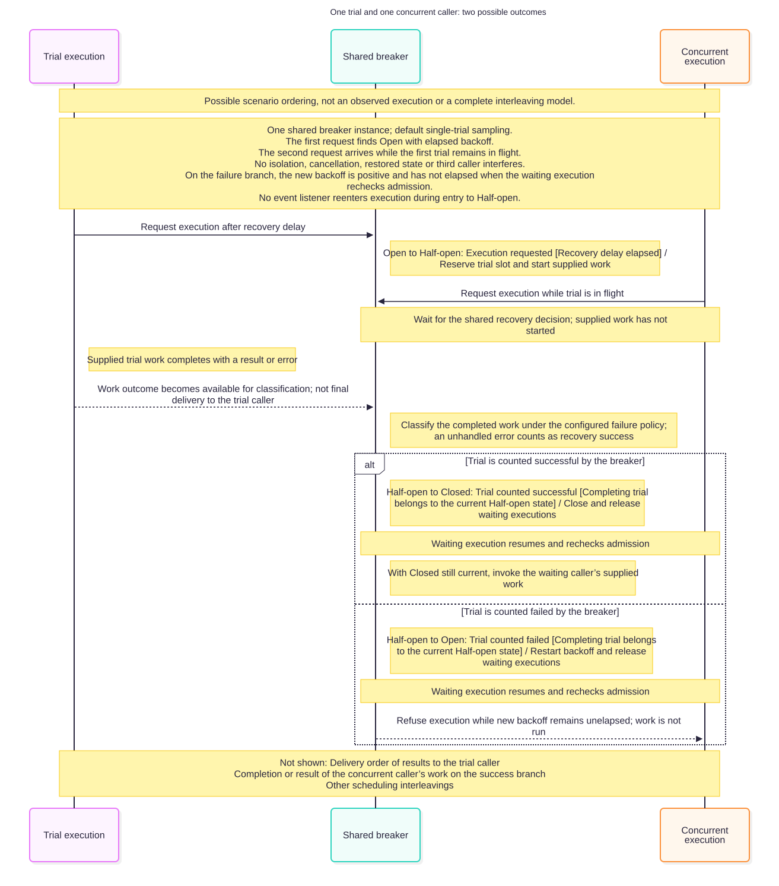

# One trial, one waiting caller

**Overview:** Possible ordering; default single trial. [Q — scope and conditions](#scope).

The short labels locate fuller meanings in the legend. Guarded transitions and scenario conditions remain part of the account; omission from a box is not removal of a condition.

## Participants

| On diagram | Full label | Designation |
| --- | --- | --- |
| Trial | Trial execution | E-trial |
| Breaker | Shared breaker | R |
| Caller | Concurrent execution | E-caller |

## Branches

| Key | Short label | Condition |
| --- | --- | --- |
| B1 | Counted success | Trial is counted successful by the breaker |
| B2 | Counted failure | Trial is counted failed by the breaker |

## Interaction legend

I-keys identify steps, not time or causation. The cause column preserves explicit `causedBy` links; it does not assert that a cause is sufficient or exclusive. “Not asserted” is not a claim that no cause exists.

| Key | Short label | Full meaning / condition | Causal support | Evidence |
| --- | --- | --- | --- | --- |
| I1 | Request trial | Request execution after recovery delay | Not asserted | E-admission |
| I2 | Start trial | Open → Half-open. Trigger: Execution requested. Guard: Recovery delay elapsed. Effect: Reserve trial slot and start supplied work. | I1 | E-admission, E-half-open |
| I3 | Request while trial pending | Request execution while trial is in flight | Not asserted | E-half-open |
| I4 | Await recovery | Because the sole trial slot remains occupied, wait for its recovery decision; supplied work has not started Condition: The sole trial slot reserved on entry remains occupied when the concurrent request arrives. Relationship: W. | I3, I2 | E-half-open |
| I5 | Work completes | Supplied trial work completes with a result or error | Not asserted | E-half-open |
| I6 | Report outcome | Work outcome becomes available for classification; not final delivery to the trial caller | I5 | E-half-open |
| I7 | Classify outcome | Classify the completed work under the configured failure policy. An error not matched by that policy is recorded as recovery success. | I6 | E-half-open |
| I8 | Close; release waiter | Half-open → Closed. Trigger: Trial counted successful. Guard: Completing trial belongs to the current Half-open state. Effect: Close and release waiting executions. | I7 | E-outcomes |
| I9 | Recheck admission | Waiting execution resumes and rechecks admission Relationship: W. | I8 | E-half-open, E-outcomes |
| I10 | Run work [still Closed] | With Closed still current, invoke the waiting caller’s supplied work | I9 | E-admission, E-half-open |
| I11 | Reopen; release waiter | Half-open → Open. Trigger: Trial counted failed. Guard: Completing trial belongs to the current Half-open state. Effect: Restart backoff and release waiting executions. | I7 | E-outcomes, E-default |
| I12 | Recheck admission | Waiting execution resumes and rechecks admission Relationship: W. | I11 | E-half-open, E-outcomes |
| I13 | Refuse [delay unelapsed] | Refuse execution while new backoff remains unelapsed; work is not run | I12 | E-admission |

## Q — Scope and qualifications

These limits apply to the overview and every legend entry. This page accompanies the image; the image alone is an overview, not the complete qualified account.

- Authored illustrative static interpretation at the pinned revision; not an observed execution or a result from the implemented PostCode investigator.
- Default one-call recovery sampling with zero permitted counted failures.
- Manual isolation, restored state, cancellation, competing external state changes and non-default sampling are outside this account.
- Application-specific usage and business success are not established. Failure classification follows the configured policy.
- Reentrant execution requests from event listeners during entry to Half-open are excluded; entry and slot reservation are treated as one admission step.

Basis: `f48bea55022ab15ab07eb52a79bfc1e661300fd4`. Static source inspection plus the prior exploratory accounts; no runtime execution.

Possible scenario ordering, not an observed execution or a complete interleaving model.

Scenario conditions:

- One shared breaker instance; default single-trial sampling.
- The first request finds Open with elapsed backoff.
- The second request arrives while the first trial remains in flight.
- No isolation, cancellation, restored state or third caller interferes.
- On the failure branch, the new backoff is positive and has not elapsed when the waiting execution rechecks admission.
- No event listener reenters execution during entry to Half-open.

Not covered / not shown:

- Delivery order of results to the trial caller
- Completion or result of the concurrent caller’s work on the success branch
- Other scheduling interleavings

## Evidence and exact content

Account content: [followup-result.json](followup-result.json). Reference keys below are display-local aliases; the traceability file maps them to exact content locations. They are not retained subject identities or correction units.

| Reference | Support |
| --- | --- |
| E-admission | [source](https://github.com/connor4312/cockatiel/blob/f48bea55022ab15ab07eb52a79bfc1e661300fd4/src/CircuitBreakerPolicy.ts) — execute |
| E-default | [source](https://github.com/connor4312/cockatiel/blob/f48bea55022ab15ab07eb52a79bfc1e661300fd4/src/CircuitBreakerPolicy.ts) — createHalfOpenSamplingOptions |
| E-half-open | [source](https://github.com/connor4312/cockatiel/blob/f48bea55022ab15ab07eb52a79bfc1e661300fd4/src/CircuitBreakerPolicy.ts) — executeHalfOpen |
| E-outcomes | [source](https://github.com/connor4312/cockatiel/blob/f48bea55022ab15ab07eb52a79bfc1e661300fd4/src/CircuitBreakerPolicy.ts) — recordHalfOpenSuccess, recordHalfOpenFailure, maybeCompleteHalfOpen, open and close |
| E-state | [source](https://github.com/connor4312/cockatiel/blob/f48bea55022ab15ab07eb52a79bfc1e661300fd4/src/CircuitBreakerPolicy.ts) — CircuitState and state getter |

[Captured basis and delivery context](context-and-bindings.json) · [Exact diagram/legend mapping](diagram-traceability.json)

