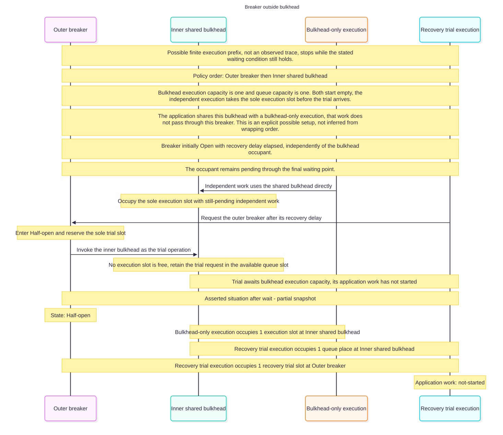

# Breaker outside bulkhead

**Overview:** Possible prefix; one bulkhead slot + one queue place; one trial. [Q — scope and conditions](#scope).

The short labels locate fuller meanings in the legend. Guarded transitions and scenario conditions remain part of the account; omission from a box is not removal of a condition.

## Participants

| On diagram | Full label | Designation |
| --- | --- | --- |
| Breaker | Outer breaker | local role breaker |
| Bulkhead | Inner shared bulkhead | local role bulkhead |
| Other work | Bulkhead-only execution | local role occupant |
| Trial | Recovery trial execution | local role trial |

## Interaction legend

I-keys identify steps, not time or causation. The cause column preserves explicit `causedBy` links; it does not assert that a cause is sufficient or exclusive. “Not asserted” is not a claim that no cause exists.

| Key | Short label | Full meaning / condition | Causal support | Evidence |
| --- | --- | --- | --- | --- |
| I1 | Request independent work | Independent work uses the shared bulkhead directly | Not asserted | E-bulkhead |
| I2 | Occupy execution slot | Occupy the sole execution slot with still-pending independent work | I1 | E-bulkhead |
| I3 | Request trial | Request the outer breaker after its recovery delay | Not asserted | E-policy, E-admission |
| I4 | Reserve trial slot | Enter Half-open and reserve the sole trial slot | I3 | E-admission, E-half-open, E-default |
| I5 | Invoke bulkhead | Invoke the inner bulkhead as the trial operation | I4 | E-policy, E-half-open |
| I6 | Queue trial request | No execution slot is free; retain the trial request in the available queue slot | I5, I2 | E-bulkhead |
| I7 | Await capacity | Trial awaits bulkhead execution capacity; its application work has not started Condition: Independent work is still pending and no capacity has been released. Relationship: local relation capacity-wait. | I6, I4 | E-policy, E-bulkhead, E-half-open |

## S1 — Trial holds trial slot while queued

Asserted after I7. Partial snapshot: absent entries are unspecified, not zero or false.

- State: local role breaker has category S (Half-open).

| Holder | Resource owner | Resource | Amount |
| --- | --- | --- | --- |
| local role occupant | local role bulkhead | Execution slot | 1 |
| local role trial | local role bulkhead | Queue place | 1 |
| local role trial | local role breaker | Recovery trial slot | 1 |

- Application work: local role trial — not-started.
- Active relations: local relation capacity-wait.
- Evidence: E-policy, E-bulkhead, E-half-open.

## Local relationships

- **capacity-wait** (waits-for-capacity): local role trial → local role bulkhead. Condition: Bulkhead full with queue room for this execution. Evidence: E-bulkhead.

Composite policy order: local role breaker → local role bulkhead. The independent bulkhead-only execution, where present, is outside that path.

## Q — Scope and qualifications

These limits apply to the overview and every legend entry. This page accompanies the image; the image alone is an overview, not the complete qualified account.

- Authored static interpretation at revision f48bea55022ab15ab07eb52a79bfc1e661300fd4; possible usage patterns, not observed application objects or an executed PostCode investigation.
- Default single-call breaker recovery with zero permitted counted failures. No cancellation, isolation, restoration, reentrant execution from event listeners, other interfering state change or additional arrivals beyond the stated setup.
- A finite possible execution prefix ending at a waiting point. No completion, fairness, delay bound, deadlock claim or eventual admission is established. Application work and the inner policy operation are distinguished.
- Bulkhead execution capacity is one and queue capacity is one. Both start empty; the independent execution takes the sole execution slot before the trial arrives.
- The application shares this bulkhead with a bulkhead-only execution; that work does not pass through this breaker. This is an explicit possible setup, not inferred from wrapping order.
- Breaker initially Open with recovery delay elapsed, independently of the bulkhead occupant.
- The occupant remains pending through the final waiting point.

Basis: `f48bea55022ab15ab07eb52a79bfc1e661300fd4`. Static source inspection plus the prior exploratory accounts; no runtime execution.

Possible finite execution prefix, not an observed trace; stops while the stated waiting condition still holds.

Bind each role once within this particular scenario. These local roles neither designate prior R/E-trial/E-caller nor identify roles in the other ordering case. Policy kind and state-category references are reused explicitly.

Scenario conditions:

- Bulkhead execution capacity is one and queue capacity is one. Both start empty; the independent execution takes the sole execution slot before the trial arrives.
- The application shares this bulkhead with a bulkhead-only execution; that work does not pass through this breaker. This is an explicit possible setup, not inferred from wrapping order.
- Breaker initially Open with recovery delay elapsed, independently of the bulkhead occupant.
- The occupant remains pending through the final waiting point.

Not covered / not shown:

- Completion and release after the final waiting point.
- All other schedules and admission branches.

## Evidence and exact content

Investigram content: [composition-result.json](composition-result.json). Reference keys below are display-local aliases; the traceability file maps them to exact content locations. They are not entity identities or correction units.

| Reference | Support |
| --- | --- |
| A-admission | Earlier investigram ADMISSION-2 — Prior interpretation, not independent repository corroboration. |
| A-bulkhead | Earlier investigram BULKHEAD-1 — Prior interpretation, not independent repository corroboration. |
| A-trial | Earlier investigram TRIAL-1 — Prior interpretation, not independent repository corroboration. |
| E-admission | [source](https://github.com/connor4312/cockatiel/blob/f48bea55022ab15ab07eb52a79bfc1e661300fd4/src/CircuitBreakerPolicy.ts) — execute |
| E-bulkhead | [source](https://github.com/connor4312/cockatiel/blob/f48bea55022ab15ab07eb52a79bfc1e661300fd4/src/BulkheadPolicy.ts) — execute and dequeue: reservation, pending work, queue and release |
| E-default | [source](https://github.com/connor4312/cockatiel/blob/f48bea55022ab15ab07eb52a79bfc1e661300fd4/src/CircuitBreakerPolicy.ts) — createHalfOpenSamplingOptions |
| E-half-open | [source](https://github.com/connor4312/cockatiel/blob/f48bea55022ab15ab07eb52a79bfc1e661300fd4/src/CircuitBreakerPolicy.ts) — executeHalfOpen |
| E-policy | [source](https://github.com/connor4312/cockatiel/blob/f48bea55022ab15ab07eb52a79bfc1e661300fd4/src/Policy.ts) — wrap: ordered invocation of existing policy instances |

[Captured basis and delivery context](context-and-bindings.json) · [Exact diagram/legend mapping](diagram-traceability.json)
