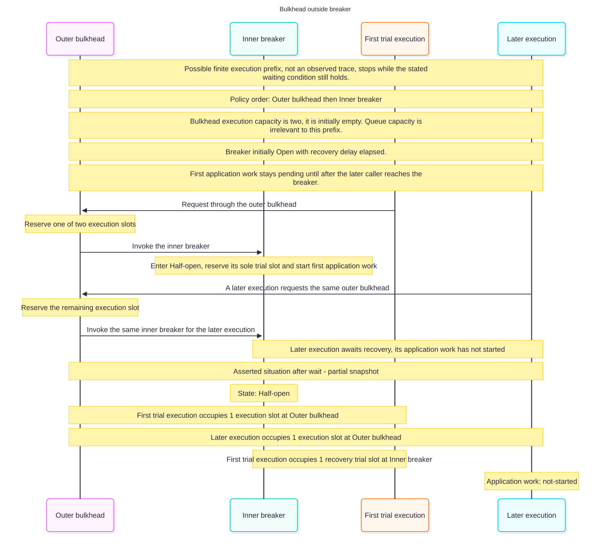

# Bulkhead outside breaker

**Overview:** Possible prefix; two bulkhead slots; one trial. [Q — scope and conditions](#scope).

The short labels locate fuller meanings in the legend. Guarded transitions and scenario conditions remain part of the account; omission from a box is not removal of a condition.

## Participants

| On diagram | Full label | Designation |
| --- | --- | --- |
| Bulkhead | Outer bulkhead | local role bulkhead |
| Breaker | Inner breaker | local role breaker |
| Trial | First trial execution | local role trial |
| Caller | Later execution | local role caller |

## Interaction legend

I-keys identify steps, not time or causation. The cause column preserves explicit `causedBy` links; it does not assert that a cause is sufficient or exclusive. “Not asserted” is not a claim that no cause exists.

| Key | Short label | Full meaning / condition | Causal support | Evidence |
| --- | --- | --- | --- | --- |
| I1 | Request trial | Request through the outer bulkhead | Not asserted | E-policy |
| I2 | Take first slot | Reserve one of two execution slots | I1 | E-bulkhead |
| I3 | Invoke breaker | Invoke the inner breaker | I2 | E-policy |
| I4 | Start trial work | Enter Half-open, reserve its sole trial slot and start first application work | I3 | E-admission, E-half-open, E-default |
| I5 | Request later execution | A later execution requests the same outer bulkhead | Not asserted | E-policy |
| I6 | Take second slot | Reserve the remaining execution slot | I5 | E-bulkhead |
| I7 | Invoke breaker | Invoke the same inner breaker for the later execution | I6 | E-policy |
| I8 | Await recovery | Later execution awaits recovery; its application work has not started Condition: First trial still occupies the sole trial slot on arrival. Relationship: local relation recovery-wait. | I7, I4 | E-half-open |

## S1 — Caller holds bulkhead slot while waiting

Asserted after I8. Partial snapshot: absent entries are unspecified, not zero or false.

- State: local role breaker has category S (Half-open).

| Holder | Resource owner | Resource | Amount |
| --- | --- | --- | --- |
| local role trial | local role bulkhead | Execution slot | 1 |
| local role caller | local role bulkhead | Execution slot | 1 |
| local role trial | local role breaker | Recovery trial slot | 1 |

- Application work: local role caller — not-started.
- Active relations: local relation recovery-wait.
- Evidence: E-policy, E-bulkhead, E-half-open.

## Local relationships

- **recovery-wait** (waits-for-decision): local role caller → local role breaker. Condition: First trial still pending in Half-open. Evidence: E-half-open.

Composite policy order: local role bulkhead → local role breaker. The independent bulkhead-only execution, where present, is outside that path.

## Q — Scope and qualifications

These limits apply to the overview and every legend entry. This page accompanies the image; the image alone is an overview, not the complete qualified account.

- Authored static interpretation at revision f48bea55022ab15ab07eb52a79bfc1e661300fd4; possible usage patterns, not observed application objects or an executed PostCode investigation.
- Default single-call breaker recovery with zero permitted counted failures. No cancellation, isolation, restoration, reentrant execution from event listeners, other interfering state change or additional arrivals beyond the stated setup.
- A finite possible execution prefix ending at a waiting point. No completion, fairness, delay bound, deadlock claim or eventual admission is established. Application work and the inner policy operation are distinguished.
- Bulkhead execution capacity is two; it is initially empty. Queue capacity is irrelevant to this prefix.
- Breaker initially Open with recovery delay elapsed.
- First application work stays pending until after the later caller reaches the breaker.

Basis: `f48bea55022ab15ab07eb52a79bfc1e661300fd4`. Static source inspection plus the prior exploratory accounts; no runtime execution.

Possible finite execution prefix, not an observed trace; stops while the stated waiting condition still holds.

Bind each role once within this particular scenario. These local roles neither designate prior R/E-trial/E-caller nor identify roles in the other ordering case. Policy kind and state-category references are reused explicitly.

Scenario conditions:

- Bulkhead execution capacity is two; it is initially empty. Queue capacity is irrelevant to this prefix.
- Breaker initially Open with recovery delay elapsed.
- First application work stays pending until after the later caller reaches the breaker.

Not covered / not shown:

- Completion and release after the final waiting point.
- All other schedules and admission branches.

## Evidence and exact content

Account content: [composition-result.json](composition-result.json). Reference keys below are display-local aliases; the traceability file maps them to exact content locations. They are not retained subject identities or correction units.

| Reference | Support |
| --- | --- |
| A-admission | Earlier account ADMISSION-2 — Prior interpretation, not independent repository corroboration. |
| A-bulkhead | Earlier account BULKHEAD-1 — Prior interpretation, not independent repository corroboration. |
| A-trial | Earlier account TRIAL-1 — Prior interpretation, not independent repository corroboration. |
| E-admission | [source](https://github.com/connor4312/cockatiel/blob/f48bea55022ab15ab07eb52a79bfc1e661300fd4/src/CircuitBreakerPolicy.ts) — execute |
| E-bulkhead | [source](https://github.com/connor4312/cockatiel/blob/f48bea55022ab15ab07eb52a79bfc1e661300fd4/src/BulkheadPolicy.ts) — execute and dequeue: reservation, pending work, queue and release |
| E-default | [source](https://github.com/connor4312/cockatiel/blob/f48bea55022ab15ab07eb52a79bfc1e661300fd4/src/CircuitBreakerPolicy.ts) — createHalfOpenSamplingOptions |
| E-half-open | [source](https://github.com/connor4312/cockatiel/blob/f48bea55022ab15ab07eb52a79bfc1e661300fd4/src/CircuitBreakerPolicy.ts) — executeHalfOpen |
| E-policy | [source](https://github.com/connor4312/cockatiel/blob/f48bea55022ab15ab07eb52a79bfc1e661300fd4/src/Policy.ts) — wrap: ordered invocation of existing policy instances |

[Captured basis and delivery context](context-and-bindings.json) · [Exact diagram/legend mapping](diagram-traceability.json)
