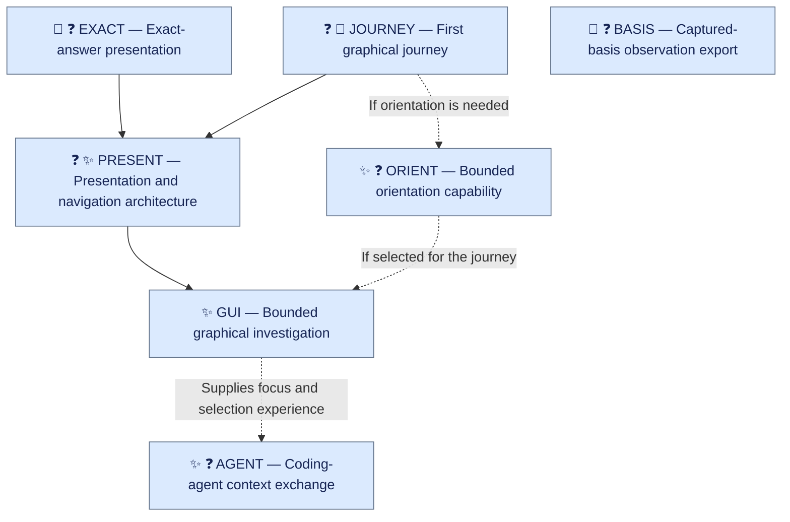

# Upcoming work

Last considered: 2026-10-14

A living document for keeping track of upcoming work and deciding what order to
do it in, updated at each major checkpoint. It is a planning aid, not a governing
document.
The [backlog](../docs/backlog.md), [candidate capabilities](candidate-capabilities.md),
and [candidate UX](candidate-ux.md) hold the broader inventories.

**Starting point:** the [Lens request-model plan](../docs/plans/lens-request-model.md)
was completed on 2026-10-13.

## Kinds of work

| Icon | Kind | Main sequencing question |
| --- | --- | --- |
| 🐛 | Defect | What does it get wrong, and who or what relies on it? |
| 🚧 | Limitation | When will its consequences become unacceptable or costly? |
| ✨ | Missing capability | What useful journey or learning does it enable? |
| ❓ | Unresolved design | What is the smallest concrete case that would help settle it? |
| 🧹 | Maintenance / housekeeping | Does leaving it undone cause confusion, friction, or accumulating cost, and is there a convenient point to address it? |

## Dependencies and decision points

Solid arrows show prerequisites; dashed arrows show conditional contributions
or useful design input. Codes identify items independently of ordering.

BASIS is needed for research assessments requiring recorded program-state
attribution. AGENT's dependencies on exact answers and basis disclosure depend
on the chosen exchange. JOURNEY exploration can overlap EXACT and BASIS.

## Tentative ordering

| Position | Item | Why here / what could change it |
| --- | --- | --- |
| Next | [EXACT — Exact-answer presentation](#exact) | Improves existing behavior and prevents graphical interactions from inheriting silent answer changes. |
| Next | [BASIS — Captured-basis observation export](#basis) | Makes state-specific research assessments trustworthy. Could precede EXACT if that research becomes urgent; neither depends on the other. |
| Likely after that | [JOURNEY — First graphical journey](#journey) | Supplies concrete requirements for Presentation architecture. Exploration can overlap earlier work. |
| Likely after that | [PRESENT — Presentation and navigation architecture](#present) | Builds on exact-answer semantics and the chosen interaction needs. |
| Likely after that | [GUI — Bounded graphical investigation](#gui) | Tests the architecture and whether people can understand the project and choose useful next questions. |
| Conditional | [ORIENT — Bounded orientation capability](#orient) | If JOURNEY establishes the need, could precede or accompany GUI. |
| Later / movable | [AGENT — Coding-agent context exchange](#agent) | GUI supplies focus and selection experience; a valuable CLI exchange could bring this forward. |

## Item catalog

Alphabetical by code.

### AGENT — Coding-agent context exchange

- **Kind:** ✨ ❓
- **Outcome:** an external coding agent can consume selected investigation context
  with clear scope, exact-result versus repeatable-request semantics, reference
  lifetime, captured basis, source mappings, and relevant origin.
- **Scope:** a first useful exchange. Includes supplied PostCode provenance when
  output returns through repository material or agent contributions, so it is
  not mistaken for independent corroboration. Persistence and richer Workspace
  context are separate possibilities.
- **Source:** [backlog: shared coding-agent context and feedback provenance](../docs/backlog.md#design-a-bounded-shared-context-interface-for-coding-agents).

### BASIS — Captured-basis observation export

- **Kind:** 🚧 ❓
- **Outcome:** exported observations identify the program inputs actually
  supporting the result, with capture limitations and repository-state provenance.
- **Scope:** attribution; full reproducibility and archival retention are separate concerns.
- **Source:** [backlog: captured-basis attribution](../docs/backlog.md#preserve-captured-basis-attribution-in-observations).

### EXACT — Exact-answer presentation

- **Kind:** 🚧 ❓
- **Outcome:** paging and reformatting present the same retained Projection,
  including its selected interpretation and qualifications. Fresh selection is
  a distinct, visible action.
- **Scope:** exact-result requests and the necessary Presentation separation
  within the current Session lifetime.
- **Source:** [backlog: exact retained-answer presentation, F6](../docs/backlog.md#allow-a-view-to-be-requested-for-an-existing-projection).

### GUI — Bounded graphical investigation

- **Kind:** ✨
- **Outcome:** a useful graphical investigation on real repositories, with evidence,
  qualifications, originals, replacements, conflicts, and reconsideration visible.
  Evaluation includes sustained use and returning to earlier answers.
- **Scope:** the selected JOURNEY within the supported Session lifetime, including
  ORIENT if needed.
- **Source:** [backlog: whole-journey UX review](../docs/backlog.md#review-the-investigation-ui-and-ux-as-a-whole).

### JOURNEY — First graphical journey

- **Kind:** ❓ 🧹
- **Outcome:** a bounded journey through orientation, inspection, interpretation,
  follow-up, evidence, and earlier accounts, using real capabilities. Updated GUI
  notes reflecting the adopted simple Workspace and current Session limits.
- **Decision:** can existing capabilities provide a useful entry point, or is
  ORIENT needed? The earlier “trees without a forest” experience motivates this
  question; the initial View and form of orientation remain open.
- **Sources:** [backlog: whole-journey UX review and GUI-note reconciliation](../docs/backlog.md#review-the-investigation-ui-and-ux-as-a-whole),
  [candidate capabilities: landscape orientation](candidate-capabilities.md#explorative-landscape-orientation).

### ORIENT — Bounded orientation capability

- **Kind:** ✨ ❓
- **Outcome:** a project-level orientation capability that helps the human begin
  useful investigation, if JOURNEY establishes the need.
- **Scope:** one selected capability. Dependency landscape and project summary
  are possible approaches with different evidential bases and uses.
- **Sources:** [candidate capabilities: landscape orientation](candidate-capabilities.md#explorative-landscape-orientation),
  [candidate capabilities: dependency landscape](candidate-capabilities.md#explorative-dependency-landscape).

### PRESENT — Presentation and navigation architecture

- **Kind:** ❓ ✨
- **Outcome:** coherent Presentation choices, parameters, display bounds, and
  reference coordination, with qualified answers separate from arrangement.
  Navigation origins are retained where available in the supported interactions.
- **Scope:** the selected journey, informed by current CLI behavior. Multi-Projection
  coordination depends on that journey's needs; discovery lineage, continuing
  View dependencies, and program relationships have distinct meanings.
- **Sources:** [backlog: Presentation representation, F5](../docs/backlog.md#decide-how-gui-presentations-and-their-parameters-are-represented),
  [backlog: navigation origins](../docs/backlog.md#assess-and-preserve-navigation-origin-lineage),
  [backlog: coordinated-View conformance](../docs/backlog.md#assess-conformance-when-extending-coordinated-views-and-state-scope).

## Principles for choosing the order

Build a sound foundation for the next useful capability, with enough concrete
use to test whether the foundation is right.

- **Correct misleading behavior before adding breadth:** especially errors in
  answers, evidence, scope, or request reporting.
- **Resolve architectural debt before extending the affected area:** prioritize
  weaknesses that would spread into the next capability or interface.
- **Use concrete needs to settle uncertain architecture:** small representative
  journeys and experiments can establish requirements.
- **Implement the required case with a credible route to generalization:** keep
  current capabilities working and explain how later extension fits.
- **Make subsequent learning trustworthy:** fix a limitation before an assessment
  relies on the missing guarantee.
- **Prefer bounded outcomes and stopping points:** improved behavior, an enabled
  next step, or a resolved uncertainty.
- **Clear small, well-understood items when convenient:** if finishing something
  costs less than carrying it through further planning, do it and remove it from
  the list. Especially useful for housekeeping, provided it doesn't disrupt
  focused work or conceal unresolved decisions.
- **Reorder as evidence changes:** findings, cost, and formative use can shift priorities.

For comparable items, favor greater user or research value, fewer dependencies,
less speculative design, and lower cost of later change.

## Checkpoint review

At substantial completions, consequential findings, or changes in priority:

- What is complete, and what remains unresolved?
- Which backlog items now merit inclusion? Have candidate ideas become relevant?
- Which listed items should move down, return to the broader inventory, or drop out?
- Have dependencies or conditional choices changed?

Update the selection, ordering, and rationale accordingly. Item codes stay stable
as priorities change; detailed outcomes and implementation history remain in
their existing records.
