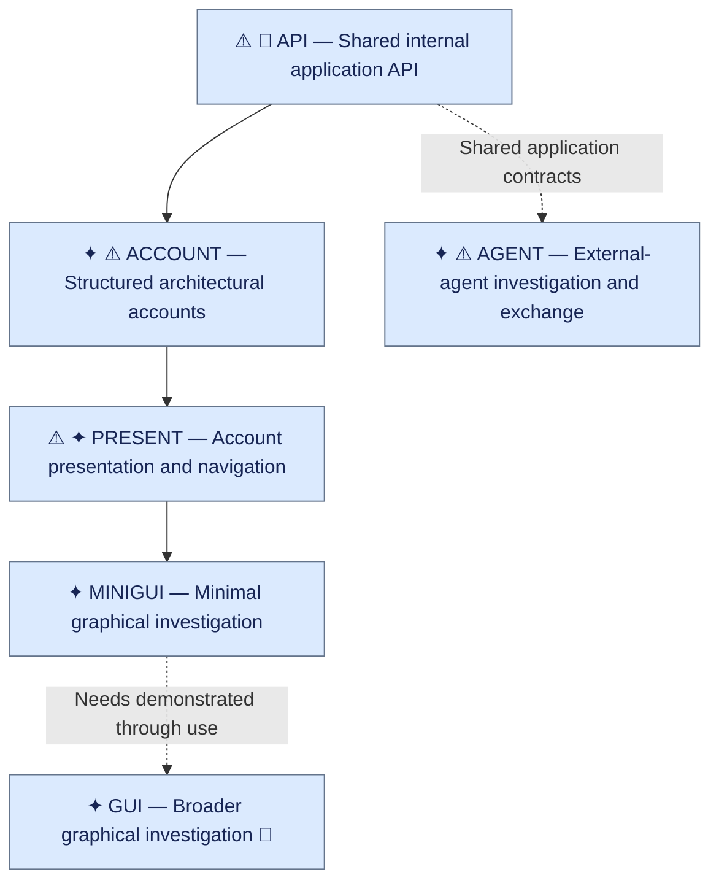

# Upcoming work

Last considered: 2026-11-08

A living document for keeping track of upcoming work and deciding what order to
do it in, updated at each major checkpoint. It is a planning aid, not a governing
document.
The [backlog](../docs/backlog.md), [candidate capabilities](candidate-capabilities.md),
and [candidate UX](candidate-ux.md) hold the broader inventories.

The current focus is useful investigation of a software project through established
architectural concepts, with retained, qualified accounts that humans and agents
can use in their design work. Comparison with capable general-purpose agents can
inform evaluation; specialization does not depend on first demonstrating superiority.

## Legend

<table class="upcoming-work-legend">
  <thead>
    <tr><th scope="col">Icon</th><th scope="col">Kind</th><th scope="col">Meaning</th></tr>
  </thead>
  <tbody>
    <tr><td>🐛</td><td>Defect</td><td>Supported behavior is wrong or violates its contract.</td></tr>
    <tr><td>🚧</td><td>Limitation</td><td>A boundary on what the system supports or guarantees that we may want to remove.</td></tr>
    <tr><td>✦</td><td>Missing capability</td><td>Something useful the system cannot yet do.</td></tr>
    <tr><td>⚠️</td><td>Open product / architectural question</td><td>An unresolved choice that could change scope, direction, or dependencies.</td></tr>
    <tr><td>🧹</td><td>Maintenance / housekeeping</td><td>Upkeep that keeps the repository and development environment accurate and usable.</td></tr>
  </tbody>
</table>

<table class="upcoming-work-legend">
  <thead>
    <tr><th scope="col">Icon</th><th scope="col">Size</th><th scope="col">Meaning</th></tr>
  </thead>
  <tbody>
    <tr><td>🐝</td><td>Quick</td><td>Well understood and likely cheaper to finish than carry through more planning.</td></tr>
    <tr><td>🧱</td><td>Large</td><td>Substantial effort; worth breaking into useful stages.</td></tr>
    <tr><td></td><td>Ordinary or uncertain</td><td>(No size marker)</td></tr>
  </tbody>
</table>

## Dependencies and decision points

Solid arrows show prerequisites; dashed arrows show conditional contributions or useful design input.
Codes identify items independently of ordering.

## Tentative ordering

| Position | Item | Why here / what could change it |
| --- | --- | --- |
| Next: plan and implement | [API — Shared internal application API](#api) | Establish the shared boundary for existing functionality, considering future use and modification by ACCOUNT, PRESENT, and MINIGUI. Verify it independently through existing capabilities and the CLI. |
| After API | [ACCOUNT — Structured architectural accounts](#account) | Choose a bounded slice from the connected account examples and validate its suitability for representative diagrams. Admission → trial → correction is a candidate; composition can test extension across accounts. |
| After ACCOUNT | [PRESENT — Account presentation and navigation](#present) | Plan against implemented accounts, then build representations, qualifications, and navigation for the graphical slice. |
| After PRESENT | [MINIGUI — Minimal graphical investigation](#minigui) | Build a small graphical surface for actual human investigation using the available account and presentation capabilities. |
| Movable, when a concrete exchange needs it | [AGENT — External-agent investigation and exchange](#agent) | Support external design or implementation agents requesting investigations or using retained accounts. Assess reusable investigation and exchange capabilities; neither retaining the interactive CLI, structured accounts, nor a preceding human GUI journey is a prerequisite. |
| Following experience with MINIGUI | [GUI — Broader graphical investigation](#gui) | Extend the graphical experience where sustained use identifies valuable capabilities. May become several plans. |

ACCOUNT, PRESENT, and MINIGUI can each modify the API as part of their own
planning and implementation. Each task completes independently; later tasks
plan against the implemented foundation rather than a chain of untested plans.

## Item catalog

Alphabetical by code.

### ACCOUNT — Structured architectural accounts

- **Kind:** ✦ ⚠️
- **Outcome:** successive investigations can reuse, extend, or challenge retained
  architectural understanding while preserving evidence, qualifications,
  conflicts, and access to earlier accounts.
- **Scope:** a bounded slice drawn from the completed exploration's connected
  account examples, within the current Session lifetime. Assess structured
  investigram content and existing associations, retention, and replacement.
  Account design and implementation must carry the semantic content needed by
  a small set of representative architectural diagrams—for example,
  structural, state, or interaction views. Their distinct information needs
  guide account structure; a working account may
  comprise several investigrams. The examples span policy kinds, instance roles,
  states, and executions; responsibility-focused investigation can inform those
  accounts without requiring a separate Lens. Preserve the known account/answer
  origin of follow-up selections, independently of evidence support or human reliance.
- **Decision:** what structure and selection are actually needed? Distinguish
  revision status, applicability to a question, and the working selection for an investigation.
  Correspondence or synthesis requires qualified analysis. A universal schema,
  consolidated model, and general retrieval system are not assumed.
  Choose how the initial architectural subjects become available; a supplied
  fixture can test machinery without demonstrating end-to-end investigation.
  Define the meaning of offered questions so it does not depend on the human's
  unspoken purpose; PRESENT can build their discoverable presentation.
- **Validation:** demonstrate within ACCOUNT that the selected diagrams can be
  generated from retained account content without reconstructing missing
  architectural meaning during rendering. Universal notation support and stored
  layout choices are not required.
- **Sources:** [journey outputs: connected account examples](initial-journey/cockatiel-account-examples.md),
  [journey findings: capability-planning inputs](initial-journey/design-findings.md#capability-planning-inputs),
  [backlog: architectural accounts through concrete journeys](../docs/backlog.md#explore-architectural-accounts-through-journeys),
  [candidate capabilities: responsibility-focused investigation](candidate-capabilities.md#responsibility-focused-investigation),
  [backlog: navigation origins](../docs/backlog.md#assess-and-preserve-navigation-origin-lineage),
  [decision: structured investigram content](../docs/decisions/structured-investigram-content.md).

### AGENT — External-agent investigation and exchange

- **Kind:** ✦ ⚠️
- **Outcome:** external design and implementation agents can request useful
  investigations and consult qualified accounts during conversations held elsewhere,
  with clear scope, exact-result versus repeatable-request semantics, reference
  lifetime, captured basis, implementation mappings, and relevant origin.
- **Scope:** a bounded exchange selected for a concrete episode, including agent-led or mixed
  investigation. Assess the investigation and exchange capabilities currently
  exposed through the CLI before choosing an agent-facing interface backed by
  the [shared application API](#api). Reuse of
  those capabilities does not depend on retaining the interactive human command
  shell; any continuing command-line interface should serve concrete agent needs.
  Structured accounts, a GUI, participant-material ingestion, and
  persistence are not prerequisites by assumption. Preserve supplied PostCode
  provenance when output returns through repository material or contributions,
  so it is not mistaken for independent corroboration.
- **Source:** [backlog: external-agent investigation and context exchange](../docs/backlog.md#design-a-bounded-shared-context-interface-for-coding-agents).

### API — Shared internal application API

- **Kind:** ⚠️ 🧹
- **Outcome:** GUI, CLI, and agent interfaces call shared application capabilities
  through explicit request and result contracts. Application and investigation
  behavior lives behind that boundary; adapters handle interface mechanics and
  may expose different subsets of capabilities.
- **Scope:** assess and establish the shared boundary for existing functionality,
  locating application behavior tied to the CLI and adapting the CLI to call
  the API. Reuse existing contracts where suitable and move behavior as needed.
  Design with future use and modification by ACCOUNT, PRESENT, and MINIGUI in
  mind, using the journey and account examples to assess likely needs. Complete
  this task independently; later capability tasks can extend the API when
  planned and implemented. This is internal, without a commitment
  to a public library, network service, or exhaustive API designed in advance.
- **Decision:** which existing contracts already fit, where interface assumptions
  leak into application behavior, and which responsibilities belong behind the
  shared boundary? The direction is agreed; the extent of restructuring needs
  assessment.
- **Validation:** exercise existing capabilities directly through the API and
  through the adapted CLI, preserving request and exact-result semantics.
  Verify that application behavior is accessible without command parsing or
  terminal formatting, and that interface adapters do not duplicate investigation
  logic or establish Claims. Completion does not depend on a graphical caller.
- **Source:** strategy discussion: shared application capabilities behind human
  and agent interfaces.

### GUI — Broader graphical investigation

- **Kind:** ✦
- **Size:** 🧱 — broader integrated investigation flows and formative evaluation;
  likely several implementation plans.
- **Outcome:** a graphical experience that supports sustained investigation on real
  repositories beyond the first bounded slice.
- **Scope:** needs demonstrated through MINIGUI use. Workspace management, richer
  layouts, persistence, and customization are possible extensions, selected for
  their value rather than assumed prerequisites for useful graphical investigation.
- **Source:** [backlog: whole-journey UX review](../docs/backlog.md#review-the-investigation-ui-and-ux-as-a-whole).

### MINIGUI — Minimal graphical investigation

- **Kind:** ✦
- **Outcome:** a usable graphical slice for investigating one project, so human-use
  evaluation can test more than typing commands and reading text results.
- **Scope:** a few account presentations and diagrams, selection of subjects and
  offered questions, following relationships, and returning to earlier or corrected
  answers with their qualifications. Build on completed ACCOUNT and PRESENT: accounts
  supply content, Presentations make it intelligible, and this item supplies the
  controls and interaction flow within the supported Session lifetime. Extend the
  API as needed within this task; full Workspace management and customization can wait.
- **Validation:** use the slice for actual investigation, including follow-up and
  reconsideration. CLI checks remain useful for core verification but do not
  establish the usefulness of the human experience. Once usable, trigger the
  [CLI retirement checkpoint](#cli-retirement-checkpoint).
- **Sources:** strategy discussion: a graphical surface for first practical human use;
  [journey outputs: investigation script](initial-journey/cockatiel-investigation-script.md),
  [journey findings: implementation-validation checks](initial-journey/design-findings.md#implementation-validation).

### PRESENT — Account presentation and navigation

- **Kind:** ⚠️ ✦
- **Outcome:** useful architectural representations through which the human can
  change perspective, inspect qualifications, and revisit earlier or revised accounts.
- **Scope:** the representations and navigation needed for the selected account
  slice, using implemented ACCOUNT capabilities and exact retained-answer presentation.
  Extend the API as needed within this task. Use
  established architectural notations where they fit. Generating a diagram
  cannot supply missing semantics or strengthen a claim. Additional perspective
  content may require investigation rather than another rendering of one account.
  Resolve composition, reference coordination, and View identity as needed by
  these interactions; broader GUI architecture follows concrete requirements.
  Make subject-specific questions discoverable, with new investigation distinct
  from displaying retained detail. Show consequential conditions and corrections
  while preserving access to earlier answers. Explore returning to a useful
  surrounding account; keeping it always visible remains a hypothesis.
- **Validation:** build on ACCOUNT's diagram validation with a bounded
  presentation and navigation demonstration, using an export or standalone renderer
  if sufficient. Check semantic fidelity, consequential scope and uncertainty,
  traceability to account content, and revised versus exact earlier answers.
  Successful rendering alone is insufficient; MINIGUI supplies the first
  interactive human-use evaluation.
- **Decision:** what belongs in the main representation versus optional detail,
  and how are partiality, disagreement, and revision made usable? Investigation
  lineage and architectural relationships remain distinct.
  Use structured qualification where it serves the selected interactions, without
  requiring a general visual taxonomy or a project-wide overview.
- **Sources:** [journey outputs: investigation script](initial-journey/cockatiel-investigation-script.md),
  [journey outputs: connected account examples](initial-journey/cockatiel-account-examples.md),
  [journey findings: implementation-validation checks](initial-journey/design-findings.md#implementation-validation),
  [candidate UX: discoverable questions](candidate-ux.md#discoverable-questions-and-named-actions),
  [candidate UX: qualification and changing accounts](candidate-ux.md#qualification-and-changing-accounts),
  [candidate UX: available orientation](candidate-ux.md#orientation-that-remains-in-view),
  [backlog: Presentation representation, F5](../docs/backlog.md#decide-how-gui-presentations-and-their-parameters-are-represented),
  [backlog: additional-detail placement](../docs/backlog.md#review-more-details-information-placement),
  [backlog: navigation origins](../docs/backlog.md#assess-and-preserve-navigation-origin-lineage),
  [backlog: coordinated-View conformance](../docs/backlog.md#assess-conformance-when-extending-coordinated-views-and-state-scope).

## Principles for choosing the order

Build a sound foundation for the next useful capability, with enough concrete
use to test whether the foundation is right.

- **Maintain progress toward a workable system:** balance housekeeping, bug fixes,
  and foundational work with steps that make PostCode useful end to end. Before
  regular use, bounded bugs and limitations can wait when they do not undermine
  current evaluation or create architectural debt in the work that follows.
- **Give extra weight to misleading behavior:** especially errors in answers,
  evidence, scope, or request reporting that people or evaluations rely on.
- **Resolve architectural debt before extending the affected area:** prioritize
  weaknesses that would spread into the next capability or interface.
- **Use concrete needs to settle uncertain architecture:** small representative
  journeys and experiments can establish requirements.
- **Implement the required case with a credible route to generalization:** keep
  current capabilities working and explain how later extension fits.
- **Make subsequent learning trustworthy:** fix a limitation before an assessment
  relies on the missing guarantee. Select research capture for the actual question;
  address recording or export gaps when that assessment depends on them.
- **Prefer bounded outcomes and stopping points:** improved behavior, an enabled
  next step, or a resolved uncertainty.
- **Clear small, well-understood items when convenient:** if finishing something
  costs less than carrying it through further planning, do it and remove it from
  the list. Especially useful for housekeeping, provided it doesn't disrupt
  focused work or conceal unresolved decisions.
- **Reorder as evidence changes:** findings, cost, and formative use can shift priorities.

For comparable items, favor greater user or research value, fewer dependencies,
less speculative design, and lower cost of later change.

## Checkpoint review

At substantial completions, consequential findings, or changes in priority:

- What is complete, and what remains unresolved?
- Which backlog items now merit inclusion? Have candidate ideas become relevant?
- Which listed items should move down, return to the broader inventory, or drop out?
- Have dependencies or conditional choices changed?

Update the selection, ordering, and rationale accordingly. Item codes stay stable
as priorities change; detailed outcomes and implementation history remain in
their existing records.

### CLI retirement checkpoint

Once MINIGUI supports usable graphical investigation, assess whether to retire
the interactive human CLI. Consider any continuing value in launching,
authentication, debugging, automation, or agent-facing access separately:
those facilities need not require retaining the interactive command shell.
The checkpoint decides what remains useful and the cost of supporting it;
neither retirement nor indefinite support for both interfaces is assumed.
