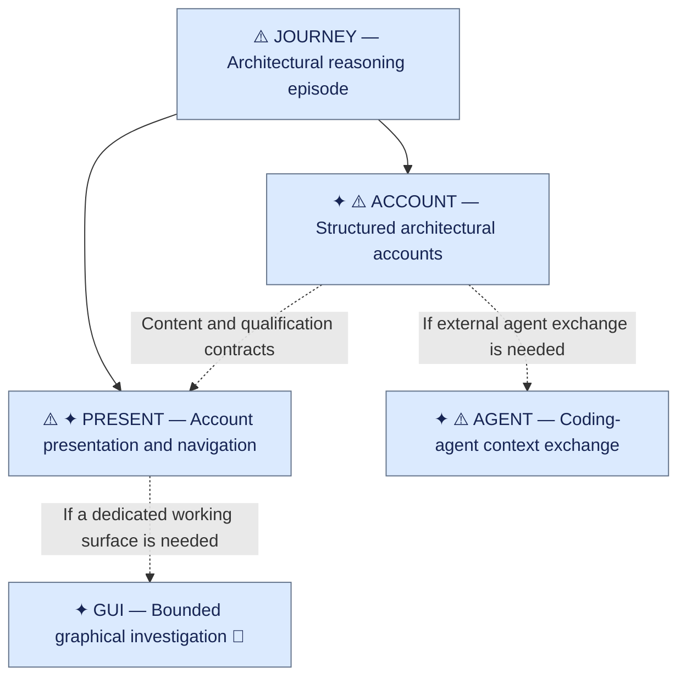

# Upcoming work

Last considered: 2026-11-03

A living document for keeping track of upcoming work and deciding what order to
do it in, updated at each major checkpoint. It is a planning aid, not a governing
document.
The [backlog](../docs/backlog.md), [candidate capabilities](candidate-capabilities.md),
and [candidate UX](candidate-ux.md) hold the broader inventories.

The current question is whether retained, qualified architectural accounts make
reasoning across perspectives and revising understanding more useful or reliable
than capable agent chat with repository access, diagrams, and retained notes.

## Legend

<table class="upcoming-work-legend">
  <thead>
    <tr><th scope="col">Icon</th><th scope="col">Kind</th><th scope="col">Meaning</th></tr>
  </thead>
  <tbody>
    <tr><td>🐛</td><td>Defect</td><td>Supported behavior is wrong or violates its contract.</td></tr>
    <tr><td>🚧</td><td>Limitation</td><td>A boundary on what the system supports or guarantees that we may want to remove.</td></tr>
    <tr><td>✦</td><td>Missing capability</td><td>Something useful the system cannot yet do.</td></tr>
    <tr><td>⚠️</td><td>Open product / architectural question</td><td>An unresolved choice that could change scope, direction, or dependencies.</td></tr>
    <tr><td>🧹</td><td>Maintenance / housekeeping</td><td>Upkeep that keeps the repository and development environment accurate and usable.</td></tr>
  </tbody>
</table>

<table class="upcoming-work-legend">
  <thead>
    <tr><th scope="col">Icon</th><th scope="col">Size</th><th scope="col">Meaning</th></tr>
  </thead>
  <tbody>
    <tr><td>🐝</td><td>Quick</td><td>Well understood and likely cheaper to finish than carry through more planning.</td></tr>
    <tr><td>🧱</td><td>Large</td><td>Substantial effort; worth breaking into useful stages.</td></tr>
    <tr><td></td><td>Ordinary or uncertain</td><td>(No size marker)</td></tr>
  </tbody>
</table>

## Dependencies and decision points

Solid arrows show prerequisites; dashed arrows show conditional contributions
or useful design input. Codes identify items independently of ordering.

## Tentative ordering

| Position | Item | Why here / what could change it |
| --- | --- | --- |
| Next | [JOURNEY — Architectural reasoning episode](#journey) | Work through a concrete architectural judgment across perspectives, with example accounts and representations. Establish what needs to carry forward and what would count as improvement over chat. |
| Once concrete examples establish the need | [ACCOUNT — Structured architectural accounts](#account) | Plan and implement the smallest account capability that supports the episode, alongside PRESENT. Use the resulting experiment to decide further architecture. |
| Alongside ACCOUNT | [PRESENT — Account presentation and navigation](#present) | Make the selected account content, qualifications, and revisions usable in the episode. Evaluate reasoning and interaction together with retention. |
| Conditional on interaction needs | [GUI — Bounded graphical investigation](#gui) | Build a dedicated working surface when its interactions are needed for the experiment or justified by its findings. Diagram presentation alone need not require the full GUI. |
| Conditional on exchange needs | [AGENT — Coding-agent context exchange](#agent) | Bring forward if shared architectural references with an external coding agent are essential to the episode. Session-local exact-answer targeting is available; additional lifetime and basis-disclosure needs depend on the exchange. |

## Item catalog

Alphabetical by code.

### ACCOUNT — Structured architectural accounts

- **Kind:** ✦ ⚠️
- **Outcome:** successive investigations can reuse, extend, or challenge retained
  architectural understanding while preserving evidence, qualifications,
  conflicts, and access to earlier accounts.
- **Scope:** the smallest capability needed by JOURNEY, evaluated with PRESENT
  within the current Session lifetime. Start by assessing structured investigram
  content and existing associations, retention, and replacement. Account shapes
  can follow the data needed by selected representations; a working account may
  comprise several investigrams.
- **Decision:** what structure and selection are actually needed? Distinguish
  revision status, applicability to a question, and the human's working selection.
  Correspondence or synthesis requires qualified analysis. A universal schema,
  consolidated model, and general retrieval system are not assumed.
- **Sources:** [backlog: architectural accounts through concrete journeys](../docs/backlog.md#explore-architectural-accounts-through-journeys),
  [decision: structured investigram content](../docs/decisions/structured-investigram-content.md).

### AGENT — Coding-agent context exchange

- **Kind:** ✦ ⚠️
- **Outcome:** an external coding agent can consume selected investigation context
  with clear scope, exact-result versus repeatable-request semantics, reference
  lifetime, captured basis, source mappings, and relevant origin.
- **Scope:** a first useful exchange selected for an architectural reasoning or
  change-design episode; it need not wait for a GUI. Includes supplied PostCode
  provenance when
  output returns through repository material or agent contributions, so it is
  not mistaken for independent corroboration. Persistence and richer Workspace
  context are separate possibilities.
- **Source:** [backlog: shared coding-agent context and feedback provenance](../docs/backlog.md#design-a-bounded-shared-context-interface-for-coding-agents).

### GUI — Bounded graphical investigation

- **Kind:** ✦
- **Size:** 🧱 — a new graphical interface with integrated investigation flows
  and formative evaluation, even within the bounded first journey.
- **Outcome:** a useful graphical investigation on real repositories, with evidence,
  qualifications, originals, replacements, conflicts, and reconsideration visible.
  Evaluation includes sustained use and returning to earlier answers.
- **Scope:** the interaction needs established through JOURNEY and PRESENT,
  within the supported Session lifetime. May become several implementation plans.
- **Source:** [backlog: whole-journey UX review](../docs/backlog.md#review-the-investigation-ui-and-ux-as-a-whole).

### JOURNEY — Architectural reasoning episode

- **Kind:** ⚠️
- **Outcome:** a concrete episode showing what the human needs to understand or
  decide, and where retained architectural accounts might improve that reasoning.
- **Scope:** build on the Cockatiel chat experiment. A candidate episode moves
  from responsibility/ownership to waiting or recovery behavior, then revisits
  the earlier account. Use representative content and rough interactions;
  manually prepared examples can expose requirements before implementation.
  Keep assumed results distinguishable from demonstrated capabilities.
- **Decision:** what carries forward, what requires new investigation, and what
  is revised? Compare usefulness, effort, and reliability with capable chat,
  including notes and diagrams. A successful rendering alone is insufficient.
  The explored journey may include a design change or handoff without requiring
  the first implementation to cover the entire journey.
- **Sources:** [backlog: architectural accounts through concrete journeys](../docs/backlog.md#explore-architectural-accounts-through-journeys),
  [backlog: whole-journey UX review](../docs/backlog.md#review-the-investigation-ui-and-ux-as-a-whole),
  [product design: investigation context and continuity](../foundation/product-design.md#investigation-context-and-continuity).

### PRESENT — Account presentation and navigation

- **Kind:** ⚠️ ✦
- **Outcome:** useful architectural representations through which the human can
  change perspective, inspect qualifications, and revisit earlier or revised accounts.
- **Scope:** the representations and navigation needed for JOURNEY, developed
  alongside ACCOUNT and building on exact retained-answer presentation. Use
  established architectural notations where they fit. Generating a diagram
  cannot supply missing semantics or strengthen a claim. Additional perspective
  content may require investigation rather than another rendering of one account.
  Resolve composition, reference coordination, and View identity as needed by
  these interactions; broader GUI architecture follows concrete requirements.
- **Decision:** what belongs in the main representation versus optional detail,
  and how are partiality, disagreement, and revision made usable? Investigation
  lineage and architectural relationships remain distinct.
- **Sources:** [backlog: Presentation representation, F5](../docs/backlog.md#decide-how-gui-presentations-and-their-parameters-are-represented),
  [backlog: additional-detail placement](../docs/backlog.md#review-more-details-information-placement),
  [backlog: navigation origins](../docs/backlog.md#assess-and-preserve-navigation-origin-lineage),
  [backlog: coordinated-View conformance](../docs/backlog.md#assess-conformance-when-extending-coordinated-views-and-state-scope).

## Principles for choosing the order

Build a sound foundation for the next useful capability, with enough concrete
use to test whether the foundation is right.

- **Maintain progress toward a workable system:** balance housekeeping, bug fixes,
  and foundational work with steps that make PostCode useful end to end. Before
  regular use, bounded bugs and limitations can wait when they do not undermine
  current evaluation or create architectural debt in the work that follows.
- **Give extra weight to misleading behavior:** especially errors in answers,
  evidence, scope, or request reporting that people or evaluations rely on.
- **Resolve architectural debt before extending the affected area:** prioritize
  weaknesses that would spread into the next capability or interface.
- **Use concrete needs to settle uncertain architecture:** small representative
  journeys and experiments can establish requirements.
- **Implement the required case with a credible route to generalization:** keep
  current capabilities working and explain how later extension fits.
- **Make subsequent learning trustworthy:** fix a limitation before an assessment
  relies on the missing guarantee.
- **Prefer bounded outcomes and stopping points:** improved behavior, an enabled
  next step, or a resolved uncertainty.
- **Clear small, well-understood items when convenient:** if finishing something
  costs less than carrying it through further planning, do it and remove it from
  the list. Especially useful for housekeeping, provided it doesn't disrupt
  focused work or conceal unresolved decisions.
- **Reorder as evidence changes:** findings, cost, and formative use can shift priorities.

For comparable items, favor greater user or research value, fewer dependencies,
less speculative design, and lower cost of later change.

## Checkpoint review

At substantial completions, consequential findings, or changes in priority:

- What is complete, and what remains unresolved?
- Which backlog items now merit inclusion? Have candidate ideas become relevant?
- Which listed items should move down, return to the broader inventory, or drop out?
- Have dependencies or conditional choices changed?

Update the selection, ordering, and rationale accordingly. Item codes stay stable
as priorities change; detailed outcomes and implementation history remain in
their existing records.
