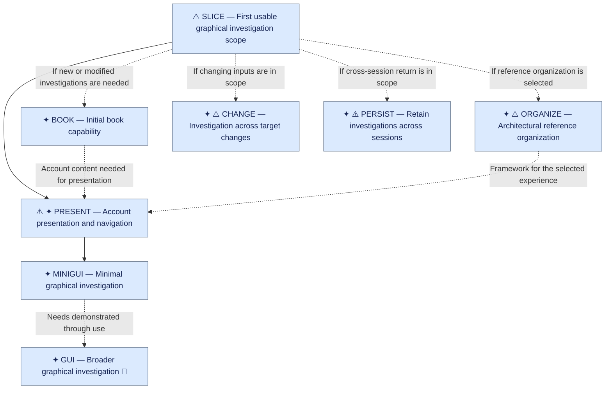

# Upcoming work

Last considered: 2026-11-21

A living document for keeping track of upcoming work and deciding what order to
do it in. Major checkpoints are useful occasions to reconsider it in strategy
discussion. It is a planning aid, not a governing document.
The [backlog](../docs/backlog.md), [candidate capabilities](candidate-capabilities.md),
and [candidate UX](candidate-ux.md) hold the broader inventories.

Maintain this document through human-led strategy discussion. Edit it only when
the human explicitly requests changes to this document; general authorization to
prepare or promote a planning package does not include it. Report implications
for upcoming work separately rather than including proposed revisions in the package.

The current focus is useful investigation of a software project through established
architectural concepts, with retained, qualified accounts that humans and agents
can use in their design work. Comparison with capable general-purpose agents can
inform evaluation; specialization does not depend on first demonstrating superiority.

## Legend

<table class="upcoming-work-legend">
  <thead>
    <tr><th scope="col">Icon</th><th scope="col">Kind</th><th scope="col">Meaning</th></tr>
  </thead>
  <tbody>
    <tr><td>🐛</td><td>Defect</td><td>Supported behavior is wrong or violates its contract.</td></tr>
    <tr><td>🚧</td><td>Limitation</td><td>A boundary on what the system supports or guarantees that we may want to remove.</td></tr>
    <tr><td>✦</td><td>Missing capability</td><td>Something useful the system cannot yet do.</td></tr>
    <tr><td>⚠️</td><td>Open product / architectural question</td><td>An unresolved choice that could change scope, direction, or dependencies.</td></tr>
    <tr><td>🧹</td><td>Maintenance / housekeeping</td><td>Upkeep that keeps the repository and development environment accurate and usable.</td></tr>
  </tbody>
</table>

<table class="upcoming-work-legend">
  <thead>
    <tr><th scope="col">Icon</th><th scope="col">Size</th><th scope="col">Meaning</th></tr>
  </thead>
  <tbody>
    <tr><td>🐝</td><td>Quick</td><td>Well understood and likely cheaper to finish than carry through more planning.</td></tr>
    <tr><td>🧱</td><td>Large</td><td>Substantial effort; worth breaking into useful stages.</td></tr>
    <tr><td></td><td>Ordinary or uncertain</td><td>(No size marker)</td></tr>
  </tbody>
</table>

## Dependencies and decision points

Solid arrows show prerequisites; dashed arrows show conditional contributions or useful design input.
Codes identify items independently of ordering.

PERSIST and CHANGE can come in either order, according to the experience needed.

## Tentative ordering

| Position | Item | Why here / what could change it |
| --- | --- | --- |
| Next: scoping | [SLICE — First usable graphical investigation scope](#slice) | Select a coherent first offering using the journey exploration and implemented capabilities, including actual diagrams and live-trial findings. Identify implementation work the experience needs; SLICE does not implement it. |
| Conditional, scoped through SLICE | [BOOK — Initial book capability](#book) | Implement new or modified investigations needed by the selected experience, before presentation work that depends on their account content. No work is needed here if existing capabilities suffice. May become several plans. |
| Conditional, scoped through SLICE | [ORGANIZE — Architectural reference organization](#organize) | Construct a useful reference framework if the selected experience needs one. Preliminary exploration can inform SLICE; implementation precedes presentation work that depends on it. |
| After SLICE and required capability work | [PRESENT — Account presentation and navigation](#present) | Build representations, qualifications, and navigation for the selected experience, using implemented accounts. BOOK and ORGANIZE supply additional content or organization where selected. |
| After PRESENT | [MINIGUI — Minimal graphical investigation](#minigui) | Build a small graphical surface for actual human investigation using the available account and presentation capabilities. |
| Conditional, when investigation must span input changes | [CHANGE — Investigation across target changes](#change) | SLICE or later use supplies the trigger. Can precede or follow PERSIST. |
| Conditional, when cross-session return is needed | [PERSIST — Retain investigations across sessions](#persist) | SLICE or later use supplies the trigger. Can precede or follow CHANGE. |
| Following experience with MINIGUI | [GUI — Broader graphical investigation](#gui) | Extend the graphical experience where sustained use identifies valuable capabilities. May become several plans. |

## Item catalog

Alphabetical by code.

### BOOK — Initial book capability

- **Kind:** ✦
- **Outcome:** the investigations selected for the first graphical experience
  produce the qualified account content that its presentations need.
- **Scope:** new or modified investigation capabilities identified by SLICE.
  Use the implemented structured-account mechanism and extend it where the selected
  investigations require it. Validate the content needed for the selected diagrams
  and other representations; rendering must not reconstruct missing architectural meaning.
- **Boundary:** conditional implementation work, potentially several separately
  scoped plans. Existing capabilities may suffice, in which case this item drops out.
  Presentation and interaction belong to PRESENT and MINIGUI; reference organization
  belongs to ORGANIZE.
- **Source:** [journey findings: capability-planning inputs](../notes/initial-journey/design-findings.md#capability-planning-inputs).

### CHANGE — Investigation across target changes

- **Kind:** ✦ ⚠️
- **Outcome:** continue useful investigation as the investigated repository changes,
  preserving earlier accounts as accounts of their captured state and making their
  applicability to the new state clear.
- **Scope:** a bounded transition between input states, with new investigation and
  access to earlier results. Establish what can be reused and what must be checked
  or investigated again. Changed inputs do not make an earlier account wrong.
- **Decision:** how are captured states, Session lifetimes and subjects related
  across a change? Choose the continuity needed by the selected experience;
  automatic refresh, selective re-evaluation and general cross-version subject
  identity are not assumed. This concerns changes to the investigated software,
  separately from changes to the generating agent or its configuration.
- **Sequencing:** SLICE or subsequent use supplies the trigger. Can precede or follow
  PERSIST. If persistence comes first, include persistence of the new changing-target state.
- **Source:** [candidate capabilities: investigation across changing repository states](candidate-capabilities.md#changing-repository-states).

### GUI — Broader graphical investigation

- **Kind:** ✦
- **Size:** 🧱 — broader integrated investigation flows and formative evaluation;
  likely several implementation plans.
- **Outcome:** a graphical experience that supports sustained investigation on real
  repositories beyond the first bounded slice.
- **Scope:** needs demonstrated through MINIGUI use. Workspace management, richer
  layouts and customization are possible extensions, selected for
  their value rather than assumed prerequisites for useful graphical investigation.
- **Source:** [backlog: whole-journey UX review](../docs/backlog.md#review-the-investigation-ui-and-ux-as-a-whole).

### MINIGUI — Minimal graphical investigation

- **Kind:** ✦
- **Outcome:** a usable graphical slice for investigating one project, so human-use
  evaluation can test more than typing commands and reading text results.
- **Scope:** the experience selected by SLICE: a few account presentations and diagrams, selection of subjects and
  offered questions, following relationships, and returning to earlier or corrected
  answers with their qualifications. Build on implemented structured accounts and PRESENT: accounts
  supply content, Presentations make it intelligible, and this item supplies the
  controls and interaction flow within the supported Session lifetime. Extend the
  API as needed within this task; full Workspace management and customization can wait.
  Make progress, failure and recovery intelligible, including explicitly requesting
  fresh investigation and returning to earlier attempts. Fresh execution is already
  supported by the application; the graphical interaction remains to be designed.
- **Decision:** choose GUI hosting and execution arrangements around the current
  in-process Node API. Synchronous compiler work cannot be preempted on its calling
  thread; preserve responsiveness, interruption and cleanup without assuming the
  API already supplies a browser runtime or transport.
- **Validation:** use the slice for actual investigation, including follow-up and
  reconsideration. CLI checks remain useful for core verification but do not
  establish the usefulness of the human experience. Once usable, trigger the
  [CLI retirement checkpoint](#cli-retirement-checkpoint).
- **Sources:** strategy discussion: a graphical surface for first practical human use;
  [journey outputs: investigation script](../notes/initial-journey/cockatiel-investigation-script.md),
  [journey findings: implementation-validation checks](../notes/initial-journey/design-findings.md#implementation-validation),
  [backlog: fresh investigation and attempt history](../docs/backlog.md#expose-fresh-investigation-and-attempt-history-in-interfaces),
  [implementation evidence: follow-up authoring and timeout](../records/validation/structured-architectural-accounts/m4-option-context-authoring.md).

### ORGANIZE — Architectural reference organization

- **Kind:** ✦ ⚠️
- **Outcome:** a navigable framework for understanding a project or architectural
  concern through its accumulated accounts.
- **Scope:** construct and revise useful groupings, entry points, cross-references
  and reading paths, using retained accounts and additional investigation where
  needed. Build on implemented accounts; SLICE selects whether and how much of this capability
  the first offering needs. Preliminary exploration can inform that selection.
- **Boundary:** distinguish editorial organization from claims about the software.
  Partial and alternative organizations need not imply comprehensive coverage or
  one canonical hierarchy. Ordinary indexing and display grouping may be mechanical;
  inferred relationships, synthesis and coverage judgments require core investigation.
  PRESENT and MINIGUI make the supplied framework readable and navigable.
- **Sources:** [exploratory notes: architectural reference organization](../notes/architectural-reference-organization.md),
  [backlog: organization of contributions and architectural entities](../docs/backlog.md#explore-organization-of-contributions-and-architectural-entities).

### PERSIST — Retain investigations across sessions

- **Kind:** ✦ ⚠️
- **Outcome:** return after closing PostCode and recover useful retained understanding
  and a place to continue, without reconstructing the investigation from scratch.
- **Scope:** select the needed level of return: readable saved accounts and exact
  answers, resumed investigation against unchanged inputs, or continuation across
  changed inputs. Restoring navigation context or layout is a separate choice.
  These need not be delivered together.
- **Decision:** what is retained, which references remain usable, and what can execute
  after reopening? Preserve captured basis, qualifications and historical meaning;
  saved records do not by themselves restore an executable Session.
- **Sequencing:** trigger when SLICE requires cross-session return or later use shows
  the need. Can precede or follow CHANGE. If changing-target support comes first,
  include retention and restoration of its multiple input states and their relationships.
- **Source:** [candidate UX: returning to an investigation](candidate-ux.md#returning-to-an-investigation).

### PRESENT — Account presentation and navigation

- **Kind:** ⚠️ ✦
- **Outcome:** useful architectural representations through which the human can
  change perspective, inspect qualifications, and revisit earlier or revised accounts.
- **Scope:** the representations and navigation needed for the experience selected
  by SLICE, using implemented structured accounts and exact retained-answer presentation.
  Extend the API as needed within this task. Use
  established architectural notations where they fit. Generating a diagram
  cannot supply missing semantics or strengthen a claim. Additional perspective
  content may require investigation rather than another rendering of one account.
  Resolve composition, reference coordination, and View identity as needed by
  these interactions; broader GUI architecture follows concrete requirements.
  Use complete qualified API content and precise subject/answer IDs rather than
  CLI output or compact-alias arrangement. Clients own Presentation declarations
  and rendering; application coordination matches their captured requirements.
  Make subject-specific questions discoverable, with new investigation distinct
  from displaying retained detail. Show consequential conditions and corrections
  while preserving access to earlier answers. Explore returning to a useful
  surrounding account; keeping it always visible remains a hypothesis.
- **Validation:** build on the implemented state-diagram validation with a bounded
  presentation and navigation demonstration, using an export or standalone renderer
  if sufficient. Check semantic fidelity, consequential scope and uncertainty,
  traceability to account content, and revised versus exact earlier answers.
  Successful rendering alone is insufficient; MINIGUI supplies the first
  interactive human-use evaluation.
- **Decision:** what belongs in the main representation versus optional detail,
  and how are partiality, disagreement, and revision made usable? Investigation
  lineage and architectural relationships remain distinct.
  Use structured qualification where it serves the selected interactions, without
  requiring a general visual taxonomy or a project-wide overview.
- **Sources:** [journey outputs: investigation script](../notes/initial-journey/cockatiel-investigation-script.md),
  [journey outputs: connected account examples](../notes/initial-journey/cockatiel-account-examples.md),
  [journey findings: implementation-validation checks](../notes/initial-journey/design-findings.md#implementation-validation),
  [candidate UX: discoverable questions](candidate-ux.md#discoverable-questions-and-named-actions),
  [candidate UX: qualification and changing accounts](candidate-ux.md#qualification-and-changing-accounts),
  [candidate UX: available orientation](candidate-ux.md#orientation-that-remains-in-view),
  [backlog: Presentation representation, F5](../docs/backlog.md#decide-how-gui-presentations-and-their-parameters-are-represented),
  [backlog: additional-detail placement](../docs/backlog.md#review-more-details-information-placement),
  [backlog: navigation origins](../docs/backlog.md#assess-and-preserve-navigation-origin-lineage),
  [backlog: coordinated-View conformance](../docs/backlog.md#assess-conformance-when-extending-coordinated-views-and-state-scope).

### SLICE — First usable graphical investigation scope

- **Kind:** ⚠️
- **Outcome:** an agreed scope for a coherent, bounded investigation experience
  for the first GUI, with acceptance criteria and identified implementation work.
- **Scope:** choose the user scenario, starting knowledge, useful endpoint,
  investigations, and representations that belong together. Use the completed
  journey exploration alongside actual generated diagrams and live-trial findings;
  mechanism validation does not establish a useful investigation experience.
  Implemented capabilities may be selected, modified, supplemented, or left out.
  This selects an initial offering rather than restarting the journey exercise.
  Explore an architectural-reference experience: browsing retained understanding
  and investigating gaps, with ORGANIZE supplying a framework if needed.
  Decide whether the first experience needs cross-session return or investigation
  across target changes, setting the scope and trigger for PERSIST and CHANGE.
  Consider how a reader responds to an inadequate account: fresh investigation is
  available, while submitting an objection to an investigating agent needs new work.
  Identify needed changes and missing capabilities, drawing on the backlog and
  candidate inventories. Scope any new or modified investigations under BOOK
  and place that work before presentation work that depends on it.
- **Boundary:** scoping and selection, without production implementation.
  Small sketches or experiments may help resolve choices. The result informs
  subsequent plans; SLICE need not produce an implementation plan of its own.
  Investigation implementation belongs to BOOK, and detailed presentation and
  interface design belong to PRESENT and MINIGUI.
- **Sources:** [exploratory notes: first graphical slice](../notes/first-graphical-slice.md),
  [journey outputs: investigation script](../notes/initial-journey/cockatiel-investigation-script.md),
  [journey outputs: connected account examples](../notes/initial-journey/cockatiel-account-examples.md),
  [journey findings: capability-planning inputs](../notes/initial-journey/design-findings.md#capability-planning-inputs),
  [implementation evidence: state-diagram trials and outputs](../records/validation/structured-architectural-accounts/m2-trials/README.md),
  [implementation evidence: follow-up-option trials](../records/validation/structured-architectural-accounts/m4-option-context-authoring.md),
  [completion record: structured architectural accounts](../records/tasks/2026-11-15-structured-architectural-accounts.md),
  strategy discussion: separate mechanism validation from selection of the first offering.

## Principles for choosing the order

Build a sound foundation for the next useful capability, with enough concrete
use to test whether the foundation is right.

- **Maintain progress toward a workable system:** balance housekeeping, bug fixes,
  and foundational work with steps that make PostCode useful end to end. Before
  regular use, bounded bugs and limitations can wait when they do not undermine
  current evaluation or create architectural debt in the work that follows.
- **Give extra weight to misleading behavior:** especially errors in answers,
  evidence, scope, or request reporting that people or evaluations rely on.
- **Resolve architectural debt before extending the affected area:** prioritize
  weaknesses that would spread into the next capability or interface.
- **Use concrete needs to settle uncertain architecture:** small representative
  journeys and experiments can establish requirements.
- **Implement the required case with a credible route to generalization:** keep
  current capabilities working and explain how later extension fits.
- **Make subsequent learning trustworthy:** fix a limitation before an assessment
  relies on the missing guarantee. Select research capture for the actual question;
  address recording or export gaps when that assessment depends on them.
- **Prefer bounded outcomes and stopping points:** improved behavior, an enabled
  next step, or a resolved uncertainty.
- **Clear small, well-understood items when convenient:** if finishing something
  costs less than carrying it through further planning, do it and remove it from
  the list. Especially useful for housekeeping, provided it doesn't disrupt
  focused work or conceal unresolved decisions.
- **Reorder as evidence changes:** findings, cost, and formative use can shift priorities.

For comparable items, favor greater user or research value, fewer dependencies,
less speculative design, and lower cost of later change.

## Checkpoint review

At substantial completions, consequential findings, or changes in priority:

- What is complete, and what remains unresolved?
- Which backlog items now merit inclusion? Have candidate ideas become relevant?
- Which listed items should move down, return to the broader inventory, or drop out?
- Have dependencies or conditional choices changed?

These questions guide human-led reconsideration of the selection, ordering, and
rationale. Item codes stay stable as priorities change; detailed outcomes and
implementation history remain in their existing records.

### CLI retirement checkpoint

Once MINIGUI supports usable graphical investigation, assess whether to retire
the interactive human CLI. Consider any continuing value in launching,
authentication, debugging, automation, or agent-facing access separately:
those facilities need not require retaining the interactive command shell.
The checkpoint decides what remains useful and the cost of supporting it;
neither retirement nor indefinite support for both interfaces is assumed.
