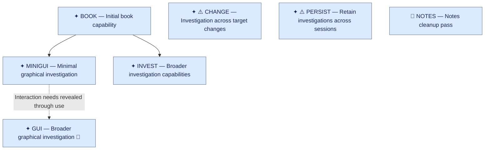

# Upcoming work

Last considered: 2026-11-23

A living document for keeping track of upcoming work and deciding what order to
do it in. Major checkpoints are useful occasions to reconsider it in strategy
discussion. It is a planning aid, not a governing document.
The [backlog](../docs/backlog.md), [candidate capabilities](candidate-capabilities.md),
and [candidate UX](candidate-ux.md) hold the broader inventories.

Maintain this document through human-led strategy discussion. Edit it only when
the human explicitly requests changes to this document; general authorization to
prepare or promote a planning package does not include it. Report implications
for upcoming work separately rather than including proposed revisions in the package.

The current focus is a reference-book experience for investigating a software project
through established architectural concepts, with connected, qualified accounts that
humans and agents can use in their design work. Comparison with capable general-purpose agents can
inform evaluation; specialization does not depend on first demonstrating superiority.

## Legend

<table class="upcoming-work-legend">
  <thead>
    <tr><th scope="col">Icon</th><th scope="col">Kind</th><th scope="col">Meaning</th></tr>
  </thead>
  <tbody>
    <tr><td>🐛</td><td>Defect</td><td>Supported behavior is wrong or violates its contract.</td></tr>
    <tr><td>🚧</td><td>Limitation</td><td>A boundary on what the system supports or guarantees that we may want to remove.</td></tr>
    <tr><td>✦</td><td>Missing capability</td><td>Something useful the system cannot yet do.</td></tr>
    <tr><td>⚠️</td><td>Open product / architectural question</td><td>An unresolved choice that could change scope, direction, or dependencies.</td></tr>
    <tr><td>🧹</td><td>Maintenance / housekeeping</td><td>Upkeep that keeps the repository and development environment accurate and usable.</td></tr>
  </tbody>
</table>

<table class="upcoming-work-legend">
  <thead>
    <tr><th scope="col">Icon</th><th scope="col">Size</th><th scope="col">Meaning</th></tr>
  </thead>
  <tbody>
    <tr><td>🐝</td><td>Quick</td><td>Well understood and likely cheaper to finish than carry through more planning.</td></tr>
    <tr><td>🧱</td><td>Large</td><td>Substantial effort; worth breaking into useful stages.</td></tr>
    <tr><td></td><td>Ordinary or uncertain</td><td>(No size marker)</td></tr>
  </tbody>
</table>

## Dependencies and decision points

Solid arrows show prerequisites; dashed arrows show conditional contributions or useful design input.
Codes identify items independently of ordering.

PERSIST and CHANGE are independently triggered by the experience needed and can come
in either order. Broader investigations can move before MINIGUI if a concrete content
gap prevents useful evaluation of the book.

## Tentative ordering

| Position | Item | Why here / what could change it |
| --- | --- | --- |
| Next: plan and implement | [BOOK — Initial book capability](#book) | Turn the book-model handoff into a minimal working capability, including organization, composition and qualified access. Assess existing presentation/expansion machinery during planning and include its migration or retirement where appropriate. |
| After BOOK | [MINIGUI — Minimal graphical investigation](#minigui) | Make the book readable and navigable, so actual use can reveal gaps in its content and interaction. |
| Tentatively after MINIGUI | [INVEST — Broader investigation capabilities](#invest) | Add a few investigations in response to needs encountered in the book. Bring a bounded capability forward if it is needed to exercise the book meaningfully. |
| Conditional, when investigation must span input changes | [CHANGE — Investigation across target changes](#change) | The intended experience or actual use supplies the trigger. Can precede or follow PERSIST. |
| Conditional, when cross-session return is needed | [PERSIST — Retain investigations across sessions](#persist) | The intended experience or actual use supplies the trigger. Can precede or follow CHANGE. |
| Following experience with MINIGUI | [GUI — Broader graphical investigation](#gui) | Extend the graphical experience where sustained use identifies valuable capabilities. May become several plans. |
| Independent, when convenient | [NOTES — Notes cleanup pass](#notes) | Review accumulated notes for superseded material, future candidates and useful references. Bring this item back periodically as design and implementation progress. |

## Item catalog

Alphabetical by code.

### BOOK — Initial book capability

- **Kind:** ✦
- **Outcome:** investigations develop connected book pages with qualified explanations,
  surrounding context and routes to further treatments, available through the application API.
- **Scope:** entity-overview, page composition and book organization form the minimal
  starting set. Implement the book objects and association behavior, page-composition
  and book-map Lenses, and the investigation-contract changes needed to supply them.
  Build on the implemented structured-account mechanism. Specialized architectural
  investigations can follow; the full Cockatiel example is not the initial scope.
- **Planning:** use the book-model handoff to develop the implementation plan,
  decisions and coordinated governing-document revisions. Assess existing presentation
  and expansion machinery as **keep, adapt, replace or remove**. Include migration
  and retirement in the plan; removals requiring a usable graphical replacement can
  belong to MINIGUI. Retain useful acquisition and qualification responsibilities
  without assuming two parallel presentation systems must remain supported.
- **Coordination:** determine how opening a page obtains its treatment and surrounding
  context, and how changed inputs to composition lead to revised material or new
  composition. Automatic updating is the preferred experience; reconsideration alone
  does not schedule it. MINIGUI supplies the visible interaction and notification.
- **Validation:** exercise generated overviews, organization and composition through
  connected pages, qualified alternatives and revisions. The authored example guides
  validation without hard-coding its pages or relationships. Check that returned
  content carries the meaning needed for rendering; human-use evaluation follows in MINIGUI.
- **Sources:** [book-model handoff: model](../notes/book-model/model.md),
  [book-model handoff: implementation considerations](../notes/book-model/implementation-notes.md),
  [book-model handoff: Cockatiel example](../notes/book-model/cockatiel-example.md),
  [backlog: organization of contributions and architectural entities](../docs/backlog.md#explore-organization-of-contributions-and-architectural-entities).

### CHANGE — Investigation across target changes

- **Kind:** ✦ ⚠️
- **Outcome:** continue useful investigation as the investigated repository changes,
  preserving earlier accounts as accounts of their captured state and making their
  applicability to the new state clear.
- **Scope:** a bounded transition between input states, with new investigation and
  access to earlier results. Establish what can be reused and what must be checked
  or investigated again. Changed inputs do not make an earlier account wrong.
- **Decision:** how are captured states, Session lifetimes and subjects related
  across a change? Choose the continuity needed by the selected experience;
  automatic refresh, selective re-evaluation and general cross-version subject
  identity are not assumed. This concerns changes to the investigated software,
  separately from changes to the generating agent or its configuration.
- **Sequencing:** the intended experience or actual use supplies the trigger. Can precede or follow
  PERSIST. If persistence comes first, include persistence of the new changing-target state.
- **Source:** [candidate capabilities: investigation across changing repository states](candidate-capabilities.md#changing-repository-states).

### GUI — Broader graphical investigation

- **Kind:** ✦
- **Size:** 🧱 — broader integrated investigation flows and formative evaluation;
  likely several implementation plans.
- **Outcome:** a graphical experience that supports sustained investigation on real
  repositories beyond the first bounded slice.
- **Scope:** needs demonstrated through MINIGUI use. Workspace management, richer
  layouts and customization are possible extensions, selected for
  their value rather than assumed prerequisites for useful graphical investigation.
- **Source:** [backlog: whole-journey UX review](../docs/backlog.md#review-the-investigation-ui-and-ux-as-a-whole).

### INVEST — Broader investigation capabilities

- **Kind:** ✦
- **Outcome:** the book can pursue a few useful architectural questions beyond the
  initial entity overviews.
- **Scope:** add or improve investigations and the account content they produce.
  Selection could draw on use, a systematic review of architectural concepts, or
  another approach. The Cockatiel state, responsibility and
  interaction examples are candidates, not a required package or a complete catalogue.
  Extend content types and diagram support where the selected investigations need them.
- **Catalogue:** consider an architectural-concept catalogue for investigating
  agents, with concept meanings, relationships, reference material and diagram
  suggestions to help them identify useful investigative perspectives, apply concepts
  appropriately and choose suitable representations.
- **Sequencing:** tentatively after MINIGUI, using experience to distinguish missing
  investigative content from organization or interaction problems. Bring a bounded
  investigation forward if its absence prevents meaningful use of the initial book.
  This item may become several plans as the capabilities develop.
- **Sources:** [book-model handoff: further architectural investigations](../notes/book-model/future-work.md#further-architectural-investigations),
  [book-model handoff: stable and familiar investigations](../notes/book-model/implementation-notes.md#stable-and-familiar-investigations),
  [book-model handoff: architectural vocabulary](../notes/book-model/future-work.md#architectural-vocabulary),
  [book-model handoff: Cockatiel example](../notes/book-model/cockatiel-example.md),
  [candidate capabilities](candidate-capabilities.md).

### MINIGUI — Minimal graphical investigation

- **Kind:** ✦
- **Outcome:** a usable graphical book for investigating one project, supporting
  evaluation through reading, navigation and further investigation.
- **Scope:** render the pages and book map supplied by BOOK. Provide page layout,
  additional detail, useful links and perspective filtering, with navigation history
  and access to visited pages. Make available investigations discoverable and distinguish
  reading retained content from obtaining new material. Include diagrams where supported
  by the available content; the interface does not invent architectural meaning.
- **Presentation:** preserve consequential scope, qualifications, alternatives and
  access to underlying material. Support exact earlier results and make revised content
  and changes to organization intelligible. Resolve View composition and reference
  coordination as needed, using qualified API content rather than CLI output.
- **Interaction:** show progress, partial or unavailable results, failure and recovery,
  including fresh investigation and earlier attempts. Present updates and notifications
  without losing the reader's place. Complete presentation retirement that depends on
  this graphical replacement. Full Workspace management and customization can wait.
- **Decision:** choose GUI hosting and execution arrangements around the current
  in-process Node API. Synchronous compiler work cannot be preempted on its calling
  thread; preserve responsiveness, interruption and cleanup without assuming the
  API already supplies a browser runtime or transport.
- **Validation:** use the book for actual investigation, including follow-up and
  revised accounts. Check faithful presentation as well as usefulness; CLI checks
  alone do not establish the human experience. Once usable, trigger the
  [CLI retirement checkpoint](#cli-retirement-checkpoint).
- **Sources:** [book-model handoff: model](../notes/book-model/model.md),
  [book-model handoff: presentation and interface considerations](../notes/book-model/implementation-notes.md#presentation-and-interface-considerations),
  [backlog: fresh investigation and attempt history](../docs/backlog.md#expose-fresh-investigation-and-attempt-history-in-interfaces),
  [backlog: Presentation representation](../docs/backlog.md#decide-how-gui-presentations-and-their-parameters-are-represented),
  [backlog: additional-detail placement](../docs/backlog.md#review-more-details-information-placement),
  [backlog: navigation origins](../docs/backlog.md#assess-and-preserve-navigation-origin-lineage),
  [backlog: coordinated-View conformance](../docs/backlog.md#assess-conformance-when-extending-coordinated-views-and-state-scope).

### NOTES — Notes cleanup pass

- **Kind:** 🧹
- **Outcome:** a useful, navigable notes collection without obsolete guidance or
  duplicated inventories obscuring the material worth keeping.
- **Scope:** review the contents of `notes/`, classifying material as done or
  superseded, future candidates, or notes to retain. Transfer useful ideas to an
  appropriate home, consolidate or delete redundant material, and update indexes
  and links. Preserve independently useful examples, research evidence and visual references.
- **Boundary:** keep working material needed by active design work. Revisit the
  book-model future-work inventory after BOOK promotion or implementation, when its
  remaining items can be assessed for backlog, candidates or continued notes.
- **Sequencing:** independent housekeeping. Complete a bounded pass, remove the item,
  and bring it back at later checkpoints when accumulated changes warrant another review.
- **Source:** [notes inventory](../notes/README.md).

### PERSIST — Retain investigations across sessions

- **Kind:** ✦ ⚠️
- **Outcome:** return after closing PostCode and recover useful retained understanding
  and a place to continue, without reconstructing the investigation from scratch.
- **Scope:** select the needed level of return: readable saved accounts and exact
  answers, resumed investigation against unchanged inputs, or continuation across
  changed inputs. Restoring navigation context or layout is a separate choice.
  These need not be delivered together.
- **Decision:** what is retained, which references remain usable, and what can execute
  after reopening? Preserve captured basis, qualifications and historical meaning;
  saved records do not by themselves restore an executable Session.
- **Sequencing:** trigger when the intended experience or actual use calls for
  cross-session return. Can precede or follow CHANGE. If changing-target support comes first,
  include retention and restoration of its multiple input states and their relationships.
- **Source:** [candidate UX: returning to an investigation](candidate-ux.md#returning-to-an-investigation).

## Principles for choosing the order

Build a sound foundation for the next useful capability, with enough concrete
use to test whether the foundation is right.

- **Maintain progress toward a workable system:** balance housekeeping, bug fixes,
  and foundational work with steps that make PostCode useful end to end. Before
  regular use, bounded bugs and limitations can wait when they do not undermine
  current evaluation or create architectural debt in the work that follows.
- **Give extra weight to misleading behavior:** especially errors in answers,
  evidence, scope, or request reporting that people or evaluations rely on.
- **Resolve architectural debt before extending the affected area:** prioritize
  weaknesses that would spread into the next capability or interface.
- **Use concrete needs to settle uncertain architecture:** small representative
  journeys and experiments can establish requirements.
- **Implement the required case with a credible route to generalization:** keep
  current capabilities working and explain how later extension fits.
- **Make subsequent learning trustworthy:** fix a limitation before an assessment
  relies on the missing guarantee. Select research capture for the actual question;
  address recording or export gaps when that assessment depends on them.
- **Prefer bounded outcomes and stopping points:** improved behavior, an enabled
  next step, or a resolved uncertainty.
- **Clear small, well-understood items when convenient:** if finishing something
  costs less than carrying it through further planning, do it and remove it from
  the list. Especially useful for housekeeping, provided it doesn't disrupt
  focused work or conceal unresolved decisions.
- **Reorder as evidence changes:** findings, cost, and formative use can shift priorities.

For comparable items, favor greater user or research value, fewer dependencies,
less speculative design, and lower cost of later change.

## Checkpoint review

At substantial completions, consequential findings, or changes in priority:

- What is complete, and what remains unresolved?
- Which backlog items now merit inclusion? Have candidate ideas become relevant?
- Which listed items should move down, return to the broader inventory, or drop out?
- Do accumulated notes warrant another cleanup pass?
- Have dependencies or conditional choices changed?

These questions guide human-led reconsideration of the selection, ordering, and
rationale. Item codes stay stable as priorities change; detailed outcomes and
implementation history remain in their existing records.

### CLI retirement checkpoint

Once MINIGUI supports usable graphical investigation, assess whether to retire
the interactive human CLI. Consider any continuing value in launching,
authentication, debugging, automation, or agent-facing access separately:
those facilities need not require retaining the interactive command shell.
The checkpoint decides what remains useful and the cost of supporting it;
neither retirement nor indefinite support for both interfaces is assumed.
